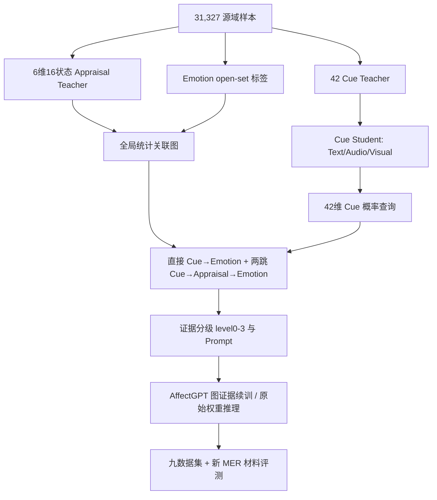

# AffectGPT-AMG 全实验汇总

**项目**：`/ai/sjq/AffectGPT-sjq`  
**生成时间**：2026-11-02；最后更新：2026-11-07  
**覆盖范围**：Cue/Appraisal/Emotion 标注与 Cue Student、188 类与 10 类统计图、P4 图检索、图证据续训、九数据集评测、188 类字段消融、路径/提示/软表达消融、最终开发/确认实验、2026-10-31 的“七个原始 checkpoint + graph10 推理”、2026-11-03～11-05 的 AMG v2/v2.1、统一 P4 与 Student OOF 图实验，以及 2026-11-05～11-07 的 v2.1 五起点续训（25 checkpoint × 9 集）、greedy judge 复评与 +2 epoch 扩展。  
**数据时点**：新增实验与新结果截至 2026-11-07 20:51；v2.1 五起点续训 225/225 组、greedy 复评 225/225、RP1.0 复评 9/9、+2 epoch 扩展 10/10 均已完成。

> **阅读提醒**：本文件区分“可部署的单权重成绩”“逐数据集挑最优的拼接成绩”“机制诊断成绩”。三者不能混用；尤其是 75.4855%（以及旧的 75.4334%）是逐集挑最高后的 oracle 均值，不对应任何单一模型；2026-11-07 的项目内最佳单权重是 74.3147%，仍低于论文作者缓存逐集最优 74.7689%。

---

## 0. 结论摘要

1. **工程完成度高**：图、查询、Cue Student、标注、版本锁定、哈希与独立复算都做得比较完整；188 类图与 10 类图均可复现加载和查询。
2. **图作为在线推理证据没有稳定增益**：188 类图 A–P 对照中 C 与 P 基本持平；路径条件 H 相对 C/P 在 7/9 集下降；软表达 G 没有超过 Cue-only；最终确认集 Appraisal C−S 区间跨 0。
3. **Appraisal 的语义内容没有被验证**：R40 和 G54 两套权重上，C（正确 Appraisal）相对 S（打乱 Appraisal）都没有稳定优势；R40 上 C 相对 A/B 的提升很可能包含输出稳定性恢复，因为 B 有 11.72% 空回答。
4. **G54+A 的收益主要是权重/训练差异**：确认集 G54+A 相对 R40+A 综合 +3.478pp，但 G54 比 R40 多训练了 45→54，且缺少同预算无图续训对照；不能归因于图。
5. **最佳单权重已刷新，但仍低于论文缓存**：2026-11-07 的 v2.1 五起点续训把项目内最佳单权重提高到 **74.3147%**（base40→epoch45），高于此前 74.0173%/74.0563%，也高于 graph10 的 73.6695%；逐集 oracle 提高到 **75.4855%**（原始随机 judge；greedy 复评 75.5365%），高于此前 75.4334%。但最佳单权重仍低于论文作者缓存逐集最优 74.7689%，且新结果没有同预算无图续训对照。
6. **2026-10-31 新增的七个原始 checkpoint + graph10 实验呈现清晰的任务分裂**：四个离散情绪任务（MER2024、MELD、IEMOCAP 等）提升，四个极性/开放词汇任务（CMUMOSEI、SIMS、SIMSv2、OVMERDPlus）明显下降；七 checkpoint 平均 -0.21pp，最佳单权重仅 +0.69pp。
7. **当前最稳的结论**：图是一个“离散情绪候选先验”，不是稳定的通用增益；它能帮助部分分类任务，但会伤害情感极性/开放词表任务。下一步应优先修证据可判定性、表达、校准与独立验证，而不是继续扩图或扫 checkpoint。
8. **AffectGPT-RL + graph10 已完成**：九数据集逐集最优平均 **78.3165%**，最佳单一 checkpoint **76.7020%**（`rl_e050`）；OPPO + graph10 为 **81.2180%**，但两者模型/权重不同，不能直接横比。
9. **2026-11-03～11-05 的 AMG v2/v2.1/OOF 三代新图仍没有超过无图基线**：三集七权重等权均值，无图 73.480、10 类旧图 71.104、v2.1+P4 72.596、OOF 新图+P4 72.715。v2.1（图与 Prompt 同时变化）把开放词汇伤害从 10 类图的 -5.56pp 缩小到 -2.56pp，OOF 进一步收窄到 -1.85pp，但仍未转为正增益；统一 P4 完成输入/Token 验收，并已用 P4 单条件跑过 3 集；但仍无 P0–P5 配对生成消融。

10. **2026-11-05～11-07 的 v2.1 五起点续训刷新了项目内最佳单权重**：5 个原始 base（30/35/40/45/50）各续训 5 epoch，共 25 个 checkpoint；九集最佳单权重 **74.3147%**（base40→45，原始随机 judge），逐集 oracle **75.4855%**（原始随机 judge）。与原始同 epoch 相比，5 个分支平均 **+1.56pp（5/5 为正）**；但**没有同预算无图续训对照**，不能把提升归因于图。

11. **复评与扩展没有提供额外收益**：greedy Qwen25 复评仅 **+0.051pp**，repetition_penalty 改为 1.0 后反而 **-0.139pp**；在最好分支上再加 2 epoch 的 10 项评测**全部下降**（-1.30～-4.62pp），这 3 个分支上 5 epoch 是局部最优。

---

## 1. 总体架构



### 1.1 数据角色

| 角色 | 数量 | 实际用途 |
|---|---:|---|
| `pseudo_train` | 27,679 | Emotion 节点发现、边权、路径联合支持 |
| `pseudo_validation` | 3,076 | P4 查询参数选择；后来并入续训集 |
| `gold_audit` | 300 | 人工审计，不参与建图 |
| `diagnostic_reserved` | 200 | 独立保留，不参与训练/建图/调参 |
| 续训集 | 30,755 | `pseudo_train + pseudo_validation` |
| 人工审计工作台 | 500 | 原 300 + 200 |
| 九个目标测试集 | 12,799 | 评测；但被多轮实验反复使用 |

**关键问题**：`pseudo_validation` 既用于 P4 选参，又进入续训；项目记录 `independent_validation_available=false`，因此不存在真正独立的源域验证集。

### 1.2 图版本

| 版本 | 节点 | 统计边 | 路径 | 状态 |
|---|---:|---:|---:|---|
| `amg_edges_v1_20261022` | 252 | 1,047 | 2,785 | 历史合并 200 诊断集版本 |
| `amg_edges_v2_restore_diagnostic_20261022` | 252 | 1,048 | 2,595 | 当前 188 类图 |
| `amg_graph10` / `graph10_rebuild` | 74 | 389 | 773 | 10 类情绪图 |
| 固定层级边 | — | 16 | — | `AppraisalDimension → AppraisalState` |
| `amg_v2_reuse_b874bc7746edf155`（v2.0） | 252 | 652（CA 149 / CE 503 / AE 0） | 未启用 AE 两跳 | 复用原 Student，内部工程验证版 |
| `amg_v2_1_cue_admission_8a8994fe1e7495f0`（v2.1） | 252 | 652（沿用 v2.0 G1） | 未启用 AE 两跳 | 双层 Cue 准入 + 校准，内部验证版 |
| `amg_v2_oof_d837c39aeb0949ca`（Student OOF） | 252 | 646（CA 148 / CE 498 / AE 0） | 未启用 AE 两跳 | 五折 OOF 重建，内部验证版 |

---

## 2. 数据、标注与 Cue Student

### 2.1 Cue 标注与 Cue Student

- Cue 本体：42 个，Text 15、Audio 17、Visual 10。
- 原始 31,327 条样本、93,981 个模态任务；成功 93,903，失败 78，涉及 72 个样本，按 `all_modalities_succeeded_v1` 整样本排除。
- 三模态齐全 31,255 条。
- Teacher：`qwen3.8-omni-flash`，分模态独立标注。

Cue Student 九组验证（Teacher 伪标签参考，macro AP）：

| 实验 | macro AP | macro F1@0.5 | micro F1@0.5 |
|---|---:|---:|---:|
| text | **86.32** | 80.14 | 85.22 |
| audio | 78.88 | 70.45 | 79.42 |
| audio_temporal | 77.19 | 69.28 | 79.53 |
| audio_full | **80.37** | 71.43 | 80.33 |
| audio_temporal_full | 79.84 | 71.04 | 80.03 |
| visual | 75.74 | 64.96 | 69.82 |
| visual_temporal | 76.73 | 66.17 | 70.62 |
| visual_full | **81.29** | 72.39 | 76.27 |
| visual_temporal_full | 80.34 | 72.74 | 75.95 |

运行时使用 `text`（XLM-R 全量）、`audio_full`（HuBERT 全量、mean）、`visual_full`（CLIP 全量、mean）。

**限制**：Cue 分数使用 **0.5 未校准阈值**，`calibration=identity/uncalibrated`；engineering profile 42 槽位全部 active，deployment profile 42 槽位全部 deferred，等待人工审计。因此实验使用的是未校准、全槽位的工程策略。

### 2.2 Appraisal 标注

- 31,255 条全部完成；6 维 × 31,255 = 187,530 个维度位置。
- `valid=true`：58,443（**31.16%**）；`valid=false`：129,087（68.84%）。
- 训练分区各维有效样本：

| 维度 | 有效训练样本 |
|---|---:|
| Goal Relevance | 12,395 |
| Goal Congruence | 8,604 |
| Expectedness | 4,645 |
| Agency | 8,258 |
| Certainty | 15,378 |
| Coping Potential | **2,400** |

六个维度可靠性差异很大；Coping Potential 只有 2,400 条有效训练样本，但图查询和提示把它与其他维度同等对待。

### 2.3 Emotion 节点

- 只从 `pseudo_train` 发现并冻结 188 个细粒度 EmotionConcept。
- 原始标签词出现 111,481 次；被原版映射略过 16,507 次（**14.81%**）。
- 训练集 27,115 条有非空映射，564 条为空；验证集 3,003 条非空，73 条为空；2 条验证 OOV 未扩展节点。
- 188 个节点中 **90 个没有任何准入入边**（CE 无入边 91，AE 无入边 114，两者都无 90）。
- CE 入度中位数 1，最大 23；AE 入度中位数 0，最大 6。
- 边权中位数 0.052，95 分位 0.254；大量弱边。

### 2.4 人工审计

500 条工作台：300 `gold_audit` + 200 `diagnostic_reserved`，当前规则 `positive_confirmation_v1`，只确认 positive，可留空；`teacher_visible_assisted_review`，不是盲审。

截至 2026-10-27 的 50 条 submitted 快照：

| 来源 | Precision | Recall | F1 |
|---|---:|---:|---:|
| Text Cue | 73.39 | 89.89 | 80.81 |
| Audio Cue | 59.78 | 76.39 | 67.07 |
| Visual Cue | 68.52 | 87.06 | 76.68 |
| Appraisal | 85.71 | 91.43 | 88.48 |

50 条只能发现问题，不能拟合阈值或宣称人工准确率；300 条 gold 审计仍未完成。

---

## 3. 图构建与查询

### 3.1 188 类图

- 节点：42 Cue + 6 AppraisalDimension + 16 AppraisalState + 188 Emotion = 252。
- 统计边：1,048（CA 177 / CE 670 / AE 201）；固定 `HAS_STATE` 16 条。
- 候选边：11,576；可估计 10,977；准入 1,048。
- 两跳候选路径：3,209；准入 2,595。
- 建图仅用 `pseudo_train`；边权为 NPMI 95% bootstrap 区间下界；准入要求支持组 ≥20、bootstrap 有效 ≥950、NPMI 下界 >0、BH `q<0.05`。
- 路径要求两条边都准入，且同样本三元联合支持 ≥5 个来源组。

**结构问题**：

- 90/188 Emotion 节点不可达；`AAG_SHARED` 和 `ACP_MIXED` 两个 Appraisal 状态没有任何 `Cue→AppraisalState` 入边。
- 42 个 Cue 平均约 14 条 CE 边；一个验证样本平均仍有约 85 个情绪获得某种支持，再截 Top3，区分度很弱。

### 3.2 10 类图

- 节点：42 Cue + 6 Dimension + 16 State + 10 Emotion = 74。
- 统计边：389（CA 177 / CE 155 / AE 57）；路径 773。
- 10 个 Emotion 全部可达；CE 入度 8–27，AE 入度 3–7。
- 合并规则：AffectGPT 原始 case3、wheel1–5、level1，取并集后做显式同义合并；10 类为 anger/disgust/fear/joy/sad/surprised/peaceful/powerful/bad/genius。

### 3.3 P4 源域检索验证

只用 3,076 条 `pseudo_validation`，冻结参数：

- `direct_two_hop_lambda=0.75`
- `emotion_top_k=3`
- `path_top_k=10`
- 每维最多展示 2 个 Appraisal 状态
- 覆盖率门槛 0

| 指标 | 数值 |
|---|---:|
| Appraisal 宏状态 F1@1 | 45.21% |
| Appraisal 宏状态 Recall@1 | 53.49% |
| Emotion 样本宏 Precision@K | 23.59% |
| Emotion 样本宏 Recall@K | 26.50% |
| Emotion 样本宏 F1@K | 24.01% |
| Emotion 查询覆盖率 | 100% |
| 平均证据预览字符数 | 10,420 |

分维度宏 F1：

| 维度 | F1 |
|---|---:|
| Goal Relevance | 21.34% |
| Agency | 27.93% |
| Coping Potential | 47.58% |
| Goal Congruence | 55.71% |
| Expectedness | 60.51% |
| Certainty | 69.00% |

λ 网格（Emotion F1）：0 → 15.48%，0.25 → 19.91%，0.5 → 23.12%，**0.75 → 24.01%**，1.0 → 23.23%。两跳只比纯直接高约 0.78pp；Top 路径约 92% 是 direct，所谓两跳推理大部分退化为直接关联。

### 3.4 查询与提示

查询权重：

$$q_c = p_c \, m_c \, a_c \, \mathbf{1}[p_c \ge \tau_c]$$

图分数是统计关联支持度，不是概率：

$$A(a\mid q)=\frac{\sum_c q_c w_{CA}(c,a)}{Z_q},\qquad D(e\mid q)=\frac{\sum_c q_c w_{CE}(c,e)}{Z_q}$$

$$S_E(e\mid q)=\lambda D(e\mid q)+(1-\lambda)P(e\mid q)$$

证据分级：

| level | 内容 |
|---:|---|
| 0 | 无图证据，回退原始 AffectGPT |
| 1 | 仅弱 Cue |
| 2 | Cue + Appraisal |
| 3 | Cue + Appraisal + Emotion 候选 + 路径 |

训练时 50% 概率强制 level 0；实际 150,000 次训练呈现中 level0 75,173（50.1%）、level1 39（0.03%）、level2 49,268（32.8%）、level3 25,520（17.0%）。只有约 17% 的训练样本真正看到 Emotion 候选/路径。

**表达问题**：每维最多展示 2 个状态，6 维平均约 10.5 个状态；二态维度经常同时展示两个互斥状态（Goal Congruence 92.95%、Expectedness 85.83%、Agency 94.80%、Certainty 87.81%、Coping 80.14%）。提示中删除了支持度、覆盖率、边权，模型看到的是并列候选，不是有强弱的证据。

---

## 4. 全实验总表

| # | 实验 | 设计 | 关键结果 | 结论 |
|---:|---|---|---|---|
| 1 | 原始 AffectGPT face/frame | 7+7 checkpoint × 9 数据集，126 项 | face 最佳单权重 72.98；逐集 oracle 74.09；frame 最佳单权重 72.31 | 原始基线 |
| 2 | 长证据图续训 | 5 起点 × 5 轮 = 25 权重 × 9 = 225 项 | 最佳单权重 74.0563；逐集 oracle 75.0644；五起点平均 +0.38 | 图训练有小幅、不稳定信号 |
| 3 | 第一轮 BCD | B=compact；C=+gate/dropout；D=+Graph-OOF | 五轮三集均值 B 73.54 / C 73.55 / D 74.00 | Graph-OOF 约 +0.45pp，非普遍 |
| 4 | Polarity OOF | B=50%图无极性；C=100%图+极性；D=50%图+极性 | B 73.76 / C 73.51 / D 73.47 | 极性辅助无稳定增益 |
| 5 | 新旧图 D 对比 | 同起点 35，旧图 vs 10 类新图，D36–40 | 新图均值 +0.20，最佳单点 +0.50 | 10 类图仅局部改善 |
| 6 | D multistart10 | 50 checkpoint × 9 = 450 项，639,950 预测 | 最佳单权重 74.0173；oracle 75.4334；50 权重平均 72.5584 | 最佳单权重未超过既有最好值 |
| 7 | 225 推理 | 25 权重 × 9 = 225 项，319,975 预测 | 逐集 oracle 75.0644；最佳单权重 74.0563 | 长证据续训的完整验证 |
| 8 | 188 类 A–P 消融 | 6 条件 × 9 集，76,794 逻辑预测 | C 75.5485、P 75.4293、A 75.0239、E 75.2496 | Appraisal 有局部增量，Emotion 多害 |
| 9 | 路径/列表 H | C/E/P/H，4,777 活跃样本重生成 | H 75.2147；H−C −0.3338；H−P −0.2146 | 删列表保留路径不是修复 |
| 10 | 提示消融 A–F | 2 权重 × 3 集 × 6 组，16,800 回答 | F−E 在 MER M 上 +4.107/+1.786；F 未超 A | 表达影响精确性，但不创造净增益 |
| 11 | G 软表达 | 2 权重 × 3 集，2,800 回答 | graph40 OV G−B +1.159；SIMS −1.748；G−C +0.093 | 不成为统一方案 |
| 12 | 最终开发/确认 | 512+512，2 权重 × 5 条件 × 3 种子，30,720 逻辑回答 | R40 C−S +0.110（跨0）；G54 C−S +0.155（跨0）；G54 A−R40 A +3.478 | Appraisal 未验证；暂定 G54+A |
| 13 | **七原始 checkpoint + graph10** | **7 checkpoint × 9 = 63 项，89,593 预测** | **最佳单权重 73.67；平均 −0.21；分类任务升、极性任务降** | **图是离散情绪先验，不是通用增益** |
| 14 | OPPO + graph10 | 官方权重 × 9 集 | 九集均值 81.2180 vs 纸面 81.05 | 单一运行，无同 checkpoint 无图对照 |
| 15 | AffectGPT-RL + graph10 | 12 checkpoint × 9 = 108 项，166,387 预测 | 逐集 oracle 78.3165；最佳单权重 76.7020（e050） | 已完成；无同 checkpoint 无图对照 |
| 16 | AMG v2.0 复用图重构 | 复用原 Cue Student；252 节点、652 条准入边 | G1 CE Macro AP 0.108044（NPMI 0.095670）；1,538 份样本图，fallback 0.33% | 工程验收通过，未做下游 |
| 17 | AMG v2.1 Cue 准入 | OOF 校准 + 双层准入；开发/评估各 1,538 条 | Candidate 33、Evidence 26、Deferred 16；T4 Precision 0.7994 / Recall 0.7655 | 精度升、召回降；未做下游 |
| 18 | 统一 P4 Prompt Adapter | 1,538 份全量输入，P0–P5 代表样本 96 组 | 平均 AMG 386.51 token；最大完整 Prompt 964/1536；35 项验收 | 输入契约通过；P0–P5 消融未跑 |
| 19 | **七个原始 checkpoint + v2.1 + P4** | **7 checkpoint × 3 集 = 21 项，9,800 推理** | **三集均值 72.596；最佳单权重 74.862（epoch45）** | **未超过无图基线 73.480** |
| 20 | Student 五折 OOF 质量 | 15 个折模型；27,679 × 42 OOF 分数 | 42 Cue 五折集成 Macro-F1 75.30 vs 全量 74.74（+0.56pp） | 消除自身训练曝光；部署未切换 |
| 21 | **Student OOF 图 + P4** | **7 checkpoint × 3 集 = 21 项，9,800 推理** | **三集均值 72.715；最佳单权重 73.445** | **略优于 v2.1，仍低于无图** |
| 22 | v2.1 35→40 前置续训 | 1 base × 5 epoch × 3 集 = 15 组，7,000 推理 | 三集均值 75.07（epoch40）；OV 63.63 vs 57.02 | Graph-OOF + D 门控前置；与主批配置不同 |
| 23 | **v2.1 五起点批量续训** | **5 base × 5 epoch = 25 ckpt × 9 集 = 225 组，319,975 推理** | **最佳单权重 74.3147；oracle 75.4855；同 epoch 平均 +1.56pp** | **项目内新最佳；无无图对照** |
| 24 | Greedy Qwen25 复评 | 225/225；固定 9 个赢家 + RP1.0 9 对 | +0.051pp（75.5365）；RP1.0 75.3978（-0.139） | judge 敏感；不构成真实增益 |
| 25 | v2.1 +2 epoch 扩展 | 3 分支 × 2 epoch × 对应数据集 = 10 组，11,926 推理 | 10/10 全部下降 -1.30～-4.62；保留 75.5365 | 5 epoch 后继续训练退化 |

---

## 5. 七个原始 checkpoint + graph10 推理（2026-10-31）

### 5.1 设置

- 运行目录：`graph/amg_base7_graph10/runs/base7_original_plus_graph10_20261031_122105`
- 权重：`AffectGPT/output/emercoarse_highlevelfilter4_outputhybird_bestsetup_bestfusion_lz/emercoarse_highlevelfilter4_outputhybird_bestsetup_bestfusion_lz_20261014230` 的 epoch 30/35/40/45/50/55/60，共 7 个。
- 图：`amg_graph10_rebuild/runs/wheel5_level1_alias10_full_20261025`（release `bfeb27136ed6b95b5cf22e6c285bd62436dbf8208156034c9b0865aa128c5abf`）。
- 条件：Cue + Appraisal + 10 Emotion 节点；policy 为 D（compact+gate），512 token 图预算，最多 2 条路径。
- 数据：九数据集 12,799 条；7 checkpoint × 9 = 63 项；89,593 条预测。
- 生成：保留原版 `do_sample=true, temperature=1.0, top_p=0.9, num_beams=1, max_new_tokens=1200, max_length=2000`；**未额外逐样本固定种子**，单次运行。
- 空输出：1,480 条（1.65%），按原版流程保留并评分。

### 5.2 与原始同 checkpoint 基线的逐 epoch 对比

基线来源：`AffectGPT/output/evaluation_20261016_2140/metrics_all.csv` 的 `face` 变体，同 7 个 checkpoint、同九数据集、同官方主指标。单位：%。

| Epoch | 版本 | MER2023 | MER2024 | MELD | IEMOCAPFour | CMUMOSI | CMUMOSEI | SIMS | SIMSv2 | OV-MERD+ | 九集均值 |
|---:|---|---:|---:|---:|---:|---:|---:|---:|---:|---:|---:|
| 30 | 原始 | 75.20 | 72.16 | 56.02 | 61.52 | 79.81 | 79.81 | 85.22 | 84.98 | 62.06 | 72.98 |
| 30 | graph10 | 78.04 | 78.42 | 58.18 | 65.69 | 80.72 | 74.99 | 85.96 | 84.02 | 57.00 | **73.67** |
| 35 | 原始 | 72.89 | 73.39 | 53.23 | 54.73 | 80.30 | 79.48 | 86.72 | 85.07 | 61.19 | 71.89 |
| 35 | graph10 | 70.83 | 78.92 | 55.71 | 59.84 | 78.43 | 74.89 | 83.82 | 85.35 | 56.63 | 71.60 |
| 40 | 原始 | 75.92 | 75.82 | 54.80 | 57.29 | 79.99 | 76.48 | 88.16 | 85.07 | 61.23 | 72.75 |
| 40 | graph10 | 72.59 | 78.83 | 54.38 | 62.52 | 80.53 | 73.38 | 84.34 | 84.45 | 56.96 | 72.00 |
| 45 | 原始 | 72.75 | 77.31 | 56.23 | 58.58 | 77.54 | 79.81 | 84.46 | 84.20 | 61.79 | 72.52 |
| 45 | graph10 | 73.02 | 79.39 | 60.20 | 65.51 | 79.61 | 75.54 | 84.65 | 83.08 | 56.64 | **73.07** |
| 50 | 原始 | 70.63 | 72.22 | 53.25 | 55.05 | 78.29 | 79.10 | 82.51 | 85.53 | 61.56 | 70.90 |
| 50 | graph10 | 71.51 | 78.65 | 55.16 | 61.75 | 77.13 | 73.45 | 84.06 | 83.56 | 55.32 | 71.18 |
| 55 | 原始 | 75.25 | 75.81 | 54.44 | 59.28 | 77.38 | 79.00 | 85.44 | 85.31 | 59.89 | 72.42 |
| 55 | graph10 | 75.15 | 80.72 | 57.36 | 65.30 | 74.02 | 72.94 | 84.24 | 83.22 | 54.85 | 71.98 |
| 60 | 原始 | 72.71 | 75.30 | 54.38 | 57.95 | 78.01 | 78.59 | 85.95 | 84.97 | 61.56 | 72.16 |
| 60 | graph10 | 72.67 | 79.88 | 54.10 | 62.94 | 78.33 | 70.22 | 81.97 | 82.61 | 52.92 | 70.63 |

逐 epoch 平均变化：

| Epoch | 原始均值 | graph10 均值 | 差值 |
|---:|---:|---:|---:|
| 30 | 72.9764 | 73.6695 | **+0.6931** |
| 35 | 71.8897 | 71.6014 | -0.2883 |
| 40 | 72.7524 | 71.9990 | -0.7535 |
| 45 | 72.5183 | 73.0695 | **+0.5512** |
| 50 | 70.9049 | 71.1776 | +0.2727 |
| 55 | 72.4212 | 71.9780 | -0.4431 |
| 60 | 72.1559 | 70.6259 | **-1.5300** |
| 七 checkpoint 总体 | **72.2313** | **72.0173** | **-0.2140** |

### 5.3 按数据集的七 checkpoint 平均变化

| 数据集 | 原始均值 | graph10 均值 | 差值 | 原始最佳 | graph10 最佳 |
|---|---:|---:|---:|---:|---:|
| MER2023 | 73.62 | 73.40 | **-0.22** | 75.92 | **78.04** |
| MER2024 | 74.57 | 79.26 | **+4.69** | 77.31 | **80.72** |
| MELD | 54.62 | 56.44 | **+1.82** | 56.23 | **60.20** |
| IEMOCAPFour | 57.77 | 63.36 | **+5.59** | 61.52 | **65.69** |
| CMUMOSI | 78.76 | 78.40 | -0.37 | 80.30 | 80.72 |
| CMUMOSEI | 78.90 | 73.63 | **-5.27** | 79.81 | 75.54 |
| SIMS | 85.50 | 84.15 | **-1.35** | 88.16 | 85.96 |
| SIMSv2 | 85.02 | 83.76 | **-1.26** | 85.53 | 85.35 |
| OVMERDPlus | 61.33 | 55.76 | **-5.56** | 62.06 | 57.00 |

**最一致的模式**：

- **离散情绪任务受益**：MER2024 +4.69、IEMOCAP +5.59、MELD +1.82；MER2023 平均 -0.22，但最佳单点 +2.84。
- **极性/开放词汇任务受损**：CMUMOSEI -5.27、OV-MERD+ -5.56、SIMS -1.35、SIMSv2 -1.26。
- 这说明 graph10 提供的主要是**基本情绪类别先验**，而不是情感 valence 先验；对 HIT 类任务可能帮助覆盖，对 WAF/F_s 类任务会把输出推向离散情绪词、破坏整体极性/开放词表。

### 5.4 汇总口径

| 口径 | 原始 7 checkpoint | graph10 7 checkpoint | 差值 |
|---|---:|---:|---:|
| 最佳单权重（九集均值） | 72.9764（epoch30） | **73.6695（epoch30）** | **+0.6931** |
| 逐数据集 oracle（不同 checkpoint 拼接） | 74.0933 | **74.3578** | **+0.2645** |
| 七 checkpoint 总体平均 | 72.2313 | 72.0173 | -0.2140 |
| 对比论文作者缓存逐集最优 | 74.7689 | 74.3578 | -0.4111 |

**结论**：

- graph10 只在 epoch30 这一个权重上带来 +0.69pp 的最佳单点提升；七个 checkpoint 平均反而 -0.21pp。
- 逐集 oracle 仅 +0.26pp，且仍低于论文作者缓存 74.77。
- 不能宣称“推理时加入图普遍提升 AffectGPT”；更准确的表述是“对离散情绪任务有局部帮助，对极性/开放词汇任务有明显伤害”。

### 5.5 证据分布与空输出

每个 epoch 的 gate 分布相同（图缓存冻结）：

| level | 样本数/epoch | 占比 |
|---|---:|---:|
| 0 | 1 | 0.008% |
| 1 | 8 | 0.063% |
| 2 | 9,176 | 71.70% |
| 3 | 3,614 | 28.24% |

即约 28% 的样本看到 3 个 Emotion 候选 + 路径；其余 72% 只看到 Cue + Appraisal。  
空输出按 epoch：30=2、35=41、40=314、45=21、50=340、55=281、60=481；总计 1,480（1.65%），主要来自 MELD 673、CMUMOSEI 344、IEMOCAP 192。晚期 checkpoint 空输出明显增加。

### 5.6 基线公平性说明

- 基线来自原始 `evaluation_20261016_2140` 的 face 七 checkpoint，九数据集、官方主指标、同 checkpoint；但它是**另一次生成运行**，没有逐样本固定种子。
- graph10 运行同样是原版随机采样、单次运行，也没有逐样本种子。
- 因此逐项差值包含生成随机性；±0.5pp 以内不宜过度解释。但 MOSEI/OV 的 -5pp 量级、跨多个 checkpoint 一致，不能全部归为噪声。
- 该实验**没有同一次运行的无图对照**；若要做严格因果比较，需要同一模型、同一次批处理、同随机流下重跑 A（无证据）与 graph10。

---

## 6. 188 类图的关键对照

### 6.1 A–P 字段消融

固定各集历史赢家权重（7 个不同 checkpoint），54 项、76,794 条逻辑预测。九集主指标均值：

| 条件 | 证据 | 九集均值 |
|---|---|---:|
| A | 无额外证据 | 75.0239 |
| B | Cue | 74.5279 |
| C | Cue + Appraisal | **75.5485** |
| D | Cue + Emotion | 74.3943 |
| E | Cue + Appraisal + Emotion，无路径 | 75.2496 |
| P | 原完整提示，含路径 | 75.4293 |

关键差值：

- **C−B = +1.0206pp，7/9 集上升**。
- **E−C = -0.2989pp，8/9 集下降**。
- **P−E = +0.1797pp，6 升 2 降 1 平**。
- **C−P = +0.1192pp，但 9 个逐集区间全部跨 0**。
- C−B 的局部显著：SIMS +3.266 [1.283,5.516]、MER2023 +2.320 [0.369,4.409]；其余多跨 0。
- E−C 在 IEMOCAP -0.887 [-1.584,-0.148]、SIMS -0.250 [-0.812,0.000]、SIMSv2 -0.106 等，整体偏负。

**解释**：Appraisal 块有局部价值，Emotion 候选多数时候有害；但 C 相对 P 没有稳定优势，不能说“删掉路径/Emotion 就更好”。

### 6.2 路径/列表 H 条件

H = P 仅删除 `Emotion hypotheses` 行，路径逐字保留；路径末端仍含情绪词，所以 H 不是“无 Emotion”。

| 条件 | 九集均值 |
|---|---:|
| C（无列表无路径） | 75.5485 |
| E（有列表无路径） | 75.2496 |
| P（有列表有路径） | 75.4293 |
| H（无列表有路径） | **75.2147** |

- H−C = **-0.3338pp**
- H−P = **-0.2146pp**
- 相对 C 和 P 都是 **7/9 集点估计下降**
- 4,777 条活跃样本中保留 9,554 条路径，89.53% 为 direct；路径端点平均仍有 1.86 个情绪。

**结论**：删除显式 Emotion 列表、保留路径，不能修复性能；H 也不是无情绪条件。

### 6.3 提示消融 A–F

两个固定权重（base35、graph40）× 三数据集（MER2023/SIMS/OV）× 六组：

| 权重 | 组 | MER HIT | MER M | SIMS WAF | OV F |
|---|---|---:|---:|---:|---:|
| base35 | A | 70.817 | 50.115 | 86.179 | 61.405 |
| base35 | B | 72.784 | 48.889 | 86.507 | 60.441 |
| base35 | C | 72.339 | 47.804 | 85.716 | 60.757 |
| base35 | D | 73.767 | 46.055 | 86.554 | 59.055 |
| base35 | E | 73.971 | 44.191 | 84.512 | 59.103 |
| base35 | F | 74.845 | 48.299 | 86.260 | 59.804 |
| graph40 | A | 75.774 | 51.399 | 84.257 | 59.825 |
| graph40 | B | 75.453 | 51.408 | 84.765 | 59.554 |
| graph40 | C | 73.778 | 50.087 | 84.765 | 60.621 |
| graph40 | D | 75.388 | 51.590 | 83.997 | 59.775 |
| graph40 | E | 74.281 | 50.541 | 82.994 | 60.476 |
| graph40 | F | 75.712 | 52.327 | 83.027 | 60.232 |

关键：

- base35 E−A：HIT +3.15，但 M **-5.92**；平均预测情绪数 1.479→1.862。
- base35 F−E：M **+4.107** [1.777,6.380]，说明表达确实影响精确性。
- graph40 F−A：HIT -0.062，SIMS -1.231，OV +0.407；F 只是修复 E 的伤害，没有超过 A。
- 没有任何一种证据组合在三个数据集、两个权重上都优于 A。

### 6.4 G 软表达

G = Cue + F 风格软表达 Appraisal，不含 Emotion、不含路径；2,800 条回答，1,718 条复用 F。

| 权重 | 数据集 | G−B 主指标 | 95% 区间 |
|---|---|---:|---|
| base35 | MER2023 | -0.332 | 跨 0 |
| base35 | SIMS | -0.025 | 跨 0 |
| base35 | OV | -0.084 | 跨 0 |
| graph40 | MER2023 | +0.073 | 跨 0 |
| graph40 | SIMS | **-1.748** | [-3.924,+0.302] |
| graph40 | OV | **+1.159** | **[+0.059,+2.285]** |

- 只有 graph40 OV 出现名义正向信号；
- G−C 仅 +0.093，区间跨 0，软表达没有明显优于原 Appraisal；
- G 仍平均展示约 10.5 个状态；Expectedness 85.9%、Certainty 94.8% 的情况同时列出两个互斥状态。

**结论**：删除情绪候选 + 改措辞不是通用修复；OV 可保留为研究分支，但不能升级为统一默认。

---

## 7. 最终开发/确认实验

### 7.1 设计

- 权重：`original_epoch40`（R40）与 `fixed_graph45_to54`（G54）。
- 条件：A 无证据；B Cue；C Cue+原始 Appraisal；S 打乱 Appraisal；P 完整图提示。
- 生成种子：42/2026/2027。
- 开发集与确认集各 512 条（384 MER track1 + 128 MER OV）。
- 共 30,720 条逻辑回答；25,656 次实际生成；5,064 条完全相同提示复用。

### 7.2 确认集结果

| 权重 | 条件 | HIT | M | 极性 WAF | OV F | OV P | OV R |
|---|---|---:|---:|---:|---:|---:|---:|
| R40 | A | 70.637 | 48.279 | 82.779 | 49.642 | 54.812 | 45.592 |
| R40 | B | 68.410 | 44.606 | 85.505 | 51.475 | 54.852 | 48.691 |
| R40 | C | 74.003 | 47.071 | 84.719 | 54.923 | 58.100 | 52.415 |
| R40 | S | 74.801 | 47.301 | 85.372 | 53.905 | 56.180 | 52.144 |
| R40 | P | 73.417 | 46.083 | 83.931 | 53.158 | 55.097 | 51.537 |
| G54 | A | 75.104 | 49.538 | 83.595 | 52.132 | 55.388 | 49.380 |
| G54 | B | 74.823 | 49.617 | 83.208 | 50.436 | 54.490 | 47.060 |
| G54 | C | 74.939 | 50.116 | 83.625 | 52.000 | 55.482 | 49.146 |
| G54 | S | 74.798 | 49.776 | 83.347 | 51.831 | 55.485 | 48.889 |
| G54 | P | 74.843 | 49.934 | 82.840 | 51.603 | 55.469 | 48.429 |

关键配对差值（综合 = HIT 与 OV F 等权）：

| 对照 | 综合差值 | 95% 区间 | 解释 |
|---|---:|---|---|
| R40 C−A | +4.323 | [+2.106,+6.453] | Appraisal 块相对无证据有增益 |
| R40 C−B | +4.520 | [+2.602,+6.451] | 相对 Cue-only 有增益 |
| **R40 C−S** | **+0.110** | **[-1.141,+1.296]** | **相对打乱 Appraisal 无差异** |
| R40 P−A | +3.148 | [+0.393,+5.884] | 完整图提示有增益 |
| G54 B−A | -0.988 | 跨 0 | 图提示无增益 |
| G54 C−A | -0.148 | 跨 0 | 图提示无增益 |
| G54 P−A | -0.394 | 跨 0 | 图提示无增益 |
| **G54 C−S** | **+0.155** | **[-0.347,+0.636]** | **Appraisal 内容无差异** |
| **G54 A−R40 A** | **+3.478** | **[+1.617,+5.325]** | **权重/训练差异显著** |

### 7.3 解释

1. **Appraisal 语义内容没有被验证**：R40 的 C 相对 A/B 看起来很好，但 S 几乎一样好；C−S 只有 +0.11pp。G54 的 C−S 也只有 +0.155pp。提升更可能来自“有结构化提示/输出稳定性”，而不是正确的 Appraisal 语义。
2. **G54+A 的收益主要是权重差异**：G54 比 R40 多训练 45→54，且数据、极性辅助、图呈现都不同；没有同预算无图对照，不能归因于图训练。
3. **G54+A 没有稳定胜过完整图 P**：开发阶段 G54+A 相对 R40+P 仅 +0.439pp，区间跨 0；确认集同口径约 +0.33pp。
4. **R40 空回答严重**：R40 B 为 180/1536（11.72%），C 45、S 55、P 34；G54 全为 0。C 相对 B 的提升可能包含输出稳定性恢复。
5. **确认集上 R40+C/S 的综合分其实高于 G54+A**：R40 C 64.46、R40 S 64.35、G54 A 63.62。但协议规定不能看确认集重选，所以保留 G54+A；这并不说明 G54+A 是确认集观测最优。

### 7.4 最终判定

- `frozen_candidate = fixed_graph45_to54 / A`
- `confirmation_passed = true`
- `Appraisal_validated = false`
- `training_ready = false`
- `source_independence_certified = false`
- 适用范围：新 MER 样本/媒体不相交的暂定实验，不是来源/说话者独立验证，也不是九标准集新最好成绩。

---

## 8. 其他模型：OPPO 与 AffectGPT-RL

### 8.1 OPPO + graph10

- 官方 OPPO 权重 × 九数据集，12,799 条样本；官方 `merbench/evaluation.py`，`full answer`、`use_answer_openset=True`。
- 九集均值：**81.2180%**；纸面均值 81.05%（但九项算术平均为 80.9444%，两组纸面值本身不一致，需核对）。

| 数据集 | 指标 | 纸面值 | OPPO+graph | 差值 |
|---|---|---:|---:|---:|
| CMUMOSI | WAF | 86.50 | 83.88 | -2.62 |
| CMUMOSEI | WAF | 84.63 | 84.03 | -0.60 |
| SIMS | WAF | 86.22 | 88.35 | +2.13 |
| SIMSv2 | WAF | 88.26 | 87.71 | -0.55 |
| MER2023 | HIT | 87.73 | 88.25 | +0.52 |
| MER2024 | HIT | 90.34 | 91.12 | +0.78 |
| MELD | HIT | 64.06 | 67.36 | +3.30 |
| IEMOCAPFour | HIT | 73.60 | 75.38 | +1.78 |
| OVMERDPlus | F_s | 67.16 | 64.88 | -2.28 |

**限制**：没有同 checkpoint、同环境无图对照；与纸面值比较不能隔离图效应。OPPO 与 AffectGPT 的标签空间/评测脚本也不同，不能与上一节直接混算。

### 8.2 AffectGPT-RL + graph10（已完成）

- 范围：AffectGPT-RL epoch 5/10/.../60 共 12 个 checkpoint × 九数据集 = 108 项，166,387 条预测。
- 图：完全复用 `base7_original_plus_graph10_20261031_122105` 的冻结 graph10 缓存与 D compact+gate 格式。
- 推理：RL 保留 1200 new tokens / max_length 2000；官方评分：OV 用 `statistic.py`，其余八集用官方 `evaluation.py`。
- 状态（2026-11-04 08:39）：108/108 项推理与官方评分全部完成，`RESULTS.md`、`metrics_all.csv`、`per_checkpoint_summary.csv` 已生成。

| Checkpoint | CMUMOSI | CMUMOSEI | SIMS | SIMSv2 | MER2023 | MER2024 | MELD | IEMOCAPFour | OV-MERD+ | 九集均值 |
|---|---:|---:|---:|---:|---:|---:|---:|---:|---:|---:|
| rl_e005 | 76.20 | 71.64 | 86.12 | 83.22 | 77.73 | 87.32 | 63.68 | 75.52 | 61.76 | 75.91 |
| rl_e010 | 68.60 | 70.73 | 84.70 | 82.78 | 81.42 | 87.43 | 65.07 | 74.21 | 62.20 | 75.24 |
| rl_e015 | 74.54 | 72.96 | 85.16 | 83.53 | 80.28 | 88.99 | 67.29 | 74.33 | 63.22 | 76.70 |
| rl_e020 | 68.52 | 75.07 | 86.80 | 84.87 | 79.96 | 89.49 | 63.70 | 72.95 | 61.73 | 75.90 |
| rl_e025 | 75.45 | 74.03 | 85.77 | 85.20 | 81.76 | 89.60 | 57.27 | 66.91 | 63.53 | 75.50 |
| rl_e030 | 73.99 | 67.10 | 83.91 | 83.10 | 81.15 | 89.07 | 62.86 | 68.45 | 64.24 | 74.87 |
| rl_e035 | 75.61 | 73.46 | 81.99 | 83.44 | 79.71 | 87.34 | 63.99 | 72.81 | 61.69 | 75.56 |
| rl_e040 | 73.40 | 72.24 | 86.96 | 82.98 | 81.53 | 87.94 | 64.60 | 70.74 | 63.51 | 75.99 |
| rl_e045 | 63.55 | 73.68 | 77.99 | 77.09 | 76.91 | 89.53 | 60.09 | 70.43 | 61.69 | 72.33 |
| rl_e050 | 72.72 | 76.76 | 84.48 | 84.87 | 79.42 | 88.49 | 65.89 | 76.80 | 60.88 | **76.70** |
| rl_e055 | 66.35 | 76.78 | 78.24 | 78.74 | 78.14 | 86.07 | 60.36 | 71.25 | 61.12 | 73.01 |
| rl_e060 | 70.27 | 76.80 | 83.81 | 81.99 | 78.33 | 86.91 | 60.78 | 72.44 | 63.40 | 74.97 |

**逐数据集独立选最优（不同数据集可选不同 checkpoint）**：

| 数据集 | 主指标 | 最好结果 | 最优 checkpoint |
|---|---|---:|---:|
| CMUMOSI | WAF | 76.20% | e005 |
| CMUMOSEI | WAF | 76.80% | e060 |
| SIMS | WAF | 86.96% | e040 |
| SIMSv2 | WAF | 85.20% | e025 |
| MER2023 | HIT | 81.76% | e025 |
| MER2024 | HIT | 89.60% | e025 |
| MELD | HIT | 67.29% | e015 |
| IEMOCAPFour | HIT | 76.80% | e050 |
| OVMERDPlus | F_s | 64.24% | e030 |
| **九数据集等权平均** | — | **78.3165%** | 逐集 oracle |

**关键口径**：

- **78.3165%** 是九个数据集各自挑最好 checkpoint 后的 oracle 均值，不对应单一可部署权重。
- **最佳单一 checkpoint** 是 `rl_e050`，九集均值 **76.7020%**；`rl_e015` 为 **76.6985%**，基本持平。
- 之前 `BEST_PER_DATASET_CKPT05_30.md` 只统计到 e030，oracle 均值为 77.9629%；补上 e035–e060 后提高到 78.3165%。
- 与 OPPO 的 81.2180% 相比低约 2.90pp，但 OPPO 与 AffectGPT-RL 的模型、权重、评测脚本不同，不能直接横比。
- 本实验仍是单次运行，没有同 checkpoint 的无图对照，不能把 78.32/76.70 直接解释为图带来的净增益。

### 8.3 base7 noemotion（未完成，不可用）

- `amg_base7_graph10_noemotion/runs/base7_noemotion_20261031_225841` 只完成了少量预测（669 条），没有评分/汇总；不能作为 H 条件或“无 Emotion”对照使用。

---

## 9. 2026-11-03～11-05 新实验：AMG v2 系列与 Student OOF

### 9.1 版本谱系与冻结边界

| 版本/发布 | 发布 ID | 关系边 | 关键变化 | 状态 |
|---|---|---:|---|---|
| AMG v2.0 | `amg_v2_reuse_b874bc7746edf155` | 652（CA 149 / CE 503 / AE 0）+16 固定 | 复用原 Text/Audio/Visual Student 与 30,755 条源域缓存；G1 学习关系替代 NPMI | 内部工程验证 |
| AMG v2.1 | `amg_v2_1_cue_admission_8a8994fe1e7495f0` | 652（沿用 G1） | 逐 Cue OOF 校准 + Candidate/Evidence 双层准入 | 内部验证 |
| 统一 P4 | `amg_unified_prompt_44fc7659770a1772` | 冻结 v2.1 | 无 task/mode 分支的统一证据 Prompt；默认 P4 | 输入验收通过；P4 已单条件跑 3 集，未做 P0–P5 消融 |
| Student OOF 图 | `amg_v2_oof_d837c39aeb0949ca` | 646（CA 148 / CE 498 / AE 0）+16 固定 | 15 个折模型（3 模态 × 5 折）生成 27,679×42 OOF 分数后重建关系 | 内部验证 |

- 旧图 `amg_edges_v2_restore_diagnostic_20261022`、graph10 与全部旧发布未修改。
- 三个新图发布均 252 节点；AE 增量门控为 False，不强行补两跳路径。
- v2.0/v2.1 的 27,679 条关系训练样本使用旧 Student **训练内预测**；只有 OOF 版本使用未见自身标签的分数。三者都不是目标域或人工独立确认。

### 9.2 v2.0 / v2.1 内部指标

v2.0 固定 G1 为主方案，内部源域对照：

| 方法 | CE Macro AP | CE Brier | 两跳准入 |
|---|---:|---:|---|
| G1 | **0.108044** | 0.019432 | False |
| G2 | 0.105996 | 0.019431 | False |
| G3 | 0.107829 | 0.019435 | False |
| G0_NPMI | 0.095670 | 0.019851 | False |

- 导出 1,538 份内部评估样本图；平均 14.77 个实例节点、38.77 条边，fallback 0.33%；类型分布 `cue_appraisal 809 / full 724 / cue_only 5`；26 项验收通过。
- G1 的融合系数当前最优 alpha=0，因此没有启用 AE 增量；3,008 条候选关系保留在审计表。

v2.1 对 Cue 做逐组 OOF 校准（Platt/Identity/Deferred）和候选/证据双层准入；最终校准器为 `platt 31 / identity 3 / deferred 8`，Candidate 准入 33 个 Cue、Evidence 准入 26 个、Evidence deferred 16 个：

| 策略 | Micro Precision | Micro Recall | 有输出 Cue 数 | 预测正例总数 |
|---|---:|---:|---:|---:|
| T0_frozen（旧发布固定策略） | 0.6645 | **0.8980** | 39 | 13,200 |
| T1（OOF 校准 + 旧单阈值） | 0.6513 | 0.8909 | 34 | 13,359 |
| T2（组区间 Candidate 单层） | 0.6512 | 0.8879 | 33 | 13,316 |
| T3（双层，未加稳定性） | 0.7990 | 0.7739 | 28 | 9,461 |
| **T4（完整双层 Evidence）** | **0.7994** | 0.7655 | 26 | 9,353 |

- 实际导出 1,538 份样本图；平均正式 CueEvidence 7.236，实际 Prompt Cue 6.644，fallback 0.00%；33 项自动验收通过。
- 10 条长文本相似性关联只作审计提示，不删样本；全部校准监督仍为源域 Teacher 伪标签，不是人工审计精度。

### 9.3 统一 P4 Prompt 与输入验收

- `UnifiedAMGPromptAdapter.build()` 不含 task/mode 分支；原问题、字幕和媒体输入完整保留，只追加 AMG 文本。
- 默认 P4 输入：正式 Cue ID、确定性英文短描述、两位小数 source-calibrated score、正式 Appraisal/Emotion 假设，以及从冻结账本读取的有符号样本贡献 `C`。
- **不展示** W、raw score、高层节点概率；Candidate / Deferred / model_only / partially_supported 不进入正式证据；不生成 AE。
- 关系边最多枚举 8 条，精确找满足“绝对贡献和正贡献覆盖均 ≥0.90”的最小关系集合；贡献用 `raw_score × W` 冻结账本计算，不用展示分数重算；bias 不算 Cue 贡献覆盖。
- 预算用原 Qwen2Tokenizer；完整 Prompt + 预留生成长度检查，不足时先移除低优先级高层假设，再减少末位 Cue；不截断原问题、字幕或多模态输入。

| 全量内部输入指标 | 结果 |
|---|---:|
| 样本数 | 1,538 |
| 平均 AMG token | 386.51 |
| AMG token P95 | 524.60 |
| 最大 AMG token | 852 / 1000 |
| 最大完整展开 Prompt token | 964 / 1536 |
| 预留生成长度 / 总窗口 | 512 / 2048 |
| 实际 CA / CE 关系数 | 1,366 / 557 |
| 实际负贡献关系数 | 552 |
| AMG fallback 样本 | 0 |

代表样本 P0–P5 配对输入（16 个样本 × 6 组 = 96 组）：

| 条件 | 平均 AMG token | 最大完整 Prompt token | CA 边 | CE 边 |
|---|---:|---:|---:|---:|
| P0（旧 v2.1 Prompt） | 132.62 | 282 | 0 | 0 |
| P1（描述） | 306.81 | 458 | 0 | 0 |
| P2（描述 + Cue 分数） | 359.62 | 520 | 0 | 0 |
| P3（再加高层假设） | 373.69 | 520 | 0 | 0 |
| **P4（显式贡献 C）** | 454.81 | 961 | 38 | 32 |
| P5（追加 W） | 482.88 | 1,018 | 33 | 32 |

**边界**：该发布完成的是输入、token 与接入契约验证，不是 P0–P5 实际生成消融；随后 9.5 的 `amg_unified_eval` 只跑了 P4 一条证据条件（对无图基线），不是 P0/P4/P5 配对对照。不能据此声称 P4 提高了性能，也尚未把 P4 定为正式默认。

### 9.4 Student 五折 OOF 图

- 只训练 15 个任务（text/audio/visual × 5 折），取消原三个全量重训任务；部署继续复用原三个全量 Student，未再训练。
- 27,679 条训练样本各有 42 维“未见自身标签”的 OOF 分数；关系层用五折 OOF 分数重建，Appraisal 输入采用关系层五折 cross-fitting。
- 图：252 节点；准入边 CA 148、CE 498、AE 0，另有 16 条固定归属边；AE 增量门控 False，不强行补两跳路径。
- 64 次来源组 Bootstrap、折间符号稳定性、边删除增量和路径门控沿用原协议；1,538 份样本图，fallback 0.00%；30 项验收通过。

| 方法 | CE Macro AP | CE Brier | 融合 Macro AP | 路径分支 |
|---|---:|---:|---:|---|
| G1 | **0.111280** | 0.019431 | **0.111280** | False |
| G2 | 0.111542 | 0.019431 | 0.111542 | False |
| G3 | 0.104550 | 0.019438 | 0.104550 | False |
| G0_NPMI | 0.095670 | 0.019851 | 0.095490 | False |

发布图使用 `learned_relations/G1.npz`；G2 的 CE Macro AP 比 G1 高 0.00026，但主方案仍固定 G1，以保持与 v2.0/v2.1 及旧实验可比。

Student 质量对照（同一 3,076 条开发集、Teacher 伪标签、同 Mask、阈值 0.5；开发集用于早停/选模，不是独立测试）：

| 模态 | 原全量 Macro-F1 | 单折均值 ± 标准差 | 五折集成 Macro-F1 | 集成较全量 |
|---|---:|---:|---:|---:|
| 文本 | 80.05% | 78.96% ± 0.45% | 80.15% | +0.10pp |
| 音频 | 71.44% | 71.67% ± 0.89% | 72.53% | +1.09pp |
| 视觉 | 72.40% | 70.18% ± 1.39% | 72.74% | +0.35pp |
| 42 Cue 整体 | 74.74% | 73.92% ± 0.54% | **75.30%** | **+0.56pp** |

**限制**：关系折稳定性以固定 Student OOF 分数为条件，不代表完整嵌套重训的端到端独立确认；未使用 500 条预留样本，未训练 AffectGPT，不宣称下游或目标域提升。

### 9.5 七个原始 checkpoint + v2.1 / OOF 推理

**设置**：

- 数据：MER2023 test1 411 条、SIMS test 457 条、OV-MERD+ 532 条；七个 epoch 30/35/40/45/50/55/60；共 21 组、9,800 条推理。
- 权重与管线：原始七个 AffectGPT checkpoint、原始模型配置、媒体读取/编码/融合/Chat 全部保持；不改图之外的输入。
- 生成：`num_beams=1, temperature=1, do_sample=True, top_p=0.9, max_new_tokens=1200, max_length=2000`；**未额外逐样本固定种子**。
- 评分：推理全部退出后自动运行原仓库 `evaluation.py`（v2.1 只用 A800 四路推理、单评测器；OOF 用 A800/A100 各四路、每节点一个评测器）；MER2023 用 `calculate_discrete_zeroshot`，SIMS 用 `calculate_dimension_zeroshot`，OV 用 `calculate_ov_zeroshot`。
- 一致性：原问题、字幕、音视频/人脸路径 1,400 条全部精确一致；最大完整 Prompt 770 token，适配原生 800 token 输入；官方 ground truth 与指标函数一致；无 target-based 调参。v2.1 首次尝试使用了非原生 `max_length`，该批 47 条预测被标记 superseded，未混入最终结果。

| Epoch | OOF MER | v2.1 MER | OOF SIMS | v2.1 SIMS | OOF OV | v2.1 OV |
|---:|---:|---:|---:|---:|---:|---:|
| 30 | 72.835 | 73.319 | 84.373 | 84.096 | 59.208 | 58.774 |
| 35 | 71.691 | 71.720 | 84.950 | 86.429 | 59.826 | 57.833 |
| 40 | 74.536 | 75.468 | 85.601 | 85.469 | 58.646 | 57.018 |
| 45 | 73.920 | 76.364 | 85.962 | 88.085 | 60.451 | 60.136 |
| 50 | 71.389 | 69.105 | 87.381 | 85.249 | 59.977 | 59.643 |
| 55 | 73.264 | 73.512 | 86.456 | 84.554 | 59.346 | 58.679 |
| 60 | 71.778 | 75.585 | 86.554 | 84.186 | 58.871 | 59.285 |
| **均值** | **72.773** | **73.582** | **85.897** | **85.439** | **59.475** | **58.767** |

四版图同口径汇总（同一批七个原始 checkpoint；MER2023=HIT，SIMS=WAF，OVMERDPlus=F_s；单位 %）：

| 方案 | MER2023 | SIMS | OVMERDPlus | 三集等权均值 | 最佳单权重 |
|---|---:|---:|---:|---:|---:|
| 无图基线 | 73.621 | 85.495 | 61.325 | **73.480** | **75.103（epoch40）** |
| 10 类旧图 | 73.401 | 84.149 | 55.760 | 71.104 | 73.668（epoch30） |
| v2.1 + P4 | 73.582 | 85.439 | 58.767 | 72.596 | 74.862（epoch45） |
| OOF 新图 + P4 | 72.773 | 85.897 | 59.475 | 72.715 | 73.445（epoch45） |

关键差值：

- **v2.1 vs 无图**：MER −0.040、SIMS −0.057、OV **−2.558**、三集均值 **−0.885pp**。
- **OOF vs v2.1**：MER **−0.809**、SIMS +0.459、OV **+0.708**、三集均值 **+0.119pp**；OOF 在 SIMS 赢 5/7、OV 赢 6/7，但 MER 只赢 1/7。
- **OOF vs 无图**：MER −0.848、SIMS +0.402、OV **−1.850**、三集均值 **−0.765pp**。
- **10 类旧图 vs 无图**：MER −0.220、SIMS −1.346、OV **−5.564**、三集均值 **−2.377pp**。
- 最佳单权重：无图 75.103 > v2.1 74.862 > 10 类旧图 73.668 > OOF 73.445（均为三集等权，不是九集）。
- 188 类旧图历史 P（78.823 / 89.691 / 62.727）使用逐数据集选出的续训权重、上下文 2736 和内容 seed 评分缓存，**不能与当前三版排序或归因**。

**解释**：

1. **新图 + P4 明显缩小了开放词汇伤害**：OV 从 10 类图的 55.760 → v2.1 58.767 → OOF 59.475，但仍低于无图 61.325。这里同时改变了图结构、Student 分数来源和 Prompt 表达（10 类旧图并用旧 Prompt，v2.1/OOF 用 P4），不能把改善单独归因于 P4。
2. **OOF 图不是全面更好**：SIMS/OV 上升、MER 明显下降，三集均值只比 v2.1 高 0.119pp；不能把 OOF 当作新默认。
3. **新图仍没有超过无图**：三集均值最好的 v2.1+P4 仍低 0.885pp；最佳单权重也低于无图 75.103。
4. **这三版对照只测了 3 个数据集**：旧 graph10 的 MER2024/IEMOCAP/MELD 收益没有在 OOF 新图复测，不能直接外推；v2.1 已在第 10 节补跑九集，OOF 仍未补。
5. **仍是单次随机生成、无逐样本种子**；无图基线来自另一次生成运行，<0.5pp 的差值不能当因果，但 OV 上 2–5pp 的跨 checkpoint 一致差距不太可能全是噪声。

### 9.6 本轮新增结论

- v2/v2.1/OOF 的图重构、校准、准入、Prompt 与 OOF 质量都完成了内部验收；这些发布本身不宣称下游收益。
- 这是 v2.1 首次进入真实生成评测：**P4 下三集仍未超过无图**；OOF 图略优于 v2.1，但同样未超过无图。
- 统一 P4 完成输入/token 验收，并已用 P4 单条件跑 3 集；但尚无 P0–P5 配对生成消融，P4 仍是候选默认，不是已验证默认。
- 下一步应优先做同一次运行、同一随机流的 **P0 vs P4 vs P5** 对照；九集复测已由第 10 节的 v2.1 批量完成，OOF 仍需补跑，而不是继续扩图或换边。

---

## 10. 2026-11-05～11-07 新实验：v2.1 五起点续训、九集评测与 judge 复评

### 10.1 前置实验：35→40 的 Graph-OOF 紧凑证据

- 运行目录：`graph/amg_v21_continue/runs/ckpt35_graph_oof_compact_gate_20261105_175732`
- 起点：原始 checkpoint35（SHA256 前缀 `0d0fa91f…`），恢复 model/optimizer/GradScaler，续训 5 epoch（36–40）；每 epoch 5,000 iteration、batch3、LR1e-5，共 25,000 iteration。
- 图与 Prompt：v2.1 `amg_v2_1_cue_admission_8a8994fe1e7495f0` + P4，1,000 graph token、800 prompt token。**Graph-OOF 是历史 D 方法的 graph-only OOF，不是 Student-OOF**；Cue Student 仍用原 v2.1，未切换 `current_student_oof`。
- 训练呈现：20% 完全无图、20% 去掉 emotion；历史 D 门控（≥2 Cue、emotion coverage≥0.35、relative gap≥0.10、≥2 支持 Cue）；证据不足回退 Cue-only/无图。
- 评估：A100 单卡，3 数据集（MER2023 411、SIMS 457、OV-MERD+ 532）；5 checkpoint × 3 = 15 组、7,000 条推理。

|Checkpoint|MER2023 HIT|SIMS WAF|OV-MERD+ F_s|三集均值|
|---:|---:|---:|---:|---:|
|36|74.07|86.72|61.91|74.23|
|37|74.59|84.73|60.74|73.35|
|38|75.45|87.01|61.38|74.61|
|39|75.04|84.45|60.99|73.49|
|**40**|**75.90**|**85.68**|**63.63**|**75.07**|

- 与 v2.1+P4 的原始 epoch40（75.47 / 85.47 / 57.02，均值 72.65）相比，续训 40 的三集均值 **+2.42pp**，主要来自 OV **+6.61pp**。
- 但该前置实验只评 3 集，且使用 Graph-OOF + D 门控，与后面的 full-graph 批量不同；不能把它与主批横比，也不能单独归因于“续训”或“图”。
- 最终批量在 35→40 的三集均值为 75.33（78.67 / 84.45 / 62.87），略高于前置 75.07；但两者配置不同，仍不能横比。

### 10.2 五起点批量续训：25 个 checkpoint × 9 数据集

- 运行目录：`graph/amg_v21_batch_20261106/runs/native_fullgraph_5bases_20261105_235903`
- 设计：原始 base 30/35/40/45/50 各恢复 model + optimizer + AMP scaler，续训 5 epoch；每个 epoch 5,000 iteration、batch3、LR1e-5，保存每个 epoch，共 **25 个 checkpoint**。
- 训练与推理使用同一冻结 **v2.1 full graph + native P4**，800 prompt token、1,000 graph token；**没有额外 D 门控、没有随机证据/情绪 dropout、没有 OOF 图替换**；原 description/ovlabel hybrid QA 与完整字幕保留。
- 推理与评分：25 个 checkpoint × 9 个官方数据集 = **225 组、319,975 条预测**；A100 在每个 checkpoint 九集齐全后立即评分，A800 继续推理；225/225 于 2026-11-07 13:52 完成。

**同 epoch 对比（每个分支都取 base+5 epoch，与原始同 epoch 单权重比较）**：

|Base|新 checkpoint|新九集均值|原始同 epoch|差值|
|---:|---:|---:|---:|---:|
|30|35|73.139|71.890|**+1.249**|
|35|40|73.770|72.752|**+1.017**|
|40|45|**74.315**|72.518|**+1.796**|
|45|50|73.069|70.905|**+2.164**|
|50|55|74.002|72.421|**+1.581**|
|—|—|—|—|**平均 +1.562**|

- **项目内最佳单权重**：base40→epoch45，九集均值 **74.3147%**；比原始最佳单权重 72.9764% **+1.3383pp**，比此前 50 checkpoint 最佳 74.0173% **+0.2974pp**，比长证据最佳 74.0563% **+0.2584pp**。
- 25 个 checkpoint 的九集均值范围 **71.02–74.31**，平均 72.71，标准差 0.81；最佳与最差相差 3.30pp，说明续训轮次/选点影响很大。
- **逐集 oracle**（原始随机 judge）：75.4855%；比原始 7 checkpoint oracle 74.0933% **+1.3922pp**，比 50 checkpoint oracle 75.4334% **+0.0521pp**。
- **仍未达到论文缓存**：最佳单权重 74.3147% 低于论文作者缓存逐集最优 74.7689% **0.4542pp**；75.4855% 是 oracle 口径，不能与单权重混用。

**与已有续训方案的共同三集对照**（来自 `graph/amg_oof_eval_20261105/runs/base7_OOF_unified_P4_20261105/已有checkpoint续训效果比较_20261105.md`）：

|方案|起点→epoch|MER2023|SIMS|OV-MERD+|三集均值|九集均值|
|---|---|---:|---:|---:|---:|---:|
|长证据图续训|35→40|77.35|86.99|62.82|**75.72**|74.06|
|D 多起点 / from_35|35→45|76.97|88.46|61.59|**75.67**|73.83|
|D 多起点 / from_30|30→39|79.01|85.65|62.25|**75.64**|73.75|
|v2.1 批量 / 35→40|35→40|78.67|84.45|62.87|75.33|73.77|
|**v2.1 批量 / 40→45**|40→45|77.24|84.94|63.86|75.35|**74.31**|

- 在 MER2023/SIMS/OV 三集共同口径上，新 v2.1 的 35→40（75.33）和 40→45（75.35）仍低于长证据 35→40（75.72）；九集最佳 74.3147 高于长证据 74.056，但三集并未全面胜出。
- 九集提升来自另外六个数据集的组合；不能把“九集最佳”写成“所有数据集都更好”。

**逐数据集最佳（新 25 checkpoint vs 原始 7 checkpoint）**：

|数据集|指标|原始最佳（epoch）|新最佳（base→epoch）|差值|
|---|---|---:|---:|---:|
|MER2023|HIT|75.92（40）|78.67（35→40）|**+2.75**|
|MER2024|HIT|77.31（45）|78.75（50→55）|**+1.43**|
|MELD|HIT|56.23（45）|58.34（40→45）|**+2.11**|
|IEMOCAPFour|HIT|61.52（30）|62.29（50→55）|**+0.77**|
|CMUMOSI|WAF|80.30（35）|82.42（50→53）|**+2.11**|
|CMUMOSEI|WAF|79.81（30）|79.74（35→39）|**-0.08**|
|SIMS|WAF|88.16（40）|88.93（45→47）|**+0.76**|
|SIMSv2|WAF|85.53（50）|86.40（35→38）|**+0.87**|
|OVMERDPlus|F_s|62.06（30）|63.86（40→45）|**+1.79**|

- 8/9 个数据集的逐集最佳提高，CMUMOSEI 基本持平（-0.08）；这比“单权重”更依赖 checkpoint 选择，不能直接当作部署成绩。
- 该批量首次在 **九个数据集** 上完整评估 v2.1 续训；此前的 v2.1+P4 只评了 MER2023/SIMS/OV-MERD+ 三集。

### 10.3 Greedy Qwen25 复评：+0.051pp，且对 repetition penalty 敏感

- 运行目录：`graph/amg_v21_rejudge_20261107/runs/judge_T0_P1_20261107_141120`
- 范围：冻结批量实验的原始预测，225/225 组重评；只改 judge 的 `temperature 0.7 → 0`、`top_p 0.8 → 1`；模型 Qwen25、`repetition_penalty=1.05`、`max_tokens=512`、官方指标/标签/测试成员不变。
- 固定批量实验原来的 9 个数据集赢家：批量实验原始随机 judge 均值 75.4855% → greedy **75.5365%**，**+0.0510pp**。
- 在全部 225 个分数上重新选逐集最佳，均值仍为 **75.5365%**；只有少数数据集的小幅变化，没有产生新的赢家组合。

|数据集|原随机 judge 最佳|greedy 后最佳|差值|
|---|---:|---:|---:|
|MER2023|78.67|78.67|0.000|
|MER2024|78.75|78.75|0.000|
|MELD|58.34|58.34|0.000|
|IEMOCAPFour|62.29|62.24|-0.047|
|CMUMOSI|82.42|82.57|+0.153|
|CMUMOSEI|79.74|79.76|+0.024|
|SIMS|88.93|88.93|0.000|
|SIMSv2|86.40|86.73|+0.328|
|OVMERDPlus|63.86|63.86|0.000|

- 进一步把 `repetition_penalty` 从 1.05 改为 1.0（固定 9 个赢家，9/9）：均值 **75.3978%**，比 RP1.05 的 75.5365% **-0.1387pp**，也低于原始随机 judge 的 75.4855%。
- **结论**：+0.051pp 与 -0.139pp 都小于 judge 设置带来的波动，不能把 greedy 复评当作真实性能提升；后续必须冻结同一 judge 配置并报告配对差值。

### 10.4 +2 epoch 扩展：10/10 全部下降

- 运行目录：`graph/amg_v21_extend2_20261107/runs/three_branches_plus2_corresponding`
- 分支：原始 35→新 40→再训 41/42（只评 MER2023）；40→45→46/47（只评 MELD、OV-MERD+）；50→55→56/57（只评 MER2024、IEMOCAPFour）。
- 规模：3 个训练任务、6 个新 artifact、10 个数据集评测、11,926 条预测；训练/推理配置、v2.1 full graph、P4、judge（temp0/top_p1/RP1.05）全部延续。
- 结果：**10/10 全部低于父 checkpoint**：

|父→新 epoch|数据集|新分数|父分数|差值|
|---|---|---:|---:|---:|
|35→40→41|MER2023|74.63|78.67|-4.04|
|35→40→42|MER2023|74.90|78.67|-3.77|
|40→45→46|MELD|54.69|58.34|-3.65|
|40→45→46|OVMERDPlus|62.56|63.86|-1.30|
|40→45→47|MELD|55.65|58.34|-2.69|
|40→45→47|OVMERDPlus|60.01|63.86|-3.84|
|50→55→56|IEMOCAPFour|57.99|62.24|-4.25|
|50→55→56|MER2024|74.75|78.75|-3.99|
|50→55→57|IEMOCAPFour|57.62|62.24|-4.62|
|50→55→57|MER2024|74.97|78.75|-3.78|

- 保留的九集最佳均值仍为 **75.5365%**，没有任何新 artifact 进入最佳组合。
- **结论**：在这 3 个分支上，base+5 epoch 已是局部最优；再增加 epoch 会稳定退化，不应继续扩展训练轮数。

### 10.5 本轮更新后的判断

- **新最佳单权重 74.3147%、oracle 75.4855%**（均为原始随机 judge）是项目内目前最好的九集结果，高于此前 74.0173%/74.0563% 的单权重和 75.4334% 的 oracle。
- 但 **最佳单权重仍低于论文作者缓存逐集最优 74.7689%**；新 oracle 高于 74.7689%，但 oracle 是逐集挑 checkpoint，不对应单一模型。
- **共同三集没有超过长证据**：新 v2.1 的 35→40/40→45 三集均值为 75.33/75.35，低于长证据 35→40 的 75.72；九集最佳是跨数据集组合的结果，不能外推为三集全面提升。
- **没有同预算无图续训对照**：同 epoch +1.56pp 可能来自图的训练/推理，也可能来自续训 recipe（LR/优化器重置、数据顺序）或 checkpoint 选择；不能把 +1.56pp 直接归因于图。
- 新批量只续训 5 个 base（30/35/40/45/50），没有 55/60 base；九集覆盖完整，但起点覆盖仍有限。
- judge 复评 ±0.14pp 说明小差值不可靠；这 3 个分支上 +2 epoch 全降说明 5 epoch 预算已经足够。
- 下一步优先级：先做 **同起点、同预算的无图续训 T0** 与 **打乱图 T2**，再谈图训练因果；同时补 P0/P4/P5 配对生成。

---

## 11. 统一结论：什么被证明、什么没有

| 主张 | 证据 | 可靠性 |
|---|---|---|
| 工程实现、版本冻结、哈希复算可靠 | 40+30 项测试、独立 NumPy 对照、manifest | **高** |
| 图检索本身较弱 | P4 Emotion F1 24%、Goal Relevance F1 21%、90/188 节点不可达 | **高** |
| 图作为在线推理证据没有稳定增益 | A–P、C–S、G–B、base7 graph10 多轮对照 | **高** |
| Appraisal 语义内容未被验证 | R40/G54 的 C−S 均跨 0 | **高** |
| Emotion 候选经常有害 | E−C 8/9 集下降；HIT 升但 M/精度降 | **较高** |
| 删除 Emotion 列表/改软表达不是修复 | H、G 结果 | **较高** |
| 10 类图比 188 类图结构更好 | 结构 Recall@5 74.4% vs 33.5%，但下游仅 +0.2~0.5pp | **中等** |
| 图训练有因果收益 | 无同预算无图对照，G54 混杂更多训练 | **未证实** |
| 九数据集达到新 SOTA | 75.4334 是逐集 oracle；最佳单权重 74.0173 < 论文 74.7689 | **不成立** |
| 来源独立泛化 | `source_independence_certified=false`，新集仅 MER | **不成立** |
| 人工心理状态准确率 | 仅 50/500 positive 审计，非盲审 | **不成立** |
| G54+A 是当前最稳候选 | 新 MER 确认集 3 种子通过预设规则 | **暂定/有条件** |
| graph10 对离散情绪任务有局部帮助 | MER2024 +4.69、IEMOCAP +5.59、MELD +1.82（7 checkpoint 平均） | **中等** |
| graph10 对极性/开放词汇任务有害 | MOSEI -5.27、OV -5.56、SIMS -1.35、SIMSv2 -1.26 | **中等偏强** |
| RL + graph10 逐集 oracle 78.32 / 单权重 76.70 | 12 checkpoint 完成，无同 checkpoint 无图对照 | **中等（探索性）** |
| AMG v2.0 关系图内部拟合优于 NPMI | CE Macro AP 0.1080 vs 0.0957；仅源域伪标签 | 中等 |
| v2.1 双层准入提高 precision、降低 recall | T4 0.799/0.766 vs T0 0.664/0.898；26/42 Cue 有正式证据 | 高（内部） |
| v2.1+P4 三集仍低于无图 | 72.596 vs 73.480（-0.885pp）；OV -2.56pp | 中等偏强 |
| Student OOF 图略优于 v2.1、仍低于无图 | 72.715 vs 72.596（+0.119pp）/ 73.480（-0.765pp） | 中等 |
| OOF 消除自身样本训练曝光 | 15 折、27,679×42 OOF 分数；非完整嵌套重训 | 中等（工程） |
| 统一 P4 输入契约通过、无 P0–P5 消融 | 35 项验收；P4 已单条件跑 3 集；P0–P5 配对生成 0 组 | 高（仅输入/单条件） |
| v2.1 五起点续训在同 epoch 上 +1.56pp（5/5 正） | 25 checkpoint、319,975 预测；原始同 epoch 对比 | **中等偏强（但无无图对照）** |
| v2.1 新最佳单权重 74.3147 / oracle 75.4855 | 九集等权；项目内高于 74.0173 / 75.4334 | **高（测量）；因果未证实** |
| 最佳单权重仍低于论文缓存 74.7689 | 74.3147 vs 74.7689；后者为逐集 oracle 口径 | **高（单权重）** |
| Greedy 复评 +0.051pp、RP1.0 -0.139pp | 225/225 与 9/9 固定对 | **低（judge 敏感）** |
| +2 epoch 扩展 10/10 全部下降 | -1.30～-4.62pp；保留均值不变 | **中等偏强** |
| 3 分支上 5 epoch 是局部最优 | 最佳单权重在 base+5；+2 epoch 均降 | **中等** |
| 新 v2.1 九集最佳未在共同三集超过长证据 | 新 35→40 75.33 / 40→45 75.35 vs 长证据 75.72 | **高** |

---

## 12. 主要风险与限制

1. **没有真正的独立源域验证**：`pseudo_validation` 已用于 P4 选参并进入续训；九测试集被反复查看。
2. **没有同预算无图续训对照**：G54 与 R40 的差异混入训练轮数、数据、极性辅助、图呈现。
3. **来源/说话者独立性未核验**：`source_group_id` 每组仅 1 样本；bootstrap/permutation 实际是样本级；原始视频/说话者映射缺失。
4. **Cue 未校准**：42 个 Cue 全部 0.5 阈值；Teacher→Student 域偏移未知。
5. **Appraisal 稀疏**：valid 31.16%，Coping 仅 2,400；维度可靠性差异大。
6. **Emotion 长尾/不可达**：90/188 无入边；10 类图虽全可达但过于粗糙。
7. **证据表达弱**：平均约 10.5 个状态，互斥状态并列；删除了分数/覆盖率。
8. **评估噪声**：judge 随机性可使完全相同回答极性翻转；多数实验单生成种子；多次比较未校正。
9. **数据重叠**：OV 与训练集有 99 个重复视频；近重复/预训练曝光未完全核清。
10. **空输出**：base7 graph10 为 1.65%，R40 B 为 11.72%；会影响指标解释。
11. **模型/任务混杂**：OPPO、RL、AffectGPT 的标签空间、评测脚本、checkpoint 预算不同，不能直接横比。
12. **新图仍是源域内部验证**：v2.0/v2.1 关系训练使用旧 Student 的训练内预测；OOF 图的折稳定性以固定 OOF 分数为条件，不是完整嵌套重训；OOF 的 42 Cue 集成优于全量也不等于下游提升。
13. **新三版评测只覆盖 3 个数据集**：MER2023 / SIMS / OV-MERD+；另外六个数据集没有重跑，不能把旧 graph10 的离散任务收益直接套到 v2/OOF。
14. **新三版仍是单次随机生成**：无逐样本种子；无图基线来自另一次生成运行，小于 0.5pp 的差值不能当因果。
15. **v2.1 续训没有同预算无图对照**：25 个 checkpoint 都是含图续训；同 epoch +1.56pp 混入了 LR/优化器重置、数据顺序、checkpoint 选择，不能归因于图。
16. **25 选 1 与逐集 oracle 的选择偏差**：最佳单权重 74.3147 是从 25 个新 checkpoint 中选出的最高值；与原始 7 checkpoint 最佳 72.9764 的比较也受候选数不同的影响。oracle 75.4855 更是每个数据集各选不同 checkpoint，均不能当作无偏部署估计；同 epoch 表（每分支 1 个权重）更公平。
17. **judge 设置比复评差值更大**：greedy +0.051pp，RP1.0 -0.139pp；必须冻结 judge 配置并报告配对差值。
18. **前置 35→40 实验配置不同**：Graph-OOF + D 门控、只评 3 集，与主批 full-graph、无 D 门控、9 集不可横比。
19. **续训起点不全**：只有 30/35/40/45/50 五个 base，没有 55/60 base；55/60 只作为分支末端出现。
20. **九集提升不等于三集提升**：新 v2.1 在 MER2023/SIMS/OV 三集上仍低于长证据 35→40；九集最佳来自其他数据集的组合/选点，不能写成全面提升。

---

## 13. 下一步建议

### P0：先修评估与数据基础

1. 冻结当前所有基线（原始 7 checkpoint、G54+A、R40+A/C/S、188 C/P、graph10 7 checkpoint、v2.1+P4、OOF+P4、v2.1 五起点 25 checkpoint、greedy/RP1.0 复评口径），不再新增同类 checkpoint/提示排列。
2. 统一评分链：所有唯一完整回答/openset 输入按内容 hash 固定 seed 和缓存；同一输入转换一致性必须 100%。
3. 建立真正独立开发集：补齐 1,253 条官方 val 媒体，按视频/说话者/近重复聚类划分；九个已查看测试集不再当开发集。
4. 完成 300 条 gold 审计（至少 150 双标）和 500 条 positive-confirmation；盲审、双人、分维度/分 Cue 报告。
5. 校准 Cue：在独立 held-out 上做 temperature scaling / isotonic / 分 Cue 阈值；区分 active/deferred。

### P1：只做最小的推理对照

固定原始 epoch30/45/55 与 G54，做同一次运行、同一随机流的：

- A 无证据
- B Cue
- C Cue + 正确 Appraisal
- S Cue + 打乱 Appraisal
- G Cue + 软表达 Appraisal，无 Emotion
- H Cue + Appraisal + 路径，无显式 Emotion
- **graph10 完整（Cue+Appraisal+10 Emotion）**
- **graph188 完整**
- **统一 P4 配对生成**：在同一冻结权重、同一次运行、同一随机流上跑 P0（旧 v2.1 Prompt）、P4（默认候选）、P5（+W），至少覆盖 MER2023/SIMS/OV-MERD+；只有 P4 > P0 才能把 P4 升级为默认。
- **固定 judge 口径**：后续所有 v2.1 复评固定 temperature=0、top_p=1、repetition_penalty=1.05，并同时报告与原始随机 judge 的配对差值；不再单独追 +0.05pp 的复评收益。

必须报告：HIT/M、WAF/正负召回、OV P/R、空回答率、平均输出词数、净纠错/伤害；至少 3 个生成种子；按视频/说话者 cluster bootstrap。

**决策规则**：

- 若正确 Appraisal ≈ 打乱 Appraisal：图语义没有被利用，优先改表达/训练目标；
- 若两者都 > 无证据：更像提示格式/输出稳定性效应；
- 若 graph10 只在分类任务升、极性任务降：明确限定使用范围，不要统一默认。

### P2：训练因果对照（只有 P1 通过才做）

必须匹配：同起点、同样本顺序、同 batch、同 lr、同 optimizer、同 5,000/25,000 steps、同极性辅助、同解码/评分；至少 3 个训练种子。

- T0：无图续训
- T1：正确图续训
- T2：打乱图续训
- T3：图 + 候选判别/媒体-图一致性辅助目标
- 注：v2.1 含图续训（T1）已由第 10 节提供 25 个 checkpoint；当前仍缺同预算 T0 与打乱图 T2。T0 需以同一 30/35/40/45/50 起点、同样 5 epoch/5,000 iter/batch3/LR1e-5、同数据顺序，只去掉图。

只有 **T1 > T0 且 T1 > T2**，才能说图训练有因果价值。

### P3：如果继续做图，优先改证据表示

1. 每维只输出一个有 margin 的状态，否则 `unknown/abstain`；
2. 提示保留支持度、覆盖率、支持 Cue 数，不要删分数；
3. Appraisal ID 转自然语言；
4. 增加有符号/负向关系，不只保留正 NPMI；
5. 增加主体、时间、评价对象、否定/only/转折范围等实例级字段；
6. 先补 “Cue+Appraisal+路径、无 Emotion” 这个缺失单元；
7. 若 10 类图仍无下游增益，不要再扩 188 类或加 GNN。

### P4：汇报口径

最诚实的叙事是：

> 在大规模多模态情绪模型上，源域统计关联图作为推理提示没有稳定增量；graph10 对离散情绪任务有局部帮助，但会伤害情感极性/开放词表任务。主要瓶颈是证据可判定性、表达、校准和数据来源独立性，而不是图结构本身。
>
> 2026-11-07 的 v2.1 五起点续训虽然刷新了项目内最佳单权重（74.3147%），但没有同预算无图对照，不能把同 epoch +1.56pp 写成图的因果增益。

---

## 14. 文件索引

| 文件/目录 | 内容 |
|---|---|
| `graph/图构建.md` | 图 Schema、统计建图、查询公式、P0–P7 计划 |
| `graph/Cue 提取与训练执行方案.md` | 42 Cue 本体、数据划分、Cue Student 训练 |
| `graph/amg_graph/runs/amg_edges_v2_restore_diagnostic_20261022/` | 当前 188 类图、manifest、verification |
| `graph/amg_graph10_rebuild/runs/wheel5_level1_alias10_full_20261025/` | 10 类图完整重建 |
| `graph/amg_runtime/releases/p2p3_20261022_111315/` | P2/P3 Cue 推理 + 查询引擎 |
| `graph/amg_validation/runs/p4_20261022_115620/` | P4 参数选择与检索指标 |
| `graph/amg_finetune_nogc/runs/graph_continue_no_gc_20261022_164836/` | 图证据续训 |
| `graph/amg_inference/runs/graph_225_20261022_174537/` | 25 权重 × 9 数据集 |
| `graph/amg_d_multistart10/runs/d_multistart10_20261025_160152/` | 50 checkpoint 扫描 |
| `graph/amg_188_audit/runs/winner188_20261028_114057/` | A–F–P 字段消融 |
| `graph/amg_188_path_noemotion/runs/path_noemotion_20261028_170538/` | H 条件、路径/列表交互 |
| `graph/amg_prompt_ablation/runs/prompt_ablation_20261027_215553/` | A–F 提示消融 |
| `graph/amg_prompt_ablation_g/runs/g_soft_appraisal_20261028_002141/` | G 软表达 |
| `graph/amg_method_decision/runs/decision_20261028_200538/` | 最终开发/确认实验 |
| **`graph/amg_base7_graph10/runs/base7_original_plus_graph10_20261031_122105/`** | **七原始 checkpoint + graph10 最新实验** |
| `graph/amg_base7_graph10_noemotion/runs/base7_noemotion_20261031_225841/` | noemotion 对照，未完成 |
| `graph/amg_rl_oppo_graph10/runs/official_plus_graph10_20261101_231152/` | OPPO 与 RL 均已完成；`RESULTS.md` 含 12 个 RL checkpoint |
| `graph/amg_graph_v2/releases/amg_v2_reuse_b874bc7746edf155/` | v2.0 复用 Cue Student 的可学习关系图（652 边） |
| `graph/amg_graph_v2/releases/amg_v2_1_cue_admission_8a8994fe1e7495f0/` | v2.1 校准 + 双层证据准入 |
| `graph/amg_graph_v2/releases/amg_unified_prompt_44fc7659770a1772/` | 统一 P4 Prompt Adapter 与 P0–P5 预检 |
| `graph/amg_graph_v2/student_oof/runs/student_oof_20261104/graph_rebuild_20261105/releases/amg_v2_oof_d837c39aeb0949ca/` | Student 五折 OOF 图 |
| `graph/amg_unified_eval/runs/base7_unified_P4_NATIVE_A800_20261103_214723/` | v2.1 + 统一 P4，7 checkpoint × 3 集 |
| `graph/amg_oof_eval_20261105/runs/base7_OOF_unified_P4_20261105/` | OOF 图 + P4；含四版图对比 |
| `graph/amg_v21_continue/runs/ckpt35_graph_oof_compact_gate_20261105_175732/` | 35→40 Graph-OOF 紧凑证据前置续训（3 集） |
| `graph/amg_v21_checkpoint_eval/` | 续训 checkpoint 的三集评估调度（前置 35→40） |
| `graph/amg_v21_batch_20261106/runs/native_fullgraph_5bases_20261105_235903/` | 五起点 × 5 epoch 批量续训；`RESULTS.md` 含 25 checkpoint / 225 组 |
| `graph/amg_v21_rejudge_20261107/runs/judge_T0_P1_20261107_141120/` | Greedy Qwen25 复评（RP1.05，225/225） |
| `graph/amg_v21_rejudge_rp1_20261107/runs/fixed_best_T0_P1_RP1_20261107_161240/` | RP1.0 固定 9 对复评 |
| `graph/amg_v21_extend2_20261107/runs/three_branches_plus2_corresponding/` | +2 epoch 扩展（3 分支、10 组） |
| `graph/amg_oof_eval_20261105/runs/base7_OOF_unified_P4_20261105/已有checkpoint续训效果比较_20261105.md` | 已有续训方案的 3 集/9 集对照（2026-11-05） |
| `graph/analysis_reports/sample_audit_75_43_20261028/` | 238 例样本审计 |
| `graph/human_annotation/` | 500 条 positive-confirmation 工作台 |
| `graph/appraisal_annotation/` | 6×16 Appraisal Teacher 标注 |
| `graph/cue_annotation/` | 42 Cue Teacher 标注 |
| `graph/cue_student/` | Cue Student 九组训练 |
| `graph/emotion_nodes/` | 188 Emotion 节点与映射 |
| `AffectGPT/output/evaluation_20261016_2140/` | 原始 7+7 checkpoint 基线评测 |
| `AffectGPT/output/emercoarse_highlevelfilter4_outputhybird_bestsetup_bestfusion_lz/..._20261014230/` | 七个原始 checkpoint 权重 |

### 复现入口

```bash
cd /ai/sjq/AffectGPT-sjq/graph

PYTHONDONTWRITEBYTECODE=1 /ai/sjq/miniconda3/envs/vllm/bin/python -B -m amg_runtime.cli --help
PYTHONDONTWRITEBYTECODE=1 /ai/sjq/miniconda3/envs/vllm/bin/python -m amg_graph.verify
PYTHONDONTWRITEBYTECODE=1 /ai/sjq/miniconda3/envs/vllm/bin/python -m amg_graph.verify_frozen_release
```

### 复现原始 7 checkpoint + graph10 结果

```bash
cd /ai/sjq/AffectGPT-sjq/graph
cat amg_base7_graph10/runs/base7_original_plus_graph10_20261031_122105/RESULTS.md
cat amg_base7_graph10/runs/base7_original_plus_graph10_20261031_122105/STATISTICS.md
column -s, -t < amg_base7_graph10/runs/base7_original_plus_graph10_20261031_122105/per_checkpoint_summary.csv
```

---

## 15. 最终一句话

**AMG 的工程与统计实现已经达到可复现、可审计的水平；截至 2026-11-07，v2.1 五起点续训把项目内最佳单权重提高到 74.3147%（九集等权），逐集 oracle 为 75.4855%，高于此前 74.0173%/75.4334%，但最佳单权重仍低于论文作者缓存 74.7689%。由于没有同预算无图续训对照，同 epoch +1.56pp 不能归因于图；greedy 复评仅 +0.051pp、RP1.0 反而 -0.139pp，额外 +2 epoch 的 10 项全部下降。当前最稳的结论仍是：图是一个任务相关的离散情绪先验，不是已证明的通用增益；下一步必须做同预算无图续训与 P0/P4/P5 配对生成，而不是继续加 epoch 或换 judge。**
