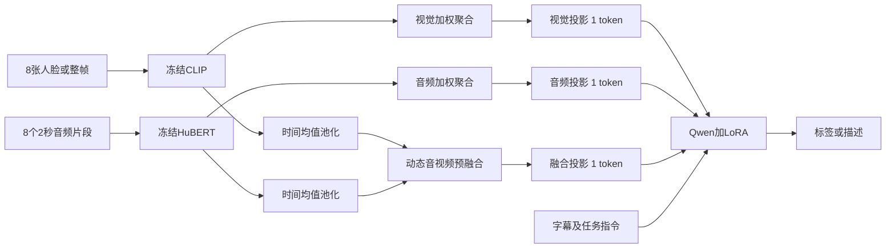

# AffectGPT 项目深度分析报告（论文、代码与服务器实证增补版）

> **修订日期：2026-10-15，北京时间。**
> **项目根目录：`/ai/sjq/AffectGPT-sjq`。所有文件操作、数据统计、权重检查及训练均在服务器执行，没有将项目文件下载或保存到本地。**
> **本次直接修订原文件，不创建备份。**
> **论文范围：完整阅读本地 `AffectGPT.pdf` 的22页，包含正文、参考文献与附录A–N；OV-MER、EmoPrefer依据其README和当前源码分析，不声称已阅读全文对应的另外两篇论文。**
> **代码基线：`fffca794c6792023234565370e3f69f0488aede9`；工作副本 origin 为 `https://github.com/songjiaqi757/AffectGPT-sjq`。本次新增原帧配置和正在生成的训练输出不属于该提交的原始内容。**
> **训练状态快照：2026-10-15 11:27:16；这是一次检查记录，后续进度会变化。**

本报告将三类证据分开：**论文报告的实验结果**、**当前代码与发布资产的实际行为**、**本服务器运行的实测记录**。除明确写为“建议”“待验证”或“示意”的内容外，定量结论须能回溯到论文页码、代码位置、CSV统计、媒体哈希或训练日志。文末给出证据索引、原稿更正清单与尚未解决的问题。

最重要的判断是：AffectGPT是情绪描述数据、紧凑多模态生成模型和自由文本评测协议共同构成的研究系统。数据带来的收益比单独预融合模块的收益更突出。当前版本有历史权重键名不兼容、训练测试同视频、情绪归一化资源错误及测试集选模等复现问题。**这些问题的证据边界不同，不能由当前数据重叠直接推断论文历史训练发生泄漏，也不能把训练loss下降当作MER-UniBench复现成功。**

## 目录

1. [项目背景与核心创新](#section-01)
2. [研究动机与问题定义](#section-02)
3. [OV-MER任务与仓库边界](#section-03)
4. [MER-Caption数据构建与真实统计](#section-04)
5. [默认模型结构与张量流](#section-05)
6. [数据、配置与前向实现](#section-06)
7. [训练流程、优化与实现细节](#section-07)
8. [MER-UniBench指标和实际评分口径](#section-08)
9. [论文真实实验与消融](#section-09)
10. [技术贡献的证据与归因边界](#section-10)
11. [能力局限与研究方向](#section-11)
12. [工程实践与复现建议](#section-12)
13. [阶段性结论](#section-13)
14. [当前版本的关键缺陷与数据隔离审计](#section-14)
15. [OV-MER与EmoPrefer的独立分析](#section-15)
16. [GPU0人脸与GPU1原帧训练实测](#section-16)
17. [可复现命令与产物管理](#section-17)
18. [论文附录A–N逐项阅读说明](#section-18)
19. [来源、代码与数据证据索引](#section-19)
20. [原稿更正记录、待验证事项与后续顺序](#section-20)

---

<a id="section-01"></a>
## 1. 项目背景与核心创新

### 1.1 从固定分类到情绪描述

传统多模态情绪识别通常把音频、视觉和文本映射到固定类别中的一个或若干标签。其优势是输出明确、指标成熟；局限是预定义类别难以覆盖复杂语境中共存、强弱不同或非常细致的情绪表达。固定类别的多标签任务仍可表达共存，不能把“传统MER”一概描述成只允许一个标签。

AffectGPT采用生成式输出。它可以回答“有哪些情绪”，也可以描述“根据字幕、声音和视觉线索，人物可能处于什么情绪状态”。例如“紧张且期待”是说明输出形式的教学例子，不是本项目已核验的真实样本或预测。

自然语言生成扩展了表达空间，但文字解释并不自动具备事实忠实性。生成器可能给出流畅却不受视频支持的原因，评测也可能只抽取其中几个情绪词。因此，本项目的“识别”“描述”“解释忠实性”应作为不同问题评估。

### 1.2 AffectGPT论文的三项主体贡献

| 贡献 | 内容 | 主要证据 |
|---|---|---|
| 数据 | MER-Caption及经过质控的MER-Caption+ | 论文第3–4页、表1 |
| 模型 | 在音频、视觉独立路径之外增加进入LLM前的预融合路径 | 论文第5–6页、图3、公式3–7 |
| 基准 | MER-UniBench，覆盖9个数据集和3类任务，设计适应自由文本输出的指标 | 论文第6–7页、附录J–L |

OV-MER任务及OV-MERD是本仓库中另一项相关研究；不能把仓库内所有任务和数据的提出都算作AffectGPT单篇论文的独立贡献。

### 1.3 为什么数据是理解结果的关键

论文表3中，保持模型与实验设置一致，MER-Caption得到68.91，MER-Caption+得到74.77；表5中，不做预融合得到72.95，Attention预融合得到74.77。两组消融分别说明数据筛选与模型设计有收益，但它们不是可直接相加的独立因果分解。

较稳妥的解释是：专门的情绪描述监督提供主要能力基础，预融合在此基础上进一步改善多模态信息利用。只用“提出新融合网络”概括项目，会低估数据与评测协议的作用。

<a id="section-02"></a>
## 2. 研究动机与问题定义

### 2.1 三种任务需要区分

1. **基本情绪识别**：固定候选类别，通常一个主标签。问题是“哪一类最符合这个人物？”
2. **开放词汇情绪识别**：输出数量可变的情绪集合，类别不限制在预定义列表。问题是“有哪些可能的情绪？”
3. **情绪描述与解释**：生成描述，涉及情绪、观察到的线索及可能的原因。问题是“根据哪些线索作出判断？”

开放集合与描述目标能表达更细的语义，但也引入标签粒度不一致、同义词、额外情绪、否定和不确定表达等评测问题。MER-UniBench的归一化解决其中一部分，同时也压缩了原始细粒度差异。

### 2.2 输入和输出的形式化表达

设视频为Xv，音频为Xa，字幕为Xt，指令为Q，回答为R。模型学习条件生成概率：

$$P(R\mid X_v,X_a,X_t,Q)=\prod_{l=1}^{L_r}P(r_l\mid X_v,X_a,X_t,Q,R_{<l}).$$

论文公式1–2与当前训练loss一致：训练时给定之前的回答token，预测下一个token。不同指令让同一模型输出描述或标签。模型并没有一个1972维的固定情绪分类头。

对开放标签任务，输出集合大小可变；对描述任务，输出是一段自然语言。当前实现用两种问题模板随机混合训练，详细见第7章。

### 2.3 “开放”与“zero-shot”的实际含义

输出不被固定类别列表截断，不等于模型对任意新类别均有可靠识别能力。模型仍受训练描述、基座语义知识、模态编码器和目标人物选择策略影响。

推理脚本的`--zeroshot`用于选择开放情绪问题模板，仍加载训练后的AffectGPT权重。它不是未经情绪微调的原始Qwen，也不能仅凭该参数证明所有测试媒体均未在训练中出现；当前99段媒体重叠见第14章。

<a id="section-03"></a>
## 3. OV-MER任务与仓库边界

### 3.1 三个子项目的职责

| 子目录 | 核心职责 | 不应混淆的边界 |
|---|---|---|
| `/ai/sjq/AffectGPT-sjq/OV-MER` | 开放词汇任务、332条OV-MERD、基线生成、线索合并、旧版指标 | 不是AffectGPT默认训练器；指标输出有12项 |
| `/ai/sjq/AffectGPT-sjq/AffectGPT` | 31K训练数据加载、模型SFT、生成推理、9数据集评测 | 默认Attention、LoRA rank16；不是偏好优化训练 |
| `/ai/sjq/AffectGPT-sjq/EmoPrefer` | 描述对的偏好判断、提示策略、偏好指标 | 脚本名含dpo不代表实现了DPO损失 |
| `/ai/sjq/AffectGPT-sjq/dataset` | 媒体、字幕、标签及不同benchmark预处理资产 | 很多是共享原项目的服务器软链接 |

项目可以被理解为“开放识别→生成描述→评价描述偏好”的研究链条，但当前代码没有把它自动闭合成偏好对齐训练系统。

### 3.2 相近任务之间的差异

| 任务 | 类别空间 | 每样本标签数 | 常见输出 |
|---|---|---|---|
| 单标签MER | 固定 | 一个 | 基本情绪 |
| 多标签MER | 固定 | 多个 | 固定类别的多热向量 |
| OV-MER | 开放 | 可变 | 自由情绪词集合 |
| 情绪描述/EMER | 自由文本 | 不直接固定 | 情绪与依据的描述 |
| 情绪偏好预测 | 候选描述已给定 | 三种比较结论 | a1/a2/same |

“可输出多种情绪”与“能给出可信解释”不是同一能力。后者需要额外检查文本中的具体视觉、声音和语义事实。

<a id="section-04"></a>
## 4. MER-Caption数据构建与真实统计

### 4.1 论文规模和当前媒体库规模

| 数据/资产 | 样本数 | 论文统计的情绪词汇数 | 说明 |
|---|---:|---:|---|
| MER-Caption | 115,595 | 2,932 | 较大规模自动描述集 |
| MER-Caption+ | 31,327 | 1,972 | 两级筛选后的训练子集 |
| OV-MERD | 332 | 236 | 旧开放情绪数据集 |
| OV-MERD+ | 532 | 类别开放 | 旧332条加新增200条 |
| 当前MER2025字幕/媒体库 | 132,171 | 不适用 | 共享媒体总量，不是Caption+训练条数 |

前两行见论文表1；OV-MERD+规模见附录J表11。当前CSV行数与训练日志确认默认训练为31,327条。132,171不能与1,972或2,932任意拼成新的数据集统计。

论文情绪词数与直接数CSV原始字符串的口径不同。发布CSV可能含词形、大小写、同义表达和格式噪声；本章后面的服务器统计不会将原始不同字符串冒充论文归一化后的真实情绪类别。

### 4.2 数据来源与描述生成

论文说明原始数据来自MER2024未标注部分，并非该工作重新采集视频。流程是：

1. 先取小部分样本进行人工细粒度情绪标注，用于比较候选模型。
2. SALMONN生成音频线索，Chat-UniVi生成视觉线索。
3. GPT-3.5（`gpt-3.5-turbo-16k-0613`）结合这两种线索与字幕生成综合描述。
4. 对描述及媒体执行低层和高层过滤，形成MER-Caption+。

附录G的合并提示要求同时整合文本、音频和视觉线索，指出哪些部分可以推断情绪并解释原因。例子展示了字幕不满、表情惊讶、声音紧张等线索可以共存；这不是要求三个模态先预测成完全相同的情绪再保留。

### 4.3 “人工辅助”的准确范围

人工先验主要用于预实验、模型选择和分类器使用的人类标注数据；不能解释成每条最终描述都经过人工复核。论文正文承认自动描述仍可能有错误。

附录F表10的单模型比较支持SALMONN与Chat-UniVi的选择。SALMONN+Chat-UniVi组合Fs为58.43，SALMONN+mPLUG-Owl为58.70，但作者明确按单模型表现选型，而非按所有组合中的最高分选择。

论文第9页用户研究随机选择20个重叠样本，邀请4位专家比较描述。MER-Caption+相对MERR-Coarse的胜/负/平为0.86/0.04/0.10，相对MERR-Fine为0.59/0.27/0.14。它支持部分样本描述质量较好，不能证明全部数据无误，也不能把80次评价当作80个独立视频。

### 4.4 两级过滤具体做什么

**低层过滤**有两项已明确的机制：

- 用TalkNet识别可见人物是否正在说话，移除音频来自画外人等不匹配场景。论文称预实验识别准确率超过90%，没有据此声称所有目标人物问题均被解决。
- 描述长度大致呈钟形分布，排除分布两端。论文未在已读正文/附录给出原稿中的固定20–150词阈值，因此不把该阈值写成事实。

**高层过滤**：使用人类标注情绪/极性数据训练多个多模态分类器；视觉CLIP ViT-L、音频HuBERT-L，经融合预测基本情绪和极性，多数投票形成参考。再从描述中抽取情绪/极性，比较两条路径是否一致。

原稿将此写为RoBERTa/BERT分类器、低层“极端模态冲突需人工复核”等，均不能由当前论文和源码确认，应删除。

115,595→31,327的保留率约27.1%。高层一致性筛选提升了下游表现，也可能偏向常见、容易分类的样本，弱化复杂冲突、稀有情绪或非典型表现。模型共识是质量代理，不等于人物心理状态的客观真值。

### 4.5 当前代码能否完整重建数据集

当前训练器直接加载预生成的标签、描述、字幕和预处理媒体。`toolkit/preprocess`含历史数据整理脚本，但不能把其中的`mer2024.py`等同于完整的模型选择、API标注、TalkNet、投票和两级筛选流水线。

本次未找到一套可按README直接端到端重建MER-Caption+的完整公开入口。缺少的可复现信息包括模型标注版本、完整生成提示与参数、过滤阈值、全部分类器训练划分和逐样本保留理由。使用发布数据训练，与从原始媒体重建发布标注，是两个不同的复现目标。

### 4.6 当前CSV的原始词面统计口径

服务器统计直接读取`track2_train_mercaption.csv`和`track2_train_mercaptionplus.csv`，使用仓库`string_to_list`的拆分规则，随后对词做lower/strip，并在每条记录内去重。**标签频次指包含该词的样本数，不是归一化到情绪轮后的频次，也不是出现次数。**

多数`openset`字段形如`[concern, pessimism]`，没有Python字符串引号，不能直接假定全部适用`ast.literal_eval`。本次没有对这些字段使用执行性`eval`。

| 当前文件 | 记录数 | 保留大小写的原始词面数 | lower/strip后的词面数 |
|---|---:|---:|---:|
| MER-Caption标签CSV | 115,595 | 6,228 | 5,783 |
| MER-Caption+标签CSV | 31,327 | 3,407 | 3,346 |

这些数不能替代论文表1的2,932/1,972。差异涉及原始字符串、同义词和归一化阶段，不能在缺少作者完整统计脚本时强行宣称已重现论文类别统计。较大的原始词面集合还包含噪声，不能据此主张数据更“细粒度”。

#### 当前发布标签的Top20：样本频次，不做同义词合并

| 排名 | Caption+词项 | 样本数 | Caption词项 | 样本数 |
|---:|---|---:|---|---:|
| 1 | anger | 4,894 | anxiety | 32,302 |
| 2 | anxiety | 4,364 | anger | 20,130 |
| 3 | frustration | 3,664 | frustration | 19,881 |
| 4 | dissatisfaction | 3,347 | anxious | 14,561 |
| 5 | anxious | 3,025 | fear | 12,511 |
| 6 | positive | 2,648 | excitement | 11,456 |
| 7 | tense | 2,319 | sadness | 10,361 |
| 8 | concern | 2,039 | tension | 8,204 |
| 9 | disappointment | 2,000 | dissatisfaction | 7,816 |
| 10 | tension | 1,903 | stress | 7,542 |
| 11 | angry | 1,768 | nervousness | 6,616 |
| 12 | sadness | 1,751 | concern | 6,507 |
| 13 | excited | 1,591 | disappointment | 6,355 |
| 14 | excitement | 1,411 | positive | 6,024 |
| 15 | stress | 1,383 | excited | 5,658 |
| 16 | frustrated | 1,252 | serious | 5,060 |
| 17 | fear | 1,161 | nervous | 4,878 |
| 18 | worry | 1,150 | frustrated | 4,572 |
| 19 | concerned | 1,046 | determination | 4,534 |
| 20 | confident | 1,030 | stressed | 4,460 |

这是lower/strip后、每个样本set去重得到的词项覆盖数；不同标签可在同一视频共存，频率不能相加当作互斥类别比例。`anger/angry`、`anxiety/anxious`在此仍是不同词，`positive`等又与细粒度情绪的层次不同。因此也不能由Top20推断真实独立情绪的长尾占比。

#### 标签数分组与空标签

| lower/strip且样本内去重后的标签数 | Caption+记录数 | Caption+占比 | Caption记录数 | Caption占比 |
|---|---:|---:|---:|---:|
| 0 | 551 | 1.76% | 680 | 0.59% |
| 1 | 189 | 0.60% | 399 | 0.35% |
| 2 | 7,082 | 22.61% | 21,922 | 18.96% |
| 3 | 9,154 | 29.22% | 33,528 | 29.00% |
| ≥4 | 14,351 | 45.81% | 59,066 | 51.10% |

| 统计 | Caption+ | Caption |
|---|---:|---:|
| 去重后平均标签数 | 3.563763 | 3.831948 |
| 去重后最大标签数 | 19 | 24 |
| lower/strip后样本内产生重复的记录数 | 80 | 429 |
| CSV物理空单元格数 | 0 | 0 |
| 解析后空集合记录数 | 551 | 680 |

原始空集合在本表仍计0，训练loader会将其target改为neutral。19/24个词项不等于经人工确认的19/24种独立情绪；其中可能包含同义词和不同粒度。原稿的“单情绪42.3%、双31.7%、三18.2%、四及以上7.8%”没有当前数据支持。

为方便复核，完整的去重后计数为：

| 标签数 | Caption+ | Caption |
|---:|---:|---:|
| 0 | 551 | 680 |
| 1 | 189 | 399 |
| 2 | 7,082 | 21,922 |
| 3 | 9,154 | 33,528 |
| 4 | 7,478 | 27,077 |
| 5 | 3,598 | 16,672 |
| 6 | 1,914 | 8,147 |
| 7 | 793 | 3,630 |
| 8 | 342 | 1,775 |
| 9 | 150 | 831 |
| 10 | 52 | 433 |
| 11 | 14 | 233 |
| 12 | 6 | 102 |
| 13 | 3 | 78 |
| 14 | 0 | 29 |
| 15 | 0 | 28 |
| 16 | 0 | 16 |
| 17 | 0 | 6 |
| 18 | 0 | 5 |
| 19 | 1 | 2 |
| 20 | 0 | 0 |
| 21 | 0 | 1 |
| 22 | 0 | 0 |
| 23 | 0 | 0 |
| 24 | 0 | 1 |

Caption大CSV发现8条非标准首尾括号记录，其中2条含完整描述，仓库简单拆分会把句段当词项。直接数CSV原始词面会受这些格式噪声影响。本次没有修改这些发布数据。

#### 可复查的标准库统计方法

下面的示例与仓库当前解析约定一致，只读标签CSV，不执行字段内容，也不做情绪轮归一化。多数无引号列表不能用Python字面量直接解析；仅571条Caption+、1,114条Caption记录可直接用AST字面量解析成功，成功部分与仓库解析一致。

```python
import csv
import re
from collections import Counter

csv_path = '/ai/sjq/AffectGPT-sjq/dataset/mer2025-dataset/track2_train_mercaptionplus.csv'

def parse_like_repository(cell):
    if cell is None or cell == '':
        return []
    if cell[0] == '[':
        cell = cell[1:]
    if cell and cell[-1] == ']':
        cell = cell[:-1]
    return [item.strip() for item in re.split(r"""['",]""", cell) if item.strip()]

frequency, sizes = Counter(), Counter()
raw_terms = set()
with open(csv_path, encoding='utf-8-sig', newline='') as f:
    for row in csv.DictReader(f):
        labels = parse_like_repository(row['openset'])
        raw_terms.update(labels)
        normalized = {word.strip().lower() for word in labels}
        frequency.update(normalized)
        sizes[len(normalized)] += 1
print('rows', sum(sizes.values()), 'raw_terms', len(raw_terms))
print(sorted(frequency.items(), key=lambda x: (-x[1], x[0]))[:20])
print(dict(sorted(sizes.items())))
```


### 4.7 训练输入的实际关联规则

`mercaptionplus_dataset.py`以`track2_train_mercaptionplus.csv`的`name`为训练样本集合，关联`track3_train_mercaptionplus.csv`中的`reason`和`subtitle_chieng.csv`中的`english`。空开放标签被转换为`neutral`，缺字幕内容可为空；需要的记录应能按name对应。

本次实测标签和描述各31,327个唯一样本，标签到描述和字幕的ID缺失均为0。Loader不自动排除benchmark ID；99段与OV-MERD+同视频的情况在第14章单列。

<a id="section-05"></a>
## 5. 默认模型结构与张量流

### 5.1 实际默认组合

| 模块 | 实际配置 | 默认输出/用途 |
|---|---|---|
| 视觉 | CLIP ViT-L/14，冻结参数 | 每帧768维图像特征 |
| 声学 | Chinese HuBERT-large，冻结参数 | 8个片段各1024维 |
| LLM | Qwen2.5-7B-Instruct | 隐藏维度3584，28层 |
| 适配 | LoRA rank16，alpha32，dropout0.05 | 更新attention和MLP七类投影 |
| 单模态聚合 | visual/audio均为attention | 各一个LLM token |
| 预融合 | attention | 一个融合token |
| 字幕 | 英文字幕直接编入prompt | 没有额外独立文本encoder |

`model_type: pretrain_vicuna`、LLAMA命名与部分4096维注释属于历史框架痕迹，实际由`llama_model: Qwen25`选择Qwen。不能根据这些字符串把模型误写为Vicuna或LLaMA。

### 5.2 默认三条非文本路径



预融合没有取代音频和视觉独立token。忽略这两条旁路会误判模型如何利用信息，也会误判视觉投影漏载的影响范围。

### 5.3 CLIP与HuBERT的真实输出

默认CLIP分支调用`CLIPModel.get_image_features`，将每张输入变成投影后的768维向量，然后恢复batch与帧维。因此主路径是`[B,8,768]`，不是原稿所写的`[B,8,257,1024]`或固定32个patch token。

HuBERT对每个2秒片段提取隐藏状态，平均最后四层，再对片段内部时间步平均，得到1024维片段特征。8段组成`[B,8,1024]`。声学编码器内部建模顺序，但输出给默认片段融合模块的已是压缩特征。

输入音频重采样至16kHz，立体声均值转单声道，过短音频补零；8个2秒片段可以重叠，不能把它理解为每段视频必须16秒长。视觉的8帧从整段视频均匀采样，也不等于只看连续0.3秒。

### 5.4 单模态attention没有softmax

下面是与默认源码数学行为一致的简化说明，不是额外公开API：

```python
# x: [B, T, D]
w = linear_score(x)                  # [B, T, 1]，无softmax
z = (x * w).sum(dim=1)              # [B, D]
token = projector(z).unsqueeze(1)   # [B, 1, 3584]
```

视觉D=768、音频D=1024。权重可为负，和不要求为1。它是数据依赖的加权聚合，不能直接当作概率或帧的因果贡献。默认实现没有给这条视觉attention加入帧位置编码，交换帧顺序不会改变这类集合聚合结果。

### 5.5 预融合也没有softmax，且先压缩时间

默认`encode_multi_attention`先沿时间取均值，将视觉768维映射到1024维，音频1024维映射到1024维，拼成2048维，再经过两个线性层生成两个原始权重。

```python
# 与当前源码等价的数学简化，顺序是visual、audio。
v = multi_video_embs(video_features.mean(dim=1))
a = multi_audio_embs(audio_features.mean(dim=1))
w = fc_att(attention_mlp(torch.cat([v, a], dim=1)))
z = w[:, 0:1] * v + w[:, 1:2] * a
fusion_token = multi_llama_proj(z).unsqueeze(1)
```

两层之间没有非线性激活，末端没有softmax。这与论文公式7一致，不是当前实现偏离论文。由于先池化，不能说该模块建立了逐帧逐词的音视频时序对应关系。

### 5.6 Q-Former和mean是备选分支

论文比较Q-Former与attention预融合。Q-Former利用查询token和带位置编码的音视频序列做cross-attention，保留更多时间组织；默认attention则更简单。

源码另有单模态mean、Q-Former等分支，不能据此说论文逐一给出了所有组合的完整消融。Q-Former还需要默认三模型清单之外的BERT资产；当前路径配置对备用编码器也未必完整。模块可注册不等于改一个字符串就能运行所有组合。

### 5.7 人脸版和原帧版的区别

| 项目 | GPU0人脸版 | GPU1原帧版 |
|---|---|---|
| 数据模式 | `multiface_audio_face_text` | `multiframe_audio_frame_text` |
| 视觉资产 | OpenFace人脸npy中均匀取8张 | 完整视频均匀取8张整帧 |
| 特殊占位 | FaceHere | FrameHere |
| 融合输入 | face隐藏特征+audio隐藏特征 | frame隐藏特征+audio隐藏特征 |
| 视觉编码器 | CLIP | 同左 |
| 依赖OpenFace文件 | 是 | 否 |
| 主模型与优化超参 | 与原帧相同 | 与人脸相同 |

原帧模型仍是逐帧CLIP，不是新的视频时序encoder。整帧能保留场景、姿态及物体，也可能加入背景干扰。人脸和整帧训练的视觉分布不同，正式对比应使用各自训练的权重。

<a id="section-06"></a>
## 6. 数据、配置与前向实现

### 6.1 真实入口与职责

| 文件/模块 | 职责 |
|---|---|
| `AffectGPT/train.py` | 解析配置、设置seed、构建数据/模型/runner并训练 |
| `AffectGPT/config.py` | 基座模型、数据资产与特殊token路径 |
| `my_affectgpt/common/config.py` | 解析YAML和命令行覆盖，按配置文件名生成输出目录 |
| `datasets/datasets/mercaptionplus_dataset.py` | 关联标签、描述、英文字幕与媒体 |
| `datasets/datasets/base_dataset.py` | 按输入模式读数据，构造问题、target及labels |
| `models/encoder.py` | 在线提取CLIP和HuBERT特征 |
| `models/affectgpt.py` | 模态聚合、占位token替换、LLM生成loss |
| `runners/runner_base.py` | 优化器、训练轮、checkpoint和日志 |
| `inference_hybird.py` | 多数据集、多checkpoint生成 |
| `inference_sample.py` | 传入视频、音频、字幕的单视频生成 |
| `evaluation.py` | 抽取开放标签、极性转换及评分 |

表中文件均在`/ai/sjq/AffectGPT-sjq/AffectGPT/`下；完整绝对路径和行号见第19章。这里不把原稿中自拟的`encode_multimodal()`、`model.inference()`等函数冒充现有API。

### 6.2 三份配置及输出路径规则

- 人脸默认：`train_configs/emercoarse_highlevelfilter4_outputhybird_bestsetup_bestfusion_lz.yaml`。
- 仓库原帧默认：`train_configs/mercaptionplus_outputhybird_bestsetup_bestfusion_frame_lz.yaml`。
- 本次新增GPU1原帧：`train_configs/mercaptionplus_frame_gpu1.yaml`。

输出目录由`Config.build_runner_config`根据YAML basename重新生成，如第三份配置得到`output/mercaptionplus_frame_gpu1/`。仅在YAML写另一个`run.output_dir`会被此逻辑覆盖；需要额外命令行覆盖时应核对最终打印配置。

当前项目大量使用相对路径，应从`/ai/sjq/AffectGPT-sjq/AffectGPT`作为cwd运行。配置中的`device: cuda`不是物理GPU号；物理卡由启动环境变量选择，见第16–17章。

### 6.3 数据读取与样本失败处理

视频/音频路径按`name.mp4`与`name.wav`构造，人脸路径为`openface_face/name/name.npy`。原帧模式`needed_data=['frame','audio']`，不读取人脸npy；人脸模式相反。虽然某些代码构造了人脸路径字符串，不代表原帧模式会打开它。

训练最大总长度1024。超过长度或媒体读取异常会被当作取样失败，并随机选择其他样本重试，最多10次。这可以让训练继续，但会改变实际曝光分布；不能仅根据CSV条数保证每条样本被等量使用。应检查失败日志和统计被替换样本，当前报告没有执行全库媒体解码检查。

### 6.4 训练与推理的前向不能混写

训练时`forward(samples)`提取视觉、音频及预融合特征，将文本中的FaceHere/FrameHere/AudioHere/MultiHere替换成投影后的向量，再调用causal LM并传入labels，返回`{"loss": outputs.loss}`。

推理时使用Chat封装准备相同类型的模态向量，再调用生成接口。原稿把`.generate()`写进训练`forward()`并把它称为完整源码，混淆了训练和生成路径；本次不再保留这段伪实现。

### 6.5 生成参数、随机性与长输入

两个推理入口默认使用`num_beams=1`、`temperature=1`、`do_sample=True`、`top_p=0.9`、`max_new_tokens=1200`、`max_length=2000`。不能沿用原稿的256 token、temperature0.7、repetition_penalty1.2作为实际默认。

输入加输出超过最大长度时，Chat从左侧截断输入。在默认预留1200个输出token的情形下，prompt最多保留约800个token；左侧通常包括多模态占位符，因此长字幕或长对话可能导致模态信息丢失。生成结果受采样影响，`.eval()`只关闭训练层随机行为，不会关闭`do_sample=True`。

### 6.6 预处理名义与实际使用的张量

默认CLIP读取`raw_image`并调用其图像处理器，没有使用Alpro预先算出的`image`增强结果。因此不能因为配置存在`alpro_video_train`就宣称其全部随机裁剪增强都进入了默认CLIP。

默认HuBERT读取`raw_audio`，没有使用同时计算的mel张量；mel在该组合下是冗余计算。未找到原稿宣称默认启用的时间拉伸、音高偏移与加噪流水线。

编码器权重冻结，但CLIP/HuBERT只在初始化时设为eval，全模型`.train()`会递归切换其模式。HuBERT配置中存在dropout/layerdrop，因此“冻结参数”不等于训练期间输出完全固定。若要离线缓存特征，必须先明确是否固定eval，否则缓存可能改变实验定义。

<a id="section-07"></a>
## 7. 训练流程、优化与实现细节

### 7.1 单阶段、随机混合目标的SFT

论文附录B明确没有采用“通用指令预训练→MER-Caption二次训练”；实验中该多阶段流程未带来收益。当前两项训练都从CLIP、HuBERT和Qwen通用预训练模型初始化，`ckpt`/`ckpt_2`为空、`resume_ckpt_path=null`，没有加载旧AffectGPT权重。

`label_type: hybird`保留了源码拼写，每次取样在`description`和`ovlabel`中随机选择。标签target模板为`The character's emotional state is ...`；描述问题要求推断情绪并给出reasoning process。它不是两个训练阶段，也不是一个样本同时计算两个独立loss。

prompt对应labels为-100，只有回答和终止符计算自回归交叉熵。模型没有当前启用的分类头、回归loss、对比loss、DPO或RLHF损失。两种目标约各占一半采样机会，但描述更长，不能认为监督token或梯度贡献严格各占一半。

### 7.2 冻结与可训练参数

| 部分 | 参数数/状态 | 来源 |
|---|---|---|
| Qwen原始基座 | 冻结 | `affectgpt.py`先冻结再增加PEFT |
| CLIP/HuBERT权重 | 冻结 | encoder初始化 |
| LLM LoRA | 40,370,176 | 392个tensor，真实checkpoint |
| 非LoRA连接器 | 16,798,468 | 20个tensor，真实checkpoint |
| checkpoint保存的可训练参数合计 | 57,168,644 | 共412个tensor |

LoRA rank16、alpha32、dropout0.05，覆盖28层中的q/k/v/o和gate/down/up七类线性投影。`frozen_llm=False`意味着LoRA可训练，不能理解为Qwen基座全参数更新。

默认face/frame路径不使用`image_llama_proj`，其2,756,096参数仍在声明可训练及保存清单中，但没有进入已检查的optimizer状态。不能把57,168,644全部解释成每步均参与计算的活跃参数，更不能沿用原稿的33.5M/44.5M统计。

Attention分支中的Q-Former冻结旗标不一定作用于对应线性attention层，修改这些旗标前要核对实际参数的`requires_grad`。

### 7.3 有效训练参数与epoch语义

| 参数 | 当前值 |
|---|---|
| optimizer | AdamW |
| betas | 0.9、0.999 |
| init_lr / min_lr | 均为1e-5 |
| YAML warmup_lr / warmup_steps | 1e-6 / 5000 |
| weight_decay | 0.05；bias、低维及部分归一化参数另分组 |
| max_epoch / iters_per_epoch | 60 / 5000 |
| batch_size_train | 3 |
| world_size / distributed | 当前均为1 / false |
| AMP / seed / workers | true / 42 / 4 |
| train split | 仅train，无默认验证集 |
| 最大序列长度 | 1024 |

`IterLoader`在数据读完后循环，epoch被定义为固定5000次batch迭代。单卡60×5000×3=900,000次样本曝光，约为31,327条数据规模的28.7倍，但随机选择、失败替换和打乱意味着并非每条恰好28.7次。

300,000次batch迭代也不必等于300,000次成功optimizer更新：AMP遇到数值问题可能跳过更新。当前进度表使用日志batch索引，不把它冒称精确更新次数。

### 7.4 warmup未实际执行，cosine实际上恒定

源码计算`total_cur_step = cur_epoch * iters_per_epoch + cur_step`；runner从epoch1开始，因此首步已经是5000，条件`total_cur_step < warmup_steps`不成立。默认warmup分支被跳过。

随后cosine函数包含`init_lr-min_lr`，当前二者相等，因此学习率保持1e-5。这与附录B的固定学习率描述不冲突，但与原稿画出的先升后降曲线不符。

本次训练console明确打印`lr: 0.00001000`。结构化`log.txt`写`train_lr: "0.000"`只是小数位格式，不能解释成学习率为零。本次没有为“修复调度”而修改正在运行的代码或配置，确保两项实验条件一致。

### 7.5 checkpoint、验证与恢复

训练开始保存epoch0，随后每epoch保存一次。无验证集时并不按验证指标选最优；`VideoTextPretrainTask.evaluation`本身也没有实现完整评价。

checkpoint包含可训练模型参数、optimizer、config、scaler和epoch，原始冻结模型参数不全部保存。epoch0约229MB，含optimizer状态后的后续文件约665MB；每个新实验保存到epoch60预计约40GB十进制量级，两项约80GB，实际以最终文件为准。

保存某个epoch的文件不等于完成其benchmark评测。要从断点恢复，仍需原始基座模型和数据，核对配置、参数名、optimizer兼容性，不能仅复制一个小checkpoint就得到完整独立模型。

### 7.6 训练资源应以实测说明

论文附录B写使用80GB A100进行训练与推理，没有给出原稿所写64核/256GB/2TB的必需规格，也没有证明batch3是80GB卡能容纳的最大batch。

当前服务器两张A800 80GB分别单卡训练，显存快照约43GB上下，稳定速度约0.38–0.39秒/batch，完整运行预计约32–33小时量级。该实测只适用于当前模型、长度、batch、硬件和共享IO；不是其他GPU的性能承诺。精确状态与时间基准见第16章。

<a id="section-08"></a>
## 8. MER-UniBench指标和实际评分口径

### 8.1 论文实际测试子集

| 类别 | 数据集 | 论文使用集合 | 样本数 | 主指标 |
|---|---|---|---:|---|
| 基本情绪 | MER2023 | MER-MULTI | 411 | HIT |
| 基本情绪 | MER2024 | MER-SEMI | 1,169 | HIT |
| 基本情绪 | MELD | Test | 2,610 | HIT |
| 基本情绪 | IEMOCAPFour | Session5 | 1,241 | HIT |
| 极性 | CMU-MOSI | Test | 686 | weighted F1 |
| 极性 | CMU-MOSEI | Test | 4,659 | weighted F1 |
| 极性 | CH-SIMS | Test | 457 | weighted F1 |
| 极性 | CH-SIMS v2 | Test | 1,034 | weighted F1 |
| 开放细粒度 | OV-MERD+ | All | 532 | 集合F-score |

来源为附录J表11。此表不混入原始数据全集规模；原稿的OV-MERD+1500条、IEMOCAP10039条作为本测试规模等应删除。

### 8.2 从生成到评分的真实链条

```text
AffectGPT或基线生成文本 → 保存NPZ → Qwen抽取情绪词列表
    ├─ 基本/开放情绪：词形、同义词、情绪轮映射 → HIT或集合P/R/F
    └─ 极性：Qwen判断positive/negative/neutral → 非零真值上的二分类WAF/ACC
```

附录E给出标签抽取和极性判断提示。代码使用本地Qwen2.5-7B-Instruct，temperature0.7、top_p0.8。缓存存在时直接复用。因此重新运行全流程与只读缓存打分，是不同层次的复现。

本基准没有使用原稿所称的Sentence-BERT语义余弦、exact set accuracy或完整MAE/Corr/Acc5/Acc7回归指标。

### 8.3 三层归一化与五个情绪轮

词形层将不同形式连接到基础词；同义词层连接近义表达；情绪轮层把外层细词映射到核心簇。论文公式8用G表示该复合映射。附录K使用五个情绪轮，而不是只用一个Plutchik定义。

代码的映射资源是固定表格，表外词可能被丢弃。多对多候选会按字母顺序选择首个能匹配该wheel的词。这些实现影响细粒度差异、额外标签惩罚与有效评分样本，必须作为评测版本的一部分保存。

### 8.4 开放情绪集合指标

对wheel k和样本i，先得到归一化集合Gk(Yi)、Gk(Pi)。对有效样本分别计算交集占预测/真值的比例，再在样本维度平均：

$$P_k=\mathrm{mean}_i\frac{|G_k(Y_i)\cap G_k(P_i)|}{|G_k(P_i)|},\qquad
R_k=\mathrm{mean}_i\frac{|G_k(Y_i)\cap G_k(P_i)|}{|G_k(Y_i)|}.$$

$$F_k=\frac{2P_kR_k}{P_k+R_k},\qquad F_s=\frac{1}{5}\sum_{k=1}^{5}F_k.$$

空预测计零；空映射真值跳过。它不是micro-F1，也不是逐样本F1的直接平均，更不是原始词汇精确匹配。细粒度类别被合并后得高分，不等于逐词区分正确。

### 8.5 基本情绪HIT及额外标签问题

真值映射后的情绪簇出现在预测集合中就命中。对于单一真值，这等价于0/1指示；主指标不惩罚额外标签。例如真值angry而预测angry、happy、sad仍可命中。

因此HIT衡量标签覆盖，不能直接替代传统单标签accuracy或weighted F1。模型多输出一些类别可能提高覆盖，必须结合开放集合precision、预测标签数和错误标签检查理解。

### 8.6 实际评分分母不是论文表中的全N

此前服务器静态映射核验结果如下；本次修订复用该核验记录，没有为了改报告重新反序列化不必要的数据文件。

| 数据集 | 测试文件N | neutral数 | W1 | W2 | W3 | W4 | W5 |
|---|---:|---:|---:|---:|---:|---:|---:|
| MER2023 | 411 | 88 | 323 | 323 | 323 | 323 | 305 |
| MER2024 | 1,169 | 201 | 968 | 968 | 968 | 968 | 885 |
| MELD | 2,610 | 1,256 | 1,354 | 1,354 | 1,286 | 1,354 | 1,005 |
| IEMOCAPFour | 1,241 | 384 | 857 | 857 | 857 | 857 | 857 |

五个wheel都排除neutral。W5还排除上述基本情绪集中的surprise；MELD的disgust还被W3/W5排除。因此同一数据集不同wheel的分母也不同。论文的N表是数据规模，不能无说明地理解为每个指标都覆盖全部N。

### 8.7 极性任务没有验证连续强度预测

真值小于0视为负，大于0视为正，真值0被排除。预测positive/negative/neutral转换为1/-1/0，最终用`pred>0`比较。因此预测neutral或解析失败得到0时，会进入非正类，而不是一个独立三分类中性类。

CMU-MOSI/MOSEI原始标签虽为[-3,3]，CH-SIMS为[-1,1]，当前评价并未计算MAE或相关系数。不能由这些任务的weighted F1声称模型可准确回归情绪强度。

### 8.8 平均分和外部抽取器的解释边界

九个主指标等权平均，不按样本数加权；4个基本情绪、4个极性和1个细粒度数据集分别占4/9、4/9、1/9。74.77是异质任务的平均分，不能写作“统一准确率74.77%”。

Qwen抽取器与固定映射共同参与最终分数。多主体、否定、可能性和描述冗长可能影响抽取结果。可以保持该协议与论文比较，但应另测解释事实、标签数、原始词精度和抽取稳定性。

### 8.9 IEMOCAP标签映射的可核验边界

附录J字面写把surprise与happiness合并到happiness；当前loader只读预先制作的`label_4way.npz`并选Session5，四类为happy/sad/neutral/anger。预处理脚本搬运外部四类pkl，没有在当前源码中实现surprise或excited的合并规则。

目前资产没有原始pkl/六类标签供追溯，故本报告不擅自“修正”作者原文，也不声称已验证原始兴奋标签的合并路径。复现应明确四类资产版本，并向原始生成过程索取映射记录。

<a id="section-09"></a>
## 9. 论文真实实验与消融

### 9.1 主结果：九项主指标及平均分

下表抄录论文表2/附录L中主要行；是论文数值，不是本次两项新训练得到的测试结果。A/V/T分别代表音频、视觉、字幕。

| 模型/输入 | MER23 | MER24 | MELD | IEMOCAP | MOSI | MOSEI | SIMS | SIMSv2 | OV+ | Mean |
|---|---:|---:|---:|---:|---:|---:|---:|---:|---:|---:|
| SALMONN A+T | 55.53 | 45.38 | 45.62 | 46.84 | 81.00 | 67.03 | 68.69 | 65.93 | 45.00 | 57.89 |
| Chat-UniVi V+T | 57.62 | 65.67 | 45.61 | 52.37 | 54.53 | 63.18 | 68.15 | 66.36 | 48.00 | 57.94 |
| mPLUG-Owl V+T | 56.86 | 59.89 | 49.11 | 55.54 | 72.40 | 72.91 | 72.13 | 75.00 | 48.18 | 62.45 |
| Emotion-LLaMA A+V+T | 59.38 | 73.62 | 46.76 | 55.47 | 66.13 | 67.66 | 78.32 | 77.23 | 52.97 | 64.17 |
| AffectGPT A+T | 72.94 | 73.41 | 56.63 | 55.68 | 83.46 | 80.74 | 82.99 | 83.75 | 59.98 | 72.18 |
| AffectGPT V+T | 74.58 | 75.29 | 57.63 | 62.19 | 82.39 | 81.57 | 87.20 | 86.29 | 61.65 | 74.31 |
| AffectGPT A+V+T | 78.54 | 78.80 | 55.65 | 60.54 | 81.30 | 80.90 | 88.49 | 86.18 | 62.52 | 74.77 |

默认AffectGPT相对Emotion-LLaMA平均高10.60个百分点，相对mPLUG-Owl高12.32个百分点；OV+相对Emotion-LLaMA高9.55个百分点。它们不是原稿所写的8.4%准确率提升。

比较使用基线官方权重，而AffectGPT经过专门情绪数据训练。结果支持整体专用系统的优势，但不隔离训练数据、基座、训练预算和结构的全部影响。纯结构归因应优先看受控消融。

更多模态并非每列都更好：MELD中A+V+T为55.65，V+T为57.63；IEMOCAP、MOSI、MOSEI也可看到V+T超过默认组合的列。不能写作在所有数据集/输入设置都严格胜出。

### 9.2 训练数据对比：表3与附录M表13

| 训练数据 | 无额外情绪筛选 | 做情绪相关筛选 |
|---|---:|---:|
| MiniGPT4 | 31.74 | 35.53 |
| VideoChat | 37.16 | 37.63 |
| LLaVA | 46.69 | 46.27 |
| WavCaps | 21.65 | 37.91 |

| 情绪描述训练数据 | Mean |
|---|---:|
| EmoVIT | 51.05 |
| MAFW | 58.16 |
| MERR-Coarse | 49.85 |
| MERR-Fine | 64.55 |
| MER-Caption | 68.91 |
| MER-Caption+ | 74.77 |

LLaVA筛选后略降，说明一般场景细节也可能间接提供情绪线索。MER-Caption+比MER-Caption高5.86个百分点，但样本数量更少；它不是原稿所写的10K/20K/31K控制规模实验。

### 9.3 过滤消融：表4

| 低层过滤 | 高层过滤 | 细粒度 | 基本情绪 | 极性 | Mean |
|---|---|---:|---:|---:|---:|
| 否 | 无 | 58.42 | 64.36 | 76.09 | 68.91 |
| 是 | 无 | 58.61 | 62.78 | 79.04 | 69.54 |
| 是 | 情绪E | 61.72 | 67.83 | 82.74 | 73.78 |
| 是 | 极性S | 61.00 | 66.33 | 85.04 | 74.05 |
| 是 | E+S | 62.52 | 68.38 | 84.22 | 74.77 |

双过滤平均最好，但S单独在极性列85.04高于E+S的84.22。不能把平均最优推成每个子任务最优。

### 9.4 预融合消融：表5

| 预融合 | 细粒度 | 基本情绪 | 极性 | Mean |
|---|---:|---:|---:|---:|
| 无 | 61.21 | 66.28 | 82.57 | 72.95 |
| Q-Former | 62.65 | 66.89 | 84.30 | 74.16 |
| Attention | 62.52 | 68.38 | 84.22 | 74.77 |

Attention相对无预融合高1.82个百分点，相对Q-Former高0.61。Q-Former的细粒度与极性列略高，Attention的平均优势主要体现在基本情绪列。无预融合不是mean pooling单模态分支，原稿将72.95标为Mean Pooling应更正。

### 9.5 输入模态：表6

| 输入 | Mean |
|---|---:|
| audio | 60.08 |
| face | 60.47 |
| frame | 59.47 |
| text | 67.44 |
| audio+face+text | 74.77 |
| audio+frame+text | 73.39 |
| audio+face+frame+text | 74.60 |

文本是该表最强单模态，不能沿用原稿“视频贡献最大、文本只是辅助”的结论。默认三模态比仅文本高7.33个百分点，但这不是可加和的固定模态贡献，也不是每个样本的因果解释。

face略优于frame，二者合用没有继续提高平均分，符合数据以人物为中心的特点。当前GPU0/GPU1实验正是在同模型、同数据与超参数下比较这两种视觉输入，尚未得到新benchmark结果。

### 9.6 LoRA：表8

| LoRA rank | LLM分支新增可训练参数 | Mean |
|---|---:|---:|
| 无LoRA | 0 | 73.30 |
| 8 | 20,185,088 | 74.65 |
| 16，默认 | 40,370,176 | 74.77 |
| 32 | 80,740,352 | 74.92 |

r32的分数最高，r16是成本与性能折中。r16→32参数翻倍，平均只增加0.15点；主结果未给足以判断这个小差异显著性的置信区间。不能写r8绝对最优，也不能编造各rank训练天数。

### 9.7 基座和编码器：图4

| 替换项 | 配置及Mean |
|---|---|
| LLM | LLaMA3 74.40；Baichuan2 75.06；Qwen2 75.12；Qwen2.5 74.77 |
| 音频encoder | ImageBind 73.81；Data2vec_Base 74.48；WavLM_Large 74.39；HuBERT_Large 74.77 |
| 视觉encoder | EVA_CLIP 73.42；DINOv2 73.12；SigLIP 74.63；CLIP_VIT 74.77 |

Qwen2.5不是图中最高分；作者采用它作为默认，并用这组实验说明换基座对总体表现的影响相对有限。该图没有原稿的Qwen14B/32B速度对比，不能补出tok/s或量化收益。

### 9.8 采样帧数：附录N图10

| 采样帧数 | face-only Mean | face+text Mean |
|---:|---:|---:|
| 0 | 不适用 | 67.44，退化为text-only |
| 2 | 59.17 | 72.94 |
| 4 | 60.76 | 73.54 |
| 8 | 60.47 | 74.31 |
| 16 | 61.26 | 73.51 |
| 32 | 61.10 | 74.10 |
| 64 | 61.49 | 74.23 |

少量帧已有效，继续增加不稳定提升，8帧是效率与效果折中。该图的face+text不是主模型audio+face+text，不能把74.31误当作主配置结果。

### 9.9 论文没有提供的结果不要补造

本次删除原稿的错误占比32/28/18/12/10%、两个自拟MER2023案例、每类情绪音视频35/65等贡献比例、2秒推理、3倍加速和80%量化准确率。当前源码没有原稿声称的attention getter及完整服务接口。

这些可以成为未来实验计划：记录真实样本ID和媒体、固定权重与提示、人工核查错误类型、做反事实模态消融。但在完成实验之前，必须写为“待实现/待测”，不能写为已观察结果。

### 9.10 描述质量用户研究：表7

由于MERR-Coarse、MERR-Fine与MER-Caption+有共享视频，作者随机取20个重叠样本，邀请4位专家观看视频并比较两段描述哪段更准确。表中以MER-Caption+为比较主体：

| 比较数据集 | MER-Caption+胜 | 负 | 平 |
|---|---:|---:|---:|
| MERR-Coarse | 0.86 | 0.04 | 0.10 |
| MERR-Fine | 0.59 | 0.27 | 0.14 |

相对自动生成Coarse的优势较大，相对Fine仍有较多负或平。该研究测量少量共同视频上的人工描述偏好；没有逐句验证所有描述事实，也不是对31K标签无错误的证明。四位专家评价同20个视频，不能将所有评价视为独立视频样本，亦不应据此补造全库错误比例或置信区间。

<a id="section-10"></a>
## 10. 技术贡献的证据与归因边界

### 10.1 数据贡献与模型贡献应分开评述

论文的受控数据对比表明，通用指令数据缺少情绪任务监督，直接移用其数据不能充分训练情绪描述模型；专门的MER-Caption及过滤后的Caption+更有效。过滤后训练样本更少而分数更高，提示数据质量、分布和任务相关性的重要性。

模型上，预融合从encoder特征中产生一个融合token，同时保留独立音频和视觉token，提供更直接的模态交互入口。相对无预融合的1.82点收益支持这条设计在本设置下有用，但它不证明所有情绪场景都必须预融合，也不能证明非归一化权重就是可解释因果贡献。

LoRA及冻结encoder是高效适配手段，论文表8验证了LoRA有益；它们本身不是该项目独创的方法。模块化registry有工程价值，但不能由“接口存在”推导所有编码器已完成集成和测试。

### 10.2 主结果与受控实验的证据强度

| 证据 | 可支持的结论 | 不能直接支持的结论 |
|---|---|---|
| 表2整体系统比较 | 专门情绪数据与模型组合优于所列官方权重基线 | 提升全来自新结构；同训练预算下架构必然更优 |
| 表3数据替换 | 训练数据选择显著影响结果 | 所有差异仅由样本数决定 |
| 表4过滤消融 | 两级过滤提升本基准平均表现 | 每条保留标注都正确；没有分布选择偏差 |
| 表5预融合 | 在固定实验设置下可提高平均分 | 确认精细时间对齐或真实推理因果 |
| 表6模态 | 文本很强，多模态通常有额外收益 | 固定模态贡献百分比；所有任务增加模态都改善 |
| 用户研究 | 少量共同样本上的描述有偏好优势 | 全库描述无幻觉；可跨场景无条件部署 |
| 当前训练loss下降 | 模型越来越拟合当前训练目标 | 测试集提升、解释更可信或原帧必然优于人脸 |

### 10.3 对“可解释”的合适表述

模型可以生成包含观察线索与推断原因的文本，这有利于人工检查。但当前主指标主要评价抽取后的情绪集合或极性，未直接验证每个原因是否真实。

如果要研究解释忠实性，建议把描述拆成可核查命题：是否看到了指定表情/手势，是否存在指定声学表现，字幕是否包含其声称的语义，以及情绪推断是否被证据支持。该评价需要人工或明确可靠的事实核查协议；Attention权重和生成流畅度都不能替代它。

<a id="section-11"></a>
## 11. 能力局限与研究方向

### 11.1 数据与标注偏差

训练主体来自电影、电视剧等片段，描述由少数教师模型生成，筛选依赖既有情绪分类器。模型可能学习到表演风格、描述模板及教师偏差。当前存在的原始词形噪声说明，发布CSV本身也应做质量审计。

跨中文影视、英文意见视频和表演对话的成绩差异同时涉及主题、场景、标签、目标人物、语言及评测分母；不能仅凭MELD分数就归因于某文化“更含蓄/更直接”。原稿中没有受控实验支持的文化刻板比较与固定3%下降数字已删除。

### 11.2 时间建模与目标人物

默认均匀8帧和顺序不敏感聚合可能丢失短暂微表情、快速转折和密集运动；音频片段内部HuBERT仍有顺序建模，所以不能说系统完全没有动态信息。

附录J聚焦单人视频。原帧输入能包含多人或环境，但这不等于训练和评测已经解决说话人关联、目标人物跟踪、轮次交互和情绪传染。标签抽取器偏向线索最多的主角，可能与用户指定目标不一致。

可研究时间位置、多token摘要、明确音视频对齐、目标人物标识及长视频分段；需要配套测试集证明收益，而不是只加模块就声称改进。

### 11.3 主观性、粒度与校准

人物表现并不唯一对应心理状态，标注也存在分歧。开放词汇输出更自由，却可能在粒度和语气上不稳定。`confident`、`confidence`等原始词形和`fear/fearless`这种相反概念必须采用不同的处理标准。

项目没有默认提供校准后的情绪置信度。生成token概率、LLM口头置信程度、原始attention数值与真实正确率不是同一种量。若设计置信度输出，需要独立验证集、可靠标签和校准指标。

### 11.4 未来方向的优先顺序

1. 先修复数据隔离、权重兼容和评测映射，建立可信基线。
2. 对描述中的事实命题与情绪词分别评估，并披露模型拒答、额外标签与不确定表达。
3. 在固定数据和选择协议下比较face/frame、时序模块、多个视觉token和音视频对齐。
4. 用视频级划分和顺序互换实验研究偏好判断，再考虑偏好对齐训练。
5. 对模态缺失、噪声、转录错误、多主体与新场景建立独立挑战集。

以上是研究建议，不是本仓库已经验证的功能。心理健康、教育和客服等方向只能视为潜在应用研究，当前证据不足以承诺具体效果。

<a id="section-12"></a>
## 12. 工程实践与复现建议

### 12.1 环境与资产准备

当前匹配环境为`/ai/sjq/miniconda3/envs/vllm`，Python3.10.19、torch2.4.0+cu121、transformers4.49.0、peft0.13.2、decord0.6.0、OmegaConf2.3.0、NumPy1.26.4。

vLLM存在版本记录差异：README写0.6.1，environment.yml固定0.6.2，实际分发metadata为0.6.2，而模块版本字符串为`0.6.1.dev238+ge2c6e0a82`。`vllm`也是当前Conda环境的名字；AffectGPT训练入口是PyTorch的`train.py`，不是vLLM服务启动命令。

现环境的librosa0.8.1单独导入因`np.complex`报错；这涉及使用它的部分辅助脚本，不能据此声称主训练入口无法运行，因为两项训练已实际进入23轮。修订前只做import检查的结论，也不能替代当前已经获得的运行证据。

### 12.2 建议记录的最小实验清单

| 记录项 | 为什么重要 |
|---|---|
| Git提交与工作区修改 | 原始提交不能表示新增配置或临时修复 |
| 三个基座模型版本/配置 | 小checkpoint不含完整基座 |
| 训练样本manifest和媒体哈希 | 判断重复、划分和发布版本差异 |
| 有效配置快照 | 注释、默认值和实际命令行可能不同 |
| seed与随机性设置 | 数据混合、dropout、采样都会影响结果 |
| checkpoint及missing/unexpected key审计 | strict=False会静默漏载训练参数 |
| 评测器与词表版本 | 标签抽取和映射参与最终分数 |
| 固定checkpoint选择规则 | 避免使用测试集寻找最优epoch |
| 单样本错误/替换统计 | CSV规模不保证全部媒体成功读取 |

### 12.3 性能优化应先测瓶颈

批量化、固定encoder特征缓存、减少冗余mel计算、解码并行和量化都可能有价值，但当前报告不提供未经验证的加速比例。

离线特征缓存要求明确encoder处于固定eval模式；否则会取消当前训练中的dropout随机性。缓存键还应包含媒体内容、采样帧、预处理、模型版本和输出层，避免同名文件或配置变更复用旧缓存。

原稿的`asyncio.to_thread`只会把工作移到线程，并不能直接证明GPU吞吐提高。`torch.cuda.empty_cache()`也不会减少仍被活跃张量占用的必要显存。

### 12.4 服务化属于待开发部分

当前没有可直接调用的完整`await model.inference()`服务API、校准confidence或自动返回modality_contributions。FastAPI可以作为后续包装层，但必须自行实现媒体解码、字幕/音频准备、任务排队、异常清理与模型调用。

接口应先返回可核对的生成文本、配置和模型版本，再决定是否提供结构化标签。若需要置信度或贡献值，必须给出定义与验证，不能直接把attention格式化成百分比交付用户。

延迟、显存、吞吐和准确率应绑定硬件、输入长度、batch、输出token和采样参数测量。原稿的A10/4090单卡方案、2秒延迟、3倍加速及80%准确率未实测，已不作为工程承诺。

### 12.5 共享资产不应在复现时被误改

当前三个模型和多套数据指向原服务器项目目录，修改软链接目标文件可能影响另一个工作副本。两项新训练输出独立在AffectGPT-sjq中，原始媒体与历史权重仍共享。

后续去重实验宜生成新的样本清单和独立配置，不覆盖共享CSV或直接删除媒体。报告修改不会暂停或重启两项正在运行的训练，也不顺便修复它们的学习率/数据设置。

<a id="section-13"></a>
## 13. 阶段性结论

AffectGPT将情绪识别从固定类别扩展到自然语言与开放标签生成，提供大规模描述数据及适配自由输出的评测框架。默认模型以冻结CLIP、HuBERT和Qwen为基础，训练LoRA与连接器；预融合与独立模态token并行，结构紧凑。

论文表明专业数据与质控有较大收益，预融合进一步改善平均结果。当前实际代码并不采用默认Q-Former、softmax归一化融合或双阶段下游微调，主评测也不是统一accuracy、连续回归或SBERT相似度。

正式复现要先解决当前历史权重键、训练测试视频重叠、映射错误和测试选模问题。本轮训练能正常运行、loss下降和保存新权重，证明了训练路径可执行；它尚未证明论文数字已经复现。

后续第14–20章给出可追溯的审计证据、相关子项目、两项实验实测、命令和待验证事项，使本报告可以直接用于继续实验，而不是只作概念介绍。

<a id="section-14"></a>
## 14. 当前版本的关键缺陷与数据隔离审计

### 14.1 历史checkpoint的视觉投影会漏载

本次重新用CPU、`weights_only=True, mmap=True`读取七份历史epoch30/35/40/45/50/55/60权重，以及本轮两份已完整保存的epoch22新权重；检查没有构造或运行GPU模型。

| 来源 | 旧`video_llama_proj.weight/bias` | 当前`affectgpt_proj.weight/bias` |
|---|---|---|
| 七份历史提供权重 | 均存在 | 均不存在 |
| 本轮GPU0人脸epoch22 | 不存在 | 存在 |
| 本轮GPU1原帧epoch22 | 不存在 | 存在 |

当前`affectgpt.py:179`定义`self.affectgpt_proj`，第469行用于独立视觉token；第790/797/804行与推理入口直接`load_state_dict(..., strict=False)`，没有旧键名转换，也没有检查返回值。

因此，**历史权重载入当前模型会跳过旧视觉投影，当前视觉投影保留初始化值。** 程序仍可能运行并输出文字，因为音频、融合token及语言路径仍存在；“没有异常”不能证明参数恢复正确。

该缺陷限定历史权重→当前代码。本轮两个新实验从空AffectGPT ckpt开始，保存的键已经匹配当前代码，不存在这项旧键问题。报告不能继续笼统写“所有当前训练权重都会漏载”。

修复建议是在确认形状一致后建立显式旧新键转换，并检查所有应恢复的可训练参数。由于checkpoint刻意不含冻结基座，不能机械要求所有state_dict键都存在；应针对已训练参数建立预期清单。**本次只修报告，没有把修复写进模型源码。**

一份历史文件可核对：

`/ai/sjq/AffectGPT-sjq/AffectGPT/output/emercoarse_highlevelfilter4_outputhybird_bestsetup_bestfusion_lz/emercoarse_highlevelfilter4_outputhybird_bestsetup_bestfusion_lz_20250110100/checkpoint_000060_loss_0.480.pth`。

### 14.2 当前MER-Caption+与OV-MERD+有99段相同视频

| 检查 | 结果 |
|---|---:|
| 当前Caption+训练唯一ID | 31,327 |
| OV-MERD+唯一ID | 532 |
| ID交集 | 99 |
| 99对媒体逐一SHA-256完全相同 | 99/99 |
| 占OV-MERD+ | 18.609% |
| 与旧OV-MERD 332条的交集 | 0 |
| 新增200条中的重叠 | 99 |

这不是仅凭相同名字判断重复。例子`samplenew3_00001616`两处视频均为843,984字节，SHA-256均为：

```text
3d9e49f7407b7fb3c1ad3f0455d150d307404f2957b9dc3534ac141f1b602222
```

训练清单第10060行与OV+标签第4行均有此ID；两处媒体分别为：

```text
/ai/sjq/AffectGPT-sjq/dataset/mer2025-dataset/video/samplenew3_00001616.mp4
/ai/sjq/AffectGPT-sjq/dataset/ovmerdplus-process/video/samplenew3_00001616.mp4
```

标签与媒体最终软链接到同一服务器原项目下的对应资产。当前loader把训练CSV全部ID加入训练，没有排除OV+；**当前两项运行也都仍使用这31,327条，未做去重。**

### 14.3 重叠能证明什么、不能证明什么

可以证明：使用当前CSV和当前loader重新训练，会接触OV-MERD+中的99段同视频，不能把该532条集全部当作未见媒体测试。

不能据此证明：历史发布权重或论文实验当年一定使用了相同31,327条清单。七份历史checkpoint内嵌`arch=video_llama9`、`dataset=emercoarsefilter`和旧`ann_path=spkfilter_merge_eng_filter_textonly_metric1_metric3.csv`；当前是`arch=affectgpt`与`mercaptionplus`，硬编码读两份新CSV。没有历史样本manifest/hash与完整loader快照，无法追溯两者是否一致。

不能进一步声称：其他8个benchmark已经通过全量媒体近似去重。99对是已确认的具体重叠，其他同源影视、相邻片段、人物或语义重复仍需额外审计。

若仅从当前训练ID排除这99条，会得到31,228个候选训练ID；应生成独立清单、核对描述/字幕关联并重新训练，不能直接删除共享媒体或将现有已见过测试视频的checkpoint改称干净实验。

### 14.4 fear与fearless被错误连接

`AffectGPT/emotion_wheel/format.csv:490`中，`fearless`词形列表错误包含`fear/fears/feared/fearing`。实际`format_mapping['fear']`连接到`fear`、`fearful`和`fearless`；后者又连到`daring/brave/courageous`。

`wheel.py:374–381`收集候选后按字母排序，选第一个属于当前wheel的词。真实链如下：

| Wheel | 第一个可匹配词 | 最终level1 |
|---|---|---|
| W1 | fearful | scared |
| W2 | courageous | happy |
| W3 | daring | joyful |
| W4 | brave | genius |
| W5 | daring | joyful |

所以当前映射能把恐惧映射到正向簇。这是资源与选择规则的具体错误，不只是情绪本体存在不同理论。

建议审计反义词、否定形式、词性和多义词；先测试fear/fearless等最小对照，再冻结映射版本。修正后必须重新计算分数，不能把使用错误映射的缓存结果当作修复后的结果，也不能在不评估影响时断言所有论文排序完全不变或完全失效。

### 14.5 测试集被用于选择checkpoint

`evaluation.py`读取测试真值，遍历结果checkpoint，第269–281行按主指标`argmax`返回最高分；第293–300行对九数据集分别选最高再平均。

这可能形成九个不同epoch的逐数据集最优组合，不能等同一个预先固定模型的统一测试。它会使模型选择使用测试反馈，应在复现协议中披露。

建议用独立验证集选一个checkpoint，或者提前固定epoch；先锁定选择规则再运行九个测试集。若为研究展示多epoch曲线，应同时报告所有预设点与统一模型结果，避免只保留测试最高点。

### 14.6 推理、缓存和其他工程风险

- 生成和标签抽取均可带采样随机性，应保存seed、参数和具体缓存。
- 推理自动寻找run目录时可能选择checkpoint数量最多的目录，不是性能最好或最新目录；正式评测应显式指定根目录。
- 长prompt左截断可能移除模态占位符，需要记录真正送入模型的有效输入。
- 训练中媒体失败/过长样本的随机替换会改变曝光分布。
- 可冻结的encoder权重与eval状态不同，离线缓存方案不能不加说明地替代当前训练。
- `OV-MER/merge.py:30`要求的`results-nosubtitle.npz`与现有缓存命名不一致，直接demo可能断言失败。

### 14.7 问题优先级与本次是否修改

| 优先顺序 | 问题 | 对当前实验的影响 | 本次处理 |
|---|---|---|---|
| 1 | 历史视觉投影键漏载 | 影响旧权重在当前源码的恢复 | 写入证据；源码未改 |
| 2 | 99同视频重叠 | 当前两项训练不适合声称OV+全量未见媒体评测 | 披露；数据/任务未改 |
| 3 | fear/fearless映射 | 影响当前评测语义与评分 | 披露；词表未改 |
| 4 | 测试选checkpoint | 影响严格测试协议与平均分解释 | 说明改进协议；脚本未改 |
| 5 | 随机性、分母和缓存版本 | 影响精确重复与结果解释 | 记录定义与要求 |

<a id="section-15"></a>
## 15. OV-MER与EmoPrefer的独立分析

### 15.1 OV-MER是任务与旧基准模块

OV-MER的README强调标签类别和数量开放，OV-MERD有332条、236种情绪，许多样本有多个标签。当前loader读MER2025中的`track2_train_ovmerd.csv`，这是旧332条，不是AffectGPT的532条OV-MERD+。

该目录提供SALMONN、Qwen-Audio、Chat-UniVi等不同基线的环境和推理入口，以及字幕/线索合并演示。不同基线可能依赖不同环境，不能假定当前vllm环境覆盖所有基线。

旧指标输出12项：词形M1、同义词M2、五个wheel各两层。AffectGPT主指标改成五个wheel level1平均，不能把两个目录同名函数的返回值互换或拼成相同口径表格。

### 15.2 EmoPrefer数据：偏好记录不是固定情绪分类

| 数据版本 | 记录数 | a1 | a2 | same | README说明 |
|---|---:|---:|---:|---:|---|
| V1 | 574 | 275 | 288 | 11 | 保留多位专家一致的比较 |
| V2 | 2,096 | 1,000 | 625 | 471 | 扩至14位标注者，保留原始标注 |

每条给定视频及两段描述，目标为哪一段更符合人物情绪。V2的2096是记录数，不能不检查unique video就称为2096个独立视频。当前CSV没有annotator ID，无法仅靠这些文件完整复现标注者分歧分析；with_modelnames版本多了候选描述生成模型名称。

### 15.3 四种提示策略的实际流程

- **S1**：模型结合媒体直接比较a1/a2。
- **S2**：先独立生成媒体描述，再结合该描述及媒体比较候选。
- **S3**：利用已缓存模型描述，交给文本Qwen比较候选。
- **S4**：文本Qwen先推理比较，再执行结论抽取。

S2/S3部分提示称参考为ground truth description，但当前来源是模型生成缓存，不是人工事实描述，应在报告中称为“模型参考描述”。

`main_dpo_batch.py`和`main_dpo_sample.py`实际是judge推理与缓存，没有DPO损失、reference policy对比、optimizer或backward。不能由文件名dpo推断仓库已经完成偏好对齐训练。

### 15.4 指标与提示选择的边界

三分类指标正常比较a1/a2/same，报告weighted F1和accuracy。二分类指标排除gt=same，却把pred=same强制改成a1，是有候选位置相关性的评分约定。

回答后处理优先读取开头或首次出现的a1/a2/same，找不到时归为same；复杂解释可能被误解析。Swap consistency先交换候选并把a1/a2逆向还原，再检查一致率，不等于正确率。

`statistic.py:249–255`按benchmark二分类F1选各模型最优prompt。应与统一固定提示的测试分开报告，避免把提示选择反馈当成独立泛化结果。

### 15.5 与情绪描述训练的媒体重叠

V1全部574个视频ID存在于MER-Caption+，V2中有566个相关ID。对于偏好任务，这不是偏好标签直接泄漏；但比较训练过MER-Caption+的模型时，应说明媒体可能已见过。

后续DPO或reward model实验应按视频而非描述对行划分，避免同视频的多个候选对跨训练和测试。还需控制候选生成模型风格、描述长度、位置偏差和模型参考描述的来源。

### 15.6 当前运行完整性

现有EmoPrefer有6份偏好CSV，缺少配置要求的`dataset/video`、`dataset/audio`、`models`和`output-matching`目录。因此不能直接按README完整执行推理/统计。应在服务器补充独立路径或明确共享映射，并固定所用模型、缓存及提示版本。

此模块的分析依据README和源码，不包含对其独立论文全文结果的再核验。

<a id="section-16"></a>
## 16. GPU0人脸与GPU1原帧训练实测

### 16.1 检查时间、进程和GPU映射

本节是**北京时间2026-10-15 11:27:16**的快照。两项任务由tmux独立运行，检查没有暂停或重启训练。

| 项目 | GPU0人脸 | GPU1原帧 |
|---|---|---|
| SSH环境PID | 10012 | 12782 |
| 物理GPU | 0，A800-SXM4-80GB | 1，A800-SXM4-80GB |
| CUDA_VISIBLE_DEVICES | 0 | 1 |
| 进程逻辑设备 | cuda:0 | cuda:0 |
| 环境 | `/ai/sjq/miniconda3/envs/vllm` | 同左 |
| 训练模式 | 单进程，distributed=false | 同左 |
| rank环境变量 | RANK/WORLD_SIZE/LOCAL_RANK均未设置 | 同左 |
| 显存瞬时快照 | 43,761 MiB | 43,289 MiB |
| GPU利用率瞬时快照 | 71% | 89% |

物理GPU1被mask成单张可见卡后，程序内部仍应使用cuda或cuda:0；写cuda:1会指向不存在的第二张逻辑卡。`inference.gpu`字段只控制推理入口的逻辑设备，不控制训练卡选择。

驱动返回的计算进程PID为3061907/3080988，与SSH环境PID不同，可能处在不同PID命名空间；查看进程时不能把两套数字混写。显存/利用率是瞬时值，不代表峰值或全天均值。

### 16.2 本次配置差异是受控的

完整读取两份run/log.txt中的有效JSON后，只有两项差异：

1. `datasets.mercaptionplus.face_or_frame`：人脸或整帧。
2. `run.output_dir`：独立输出目录。

模型、LoRA、输入帧数、batch3、seed42、学习率1e-5、60×5000、AMP及workers均相同。当前两项也都使用原始31,327条训练清单，尚未进行99同视频排除。

### 16.3 会话、配置与真实run路径

**人脸实验**

```text
session: affectgpt-train-20261014-230342
config: /ai/sjq/AffectGPT-sjq/AffectGPT/train_configs/emercoarse_highlevelfilter4_outputhybird_bestsetup_bestfusion_lz.yaml
run: /ai/sjq/AffectGPT-sjq/AffectGPT/output/emercoarse_highlevelfilter4_outputhybird_bestsetup_bestfusion_lz/emercoarse_highlevelfilter4_outputhybird_bestsetup_bestfusion_lz_20261014230
console: /ai/sjq/AffectGPT-sjq/AffectGPT/output/training-logs/affectgpt-train-20261014-230342.log
```

**原帧实验**

```text
session: affectgpt-frame-gpu1-20261014-231854
config: /ai/sjq/AffectGPT-sjq/AffectGPT/train_configs/mercaptionplus_frame_gpu1.yaml
run: /ai/sjq/AffectGPT-sjq/AffectGPT/output/mercaptionplus_frame_gpu1/mercaptionplus_frame_gpu1_20261014231
console: /ai/sjq/AffectGPT-sjq/AffectGPT/output/training-logs/affectgpt-frame-gpu1-20261014-231854.log
```

两份新run均为真实目录，不是指向旧项目的软链接。训练起始为2026-10-14 23:07:35和23:19:46，首batch loss分别3.95997858、3.87189150。tmux启动时间更早，不能把模型加载时间当成训练step速度。

### 16.4 当前进度与最近速度

| 项目 | 人脸 | 原帧 |
|---|---:|---:|
| 已完成epoch | 22 | 22 |
| 当前日志进度 | epoch23，3650/5000 | epoch23，3550/5000 |
| batch迭代累计下界 | 113,651/300,000 | 113,551/300,000 |
| 日志可见完成比例 | 约37.884% | 约37.850% |
| 最近打印loss | 0.91907609 | 0.97548395 |
| 最近20个打印点time均值 | 0.38955秒/step | 0.383385秒/step |
| 最近日志行时间 | 11:27:08.813894 | 11:27:08.614455 |

batch索引从0开始，所以累计下界加1；两次打印之间还可能已完成一些step。time列为日志统计，不等同直接测得每次成功optimizer更新耗时。

### 16.5 已完成22轮的平均训练loss

来源是console中的`Averaged stats`；结构化log.txt第108–129行只保存三位，下面保留console四位。它们是训练目标均值，不是验证loss。

| Epoch | 人脸 | 原帧 |
|---:|---:|---:|
| 1 | 1.2268 | 1.2241 |
| 2 | 1.0974 | 1.0962 |
| 3 | 1.0597 | 1.0570 |
| 4 | 1.0423 | 1.0389 |
| 5 | 1.0206 | 1.0225 |
| 6 | 1.0195 | 1.0194 |
| 7 | 1.0005 | 0.9948 |
| 8 | 0.9948 | 0.9878 |
| 9 | 0.9882 | 0.9741 |
| 10 | 0.9742 | 0.9721 |
| 11 | 0.9625 | 0.9601 |
| 12 | 0.9554 | 0.9509 |
| 13 | 0.9555 | 0.9493 |
| 14 | 0.9375 | 0.9308 |
| 15 | 0.9277 | 0.9207 |
| 16 | 0.9195 | 0.9125 |
| 17 | 0.9077 | 0.9002 |
| 18 | 0.8957 | 0.8872 |
| 19 | 0.8942 | 0.8868 |
| 20 | 0.8788 | 0.8700 |
| 21 | 0.8781 | 0.8694 |
| 22 | 0.8525 | 0.8433 |

两条训练loss整体下降，但二者无独立验证集；不能因原帧的训练loss略低就判断其识别或解释能力更强。此前模型没有经过本轮统一benchmark评测，不应把论文74.77/73.39当成当前run的结果。

### 16.6 当前checkpoint与后续评测的区别

两项各已保存epoch0–22，共23份文件。epoch0分别229,133,914/229,133,850字节；训练后文件分别约664,806,694/664,806,630字节。当前每个run累计pth约14.85GB十进制。

最新完整文件：

```text
/ai/sjq/AffectGPT-sjq/AffectGPT/output/emercoarse_highlevelfilter4_outputhybird_bestsetup_bestfusion_lz/emercoarse_highlevelfilter4_outputhybird_bestsetup_bestfusion_lz_20261014230/checkpoint_000022_loss_0.852.pth

/ai/sjq/AffectGPT-sjq/AffectGPT/output/mercaptionplus_frame_gpu1/mercaptionplus_frame_gpu1_20261014231/checkpoint_000022_loss_0.843.pth
```

写入完成时间分别为11:03:33.739824、11:04:28.153532；保存日志开始时间比它们早约6秒。当前新权重键与源码一致，见14.1。

本次日志检查未发现Traceback、RuntimeError、CUDA out of memory、nan或Failed to模式；这只说明已检查日志未出现这些文本，不能证明所有数值稳定性与数据质量问题都不存在。

### 16.7 完成时间估算及有效期

按最近epoch17→22五个完整checkpoint保存间隔，包含写盘开销：

| 项目 | 人脸 | 原帧 |
|---|---:|---:|
| 最近五轮平均epoch时间 | 1948.672秒，约32分29秒 | 1916.473秒，约31分56秒 |
| 外推epoch60保存完成 | 2026-10-16约07:38 | 2026-10-16约07:18 |

条件为后续平均速度、资源和IO保持，没有中断或大量异常重试。完成时间是动态估算，不是确定承诺，不含九数据集生成及评测。console的eta只针对当前epoch，首步还包含初始化，不能直接拿它外推全程。

### 16.8 共享存储与权限边界

当前3个基座模型、9个benchmark目录、MER2025内部17个资产链接及1个历史run链接均有效，主要指向`/ai/sjq/AffectGPT/`下的原项目。两个新run和训练日志实际写入`/ai/sjq/AffectGPT-sjq/AffectGPT/output/`。

本次审计时磁盘剩余约501GB。删除共享模型/数据会影响其他引用，清理应先区分软链接本身与目标。报告编辑不删除checkpoint，也不改共享CSV。

<a id="section-17"></a>
## 17. 可复现命令与产物管理

### 17.1 当前两项训练的等价启动记录

以下是启动入口的记录，**当前任务已运行，不要为查看状态再次执行训练命令**。两项当时各置于独立tmux会话。

```bash
cd /ai/sjq/AffectGPT-sjq/AffectGPT
source /ai/sjq/miniconda3/etc/profile.d/conda.sh
conda activate vllm
unset RANK WORLD_SIZE LOCAL_RANK SLURM_PROCID

# 人脸，物理GPU0，独立终端或tmux会话中执行。
CUDA_VISIBLE_DEVICES=0 python -u train.py \
  --cfg-path=train_configs/emercoarse_highlevelfilter4_outputhybird_bestsetup_bestfusion_lz.yaml

# 原帧，物理GPU1，在另一个独立终端或tmux会话中执行。
CUDA_VISIBLE_DEVICES=1 python -u train.py \
  --cfg-path=train_configs/mercaptionplus_frame_gpu1.yaml
```

GPU1配置核心如下；完整文件还包含模型、processor与推理字段，不能只复制这个片段当完整配置：

```yaml
datasets:
  mercaptionplus:
    data_type: video
    face_or_frame: multiframe_audio_frame_text
    label_type: hybird
run:
  device: cuda
  distributed: false
  world_size: 1
  batch_size_train: 3
  max_epoch: 60
  iters_per_epoch: 5000
  init_lr: 1.0e-5
  min_lr: 1.0e-5
  amp: true
```

不要仅在YAML把`inference.gpu`改成1来选择训练卡。遮罩后只有逻辑cuda:0，当前训练卡通过环境变量确定。

### 17.2 查看状态与日志

```bash
tmux list-sessions
nvidia-smi

tail -n 25 /ai/sjq/AffectGPT-sjq/AffectGPT/output/training-logs/affectgpt-train-20261014-230342.log

tail -n 25 /ai/sjq/AffectGPT-sjq/AffectGPT/output/training-logs/affectgpt-frame-gpu1-20261014-231854.log

# 两个attach命令分别选择所需会话；Ctrl+B再D只离开会话，不终止训练。
tmux attach -t affectgpt-train-20261014-230342
tmux attach -t affectgpt-frame-gpu1-20261014-231854
```

console保存完整启动信息、分步loss和四位epoch均值；run/log.txt保存有效JSON配置和三位训练统计；checkpoint包含训练参数和恢复状态。三者应一起归档。

### 17.3 后续推理应固定新run和epoch

训练完成后，建议明确指定run，不使用“checkpoint最多”自动搜索。下面是以人脸run的epoch60为例的**后续模板**；当前快照只有epoch22，不能现在照此运行，也不应在两张卡训练中额外启动占GPU的评测。

```bash
cd /ai/sjq/AffectGPT-sjq/AffectGPT
CUDA_VISIBLE_DEVICES=0 python -u inference_hybird.py \
  --zeroshot --dataset=inferenceData \
  --cfg-path=train_configs/emercoarse_highlevelfilter4_outputhybird_bestsetup_bestfusion_lz.yaml \
  --options \
  inference.gpu=0 \
  inference.ckpt_root=output/emercoarse_highlevelfilter4_outputhybird_bestsetup_bestfusion_lz/emercoarse_highlevelfilter4_outputhybird_bestsetup_bestfusion_lz_20261014230 \
  inference.test_epochs=60-60 \
  inference.skip_epoch=1 \
  inference.base_root=output/results-face-fixed60
```

原帧相应替换配置、run和结果前缀，并设`CUDA_VISIBLE_DEVICES=1`、逻辑`inference.gpu=0`。这里的60是便于说明固定epoch的模板，不是建议用测试分数挑60；正式选择规则须事先确定。

标签问题默认使用`--zeroshot`；描述生成需要额外传`--outside_user_message="Please infer the person's emotional state and provide your reasoning process."`。音频/字幕需预先准备，单视频推理不自动执行完整ASR。

### 17.4 评分与缓存版本管理

只评分已有抽取缓存的入口是`evaluation-scoreonly.py`；完整`evaluation.py`还可能调用Qwen生成新的标签或极性缓存。应记录缓存是否来源于官方中间输出、历史权重还是本次新权重，不能混用。

当前默认脚本会跨checkpoint取最高；固定epoch生成文件后，也要核对评分目录只有预先选定的结果，或在评分入口明确限制epoch。数据排重、词表修正和生成参数改变后，应生成新结果目录，而不是在旧缓存上改名。

### 17.5 媒体重叠的标准库只读复核示例

以下可在服务器以`python -`执行，只读当前CSV和99对媒体，不修改样本清单：

```python
import csv
import hashlib
from pathlib import Path

root = Path('/ai/sjq/AffectGPT-sjq/dataset')

def read_names(path):
    with path.open(encoding='utf-8-sig', newline='') as f:
        return {row['name'] for row in csv.DictReader(f)}

def sha256(path):
    digest = hashlib.sha256()
    with path.open('rb') as f:
        for chunk in iter(lambda: f.read(1024 * 1024), b''):
            digest.update(chunk)
    return digest.hexdigest()

train = read_names(root / 'mer2025-dataset/track2_train_mercaptionplus.csv')
test = read_names(root / 'ovmerdplus-process/ovlabel.csv')
common = sorted(train & test)
identical = []
for name in common:
    left = root / 'mer2025-dataset/video' / (name + '.mp4')
    right = root / 'ovmerdplus-process/video' / (name + '.mp4')
    if sha256(left) == sha256(right):
        identical.append(name)
print('train', len(train), 'test', len(test))
print('common IDs', len(common), 'identical videos', len(identical))
```

该示例仅验证精确内容重复；不做相似片段、同源节目或跨数据集语义重复检测。

### 17.6 安全、可审计地核对checkpoint

权重检查应只对已保存完成的文件进行，使用CPU、支持时启用mmap，并优先`weights_only=True`。检查保存键、张量shape、配置和epoch，不需要初始化完整GPU模型。

不应为了报告统计随意反序列化未知pickle、执行数据字段或加载来源不明的对象。本文的媒体与CSV审计使用标准库，训练权重使用受限权重读取；旧评分分母采用此前静态映射核验记录。

<a id="section-18"></a>
## 18. 论文附录A–N逐项阅读说明

本地PDF共22页：主体在第1–9页；致谢、影响声明与参考文献位于第10–13页；附录从第14页开始。以下逐项列出用途，避免只读摘要或README后遗漏关键实验条件。

| 附录 | PDF页 | 内容 | 对分析的重要性 |
|---|---:|---|---|
| A Related Works | 14 | 分类/描述数据与情绪模型综述 | 说明任务迁移和多模态融合背景，不把所有相关方法算AffectGPT原创 |
| B Implementation Details | 14–15 | encoder、Qwen、冻结/LoRA、单阶段、60×5000、batch3、AdamW、1e-5、80GB A100 | 纠正双阶段训练、rank8与硬件臆测 |
| C MLLM Details | 15 | 基线模型卡、模态和权重链接 | 明确基线支持的输入及官方权重来源 |
| D Output Visualization | 16 | 不同模型的自由文本输出案例 | 支持输出格式差异；不是定量解释忠实性评价 |
| E Label Extraction | 16 | Qwen情绪词抽取与极性提示 | 明确额外LLM参与评价，极性采用多步处理 |
| F Generation Strategy | 17 | 单模态及线索组合预实验 | 选型依据是单模型表现；组合分数不是唯一决策规则 |
| G Clue Merge | 18 | GPT-3.5合并提示和冲突案例 | 模态冲突可共存，不应虚构第三条低层冲突删除规则 |
| H Dataset Comparison | 18 | 描述长度与每样本情绪数分布图 | 支持描述较详尽，不提供原稿自拟Top20精确频次 |
| I Duration | 18–19 | 视频时长分布，多数2–5秒 | 解释短片段任务及8帧折中，不能写8帧只覆盖0.3秒 |
| J UniBench Details | 19–20 | 九测试子集、样本数和单人范围 | 区分全库规模、测试规模和代码有效分母 |
| K Emotion Wheels | 20 | 五种情绪轮 | 说明多个映射版本；不能假定细粒度词都被保留 |
| L Full Results | 20–21 | 表12完整主次指标 | HIT、WAF、ACC、P/R/F的对应关系与异质平均 |
| M Dataset Ablation | 20–21 | 表13逐数据集训练数据比较 | 不能用自拟10K/20K/31K规模曲线替代 |
| N Sampling Frames | 22 | 2–64帧，face-only和face+text | 默认8帧；增加采样不稳定提高，比较输入要对齐 |

### 18.1 正文的关键图表定位

- 图1，第2页：情绪多样性与共存示例。
- 表1，第3页：数据规模、情绪词数与标注方式。
- 图2，第4页：模型主导人工辅助标注及两级过滤。
- 图3，第5页：AffectGPT与常见单/多模态LLM路径比较。
- 表2，第7页：主指标与九数据集平均。
- 表3/4/5，第8页：训练数据、过滤、预融合消融。
- 表6/7/8与图4，第9页：输入、用户研究、LoRA及基座/encoder。
- 表10，第17页：线索生成预实验；表11，第19页：测试集规模。
- 表12/13，第21页：完整结果与逐数据集数据对比；图10，第22页：采样帧数。

### 18.2 影响声明与使用条件

论文说明媒体来自获准使用的MER2024资产，数据按CC BY-NC 4.0限制使用。项目README又标注代码Apache2.0及研究预览非商用文字，数据README给出定制EULA、审批和再分发限制。

这些是不同资产和说明文本；本报告不据代码许可推断数据/权重可自由商业使用，也不替代具体许可条款审查。数据访问后的README是下载、分卷解压和校验说明，不是完整标注生成流水线。

<a id="section-19"></a>
## 19. 来源、代码与数据证据索引

### 19.1 论文与README来源

下面路径全部在服务器；Markdown链接的目标是服务器绝对路径，没有创建本地副本。论文页码优先使用PDF物理页号，代码行号对应本次核验时的工作副本。

| 编号 | 来源 | 用途 |
|---|---|---|
| P01 | [AffectGPT本地PDF](/ai/sjq/AffectGPT-sjq/AffectGPT.pdf) | 全22页；正文及附录A–N；论文实验值 |
| R01 | [根README](/ai/sjq/AffectGPT-sjq/README.md) | OV-MER、AffectGPT、EmoPrefer的仓库边界 |
| R02 | [AffectGPT README](/ai/sjq/AffectGPT-sjq/AffectGPT/README.md) | 环境、数据、权重、训练与推理入口 |
| R03 | [OV-MER README](/ai/sjq/AffectGPT-sjq/OV-MER/README.md) | 旧OV-MERD、基线环境、12项指标 |
| R04 | [EmoPrefer README](/ai/sjq/AffectGPT-sjq/EmoPrefer/README.md) | V1/V2、四种提示策略与偏好统计 |
| R05 | [MER2025数据README](/ai/sjq/AffectGPT-sjq/dataset/mer2025-dataset/README.md) | Caption/Caption+规模；第84–95、145–157行访问与许可 |
| R06 | [审批后下载说明](/ai/sjq/AffectGPT-sjq/dataset/mer2025-dataset/README_AFTER_APPROVAL.md) | 下载方式、分卷解压、完整性校验 |

### 19.2 核心实现与行号

| 编号 | 源文件 | 关键位置与结论 |
|---|---|---|
| C01 | [模型](/ai/sjq/AffectGPT-sjq/AffectGPT/my_affectgpt/models/affectgpt.py) | 98–127基座冻结/LoRA；179当前视觉投影；442–472视觉attention；543–567音频；615–640预融合；656–729 token注入与loss；753默认rank；790/797/804非严格加载 |
| C02 | [编码器](/ai/sjq/AffectGPT-sjq/AffectGPT/my_affectgpt/models/encoder.py) | 176–208 CLIP图像特征/raw路径；395–432 HuBERT片段与隐藏层均值 |
| C03 | [训练数据loader](/ai/sjq/AffectGPT-sjq/AffectGPT/my_affectgpt/datasets/datasets/mercaptionplus_dataset.py) | 39–82三表join/空标签；75–81全部训练ID入集合 |
| C04 | [BaseDataset](/ai/sjq/AffectGPT-sjq/AffectGPT/my_affectgpt/datasets/datasets/base_dataset.py) | 125–128随机目标；150–225按模式读媒体；254–274问题；526–539占位；597–616 labels/过长替换；658–680 collate |
| C05 | [视频处理](/ai/sjq/AffectGPT-sjq/AffectGPT/my_affectgpt/processors/video_processor.py) | 29–56 Decord均匀取帧；183–211 Alpro transform |
| C06 | [音频片段准备](/ai/sjq/AffectGPT-sjq/AffectGPT/my_affectgpt/models/ImageBind/data.py) | 170–214，16kHz、单声道、2秒与clip采样 |
| C07 | [字符串及辅助函数](/ai/sjq/AffectGPT-sjq/AffectGPT/toolkit/utils/functions.py) | 609–626 string_to_list；CSV词项统计复刻此规则 |
| C08 | [配置解析](/ai/sjq/AffectGPT-sjq/AffectGPT/my_affectgpt/common/config.py) | 40–59由配置basename导出output；模型/数据/run覆盖规则 |
| C09 | [全局路径](/ai/sjq/AffectGPT-sjq/AffectGPT/config.py) | 13–41模型及数据相对路径；cwd要求 |
| C10 | [训练器](/ai/sjq/AffectGPT-sjq/AffectGPT/my_affectgpt/runners/runner_base.py) | 110–143 AdamW；389–397 epoch从1；423–426无验证保存；593–623 checkpoint内容 |
| C11 | [循环DataLoader](/ai/sjq/AffectGPT-sjq/AffectGPT/my_affectgpt/datasets/datasets/dataloader_utils.py) | 46–78数据迭代器耗尽后重启 |
| C12 | [任务训练循环](/ai/sjq/AffectGPT-sjq/AffectGPT/my_affectgpt/tasks/base_task.py) | 100–172固定迭代、前向前调scheduler与优化 |
| C13 | [默认任务](/ai/sjq/AffectGPT-sjq/AffectGPT/my_affectgpt/tasks/video_text_pretrain.py) | 17–18 evaluation未实现完整验证 |
| C14 | [学习率实现](/ai/sjq/AffectGPT-sjq/AffectGPT/my_affectgpt/common/optims.py) | 81–105步数、warmup条件与cosine |
| C15 | [分布式初始化](/ai/sjq/AffectGPT-sjq/AffectGPT/my_affectgpt/common/dist_utils.py) | 54–68根据rank环境决定是否分布式 |
| C16 | [训练入口](/ai/sjq/AffectGPT-sjq/AffectGPT/train.py) | 45–83配置、job_id、构建与runner.train |
| C17 | [批量生成](/ai/sjq/AffectGPT-sjq/AffectGPT/inference_hybird.py) | 31–54 run搜索；138逻辑GPU；171–182权重载入；263–265生成参数 |
| C18 | [单视频生成](/ai/sjq/AffectGPT-sjq/AffectGPT/inference_sample.py) | 117–119/189–205不传人脸npy；166–167权重加载；219–221生成参数 |
| C19 | [Chat与截断](/ai/sjq/AffectGPT-sjq/AffectGPT/my_affectgpt/conversation/conversation_video.py) | 212–244左截断与token替换；其后生成/解码 |
| C20 | [评分主脚本](/ai/sjq/AffectGPT-sjq/AffectGPT/evaluation.py) | 117–122 Qwen参数；125–196三任务；269–281测试集最优；293–300逐数据集最优平均 |
| C21 | [评分组合](/ai/sjq/AffectGPT-sjq/AffectGPT/my_affectgpt/evaluation/ew_metric.py) | 140–174五轮集合F；177–197五轮HIT |
| C22 | [静态映射与分母](/ai/sjq/AffectGPT-sjq/AffectGPT/my_affectgpt/evaluation/wheel.py) | 370–394候选排序和丢词；448–466集合评分；558–582非空gt的HIT |
| C23 | [Qwen标签/极性提示](/ai/sjq/AffectGPT-sjq/AffectGPT/toolkit/utils/qwen.py) | 270–296情绪抽取；358–366极性判别 |
| C24 | [OV+数据loader](/ai/sjq/AffectGPT-sjq/AffectGPT/my_affectgpt/datasets/datasets/ovmerdplus_dataset.py) | 57–66真值；100–103测试集合 |
| C25 | [IEMOCAP loader](/ai/sjq/AffectGPT-sjq/AffectGPT/my_affectgpt/datasets/datasets/iemocap.py) | 30四类；53–62读取现成四类标签；Session5筛选 |
| C26 | [IEMOCAP预处理](/ai/sjq/AffectGPT-sjq/AffectGPT/toolkit/preprocess/iemocap.py) | 92–106外部四类pkl标签搬运，不含完整原始合并证据 |
| C27 | [历史MER2024整理](/ai/sjq/AffectGPT-sjq/AffectGPT/toolkit/preprocess/mer2024.py) | 9–74、104–144为数据整理，不是完整Caption标注流水线 |
| C28 | [EmoPrefer批量judge](/ai/sjq/AffectGPT-sjq/EmoPrefer/main_dpo_batch.py) | 40–123，提示推理与模型参考描述；不是DPO训练 |
| C29 | [EmoPrefer分步judge](/ai/sjq/AffectGPT-sjq/EmoPrefer/main_dpo_sample.py) | 118–229，文本比较与结论抽取 |
| C30 | [偏好解析/评分](/ai/sjq/AffectGPT-sjq/EmoPrefer/utils/common.py) | 34–51解析；67–104三类/二类，same→a1 |
| C31 | [偏好统计](/ai/sjq/AffectGPT-sjq/EmoPrefer/statistic.py) | 249–255按benchmark分数选prompt |
| C32 | [OV线索合并](/ai/sjq/AffectGPT-sjq/OV-MER/merge.py) | 30缓存命名要求 |

### 19.3 数据、词表与实验配置

| 编号 | 文件 | 证据用途 |
|---|---|---|
| D01 | [Caption标签](/ai/sjq/AffectGPT-sjq/dataset/mer2025-dataset/track2_train_mercaption.csv) | 115,595条与原始词项统计 |
| D02 | [Caption+标签](/ai/sjq/AffectGPT-sjq/dataset/mer2025-dataset/track2_train_mercaptionplus.csv) | 31,327条；第10060行重叠例子 |
| D03 | [Caption+描述](/ai/sjq/AffectGPT-sjq/dataset/mer2025-dataset/track3_train_mercaptionplus.csv) | 与标签按name关联 |
| D04 | [双语字幕](/ai/sjq/AffectGPT-sjq/dataset/mer2025-dataset/subtitle_chieng.csv) | 132,171条资产，训练读取english |
| D05 | [OV+标签](/ai/sjq/AffectGPT-sjq/dataset/ovmerdplus-process/ovlabel.csv) | 532条；第4行重叠例子 |
| D06 | [词形映射](/ai/sjq/AffectGPT-sjq/AffectGPT/emotion_wheel/format.csv) | 第488–490行fear/fearful/fearless连接 |
| D07 | [同义词映射](/ai/sjq/AffectGPT-sjq/AffectGPT/emotion_wheel/synonym.xlsx) | 固定映射资源，应与评测版本一起保存 |
| D08 | [默认人脸YAML](/ai/sjq/AffectGPT-sjq/AffectGPT/train_configs/emercoarse_highlevelfilter4_outputhybird_bestsetup_bestfusion_lz.yaml) | 原始默认超参和face模式 |
| D09 | [原仓库原帧YAML](/ai/sjq/AffectGPT-sjq/AffectGPT/train_configs/mercaptionplus_outputhybird_bestsetup_bestfusion_frame_lz.yaml) | 与原人脸配置只改变视觉模式 |
| D10 | [本次GPU1原帧YAML](/ai/sjq/AffectGPT-sjq/AffectGPT/train_configs/mercaptionplus_frame_gpu1.yaml) | 独立输出、物理GPU遮罩说明、单卡有效配置 |
| D11 | [人脸console日志](/ai/sjq/AffectGPT-sjq/AffectGPT/output/training-logs/affectgpt-train-20261014-230342.log) | 首步、逐50步进度、epoch均值、保存记录 |
| D12 | [原帧console日志](/ai/sjq/AffectGPT-sjq/AffectGPT/output/training-logs/affectgpt-frame-gpu1-20261014-231854.log) | 原帧实际运行证据 |
| D13 | [人脸run配置与统计](/ai/sjq/AffectGPT-sjq/AffectGPT/output/emercoarse_highlevelfilter4_outputhybird_bestsetup_bestfusion_lz/emercoarse_highlevelfilter4_outputhybird_bestsetup_bestfusion_lz_20261014230/log.txt) | 完整JSON配置；108–129行epoch1–22的三位loss |
| D14 | [原帧run配置与统计](/ai/sjq/AffectGPT-sjq/AffectGPT/output/mercaptionplus_frame_gpu1/mercaptionplus_frame_gpu1_20261014231/log.txt) | 与人脸配置受控对比 |

数据和日志会随发布与运行变化；本报告记录的是明确时间的工作副本。路径存在不意味着所有文件内容已逐字或逐帧人工审核，审核范围见各节。

### 19.4 外部资源与阅读边界

下面链接来自本地PDF/README的资源声明，本次修订未额外联网验证其当前可用性：

- AffectGPT官方源项目：[zeroQiaoba/AffectGPT](https://github.com/zeroQiaoba/AffectGPT)。
- 当前工作副本origin：[songjiaqi757/AffectGPT-sjq](https://github.com/songjiaqi757/AffectGPT-sjq)。
- 模型发布页：[MERChallenge/AffectGPT](https://huggingface.co/MERChallenge/AffectGPT)。
- 数据发布页：[MERChallenge/MER2025](https://huggingface.co/datasets/MERChallenge/MER2025)。
- AffectGPT论文：[OpenReview条目所附PDF](https://openreview.net/pdf?id=xmbdACI0xu)。

CLIP、HuBERT、LoRA等原始论文可作为方法背景资料，但本报告不把参考文献列表等同于本次已逐篇阅读全文。当前可直接支撑报告的主要来源是本地AffectGPT PDF、六份README、当前源码、CSV、媒体哈希、受限CPU权重检查和训练日志。

<a id="section-20"></a>
## 20. 原稿更正记录、待验证事项与后续顺序

### 20.1 本次修订方式

直接更新`/ai/sjq/AffectGPT-sjq/AffectGPT_深度分析报告.md`，不创建原稿备份，不修改模型源码、共享数据或正在运行的训练配置。为标识原稿，仅记录其原始大小和SHA-256：

```text
原稿大小：64,970字节，2,294行
原稿SHA-256：5bf6a79639f480dcad8272e46a2b231658933aad6f8a2cde54f8ed698dcaf8a0
```

本次不是在末尾追加一段免责声明，而是在相关章节直接更正事实，并补入证据、统计与运行记录。原稿无法由仓库确认的分析者身份与“项目v1.0”不再作为版本依据；改用Git提交、修订日期和检查时间。

### 20.2 关键更正对照

下列位置是旧稿行号，便于理解本次修改范围，不对应修订后行号。

| 旧稿内容/位置 | 问题 | 本次更正 |
|---|---|---|
| 第55/2217行Caption+132K、2932 | 混淆媒体库、粗描述与筛选子集 | 115595/2932、31327/1972、132171分别注明 |
| 第324–343行Top20与标签比例 | 当前CSV不支持 | 用全CSV真实统计替换，并给解析方法 |
| 第225行生成流程错引mer2024.py | 整理脚本不含完整标注/筛选 | 说明构建复现与读取发布数据的区别 |
| 第259/261行20–150词 | 缺少论文/代码依据 | 删除固定阈值，不编造过滤参数 |
| 第266–279行第三条冲突过滤 | 不符已读论文机制 | 只写说话人/长度及高层共识，保留冲突合并分析 |
| 第289–293行RoBERTa/BERT分类器 | 伪实现被当实际构成 | 用论文多模态CLIP/HuBERT分类器说明 |
| 第406/472行CLIP patch维度 | 混用不同encoder和内部层 | 默认图像向量[B,8,768] |
| 第432/723行rank8 | 缺省实际为16 | 改为16并给40,370,176真实LoRA参数 |
| 第561/644行softmax | 源码与公式均无该操作 | 改为可负、不归一的原始线性权重 |
| 第668行显式时序对齐 | 默认预融合先均值 | 说明顺序不敏感与时间信息压缩 |
| 第753–809行训练forward调用generate | 混淆训练/生成，多个伪接口 | 用真实调用链和短等价数学片段替代 |
| 第957–1051行Dataset/音频示例 | 类、字段、库和长度都不符 | 按三表join、Decord、8×2秒torchaudio说明 |
| 第1165–1217行生成256token/.7 | 不符入口实际默认 | 1200token、temperature1、采样及截断风险 |
| 第1225行双阶段训练 | 与附录B、当前入口不符 | 单阶段随机混合SFT |
| 第1248–1265行60GB/0.8iter/s/4.3天 | 不是本项目实测 | 用当前A800日志速度、显存及有条件ETA |
| 第1270–1319行warmup+下降曲线 | 当前逻辑未warmup且两端LR相同 | 固定1e-5及真实源码原因 |
| 第1340–1352行44.5M参数 | 分项、比例与rank均不符 | checkpoint412tensor/57,168,644 |
| 第1381–1395行增广 | 默认CLIP/HuBERT并未采用所列方案 | 区分raw输入与名义processor及冗余mel |
| 第1408–1414行loss日志/gradient_clip | 无观测记录且无对应默认实现 | 删除伪日志，不声称已启用梯度裁剪 |
| 第1447–1457行基准样本数 | 混用全库/子集，OV+1500错误 | 按附录J九测试子集逐一更正 |
| 第1461–1521行F1/回归/SBERT | 不属于当前协议 | HIT、极性二分类WAF/ACC、五轮集合P/R/F |
| 第1580–1667行整批实验表 | 与论文真值不符 | 用表2–8、图4和附录N真实数据替换 |
| 第1673–1713行错误占比/案例 | 没有样本与测量依据 | 不保留为真实评测案例 |
| 第1720–1761行getter与模态百分比 | 接口不存在且权重不是概率 | 作为待实现研究，不声称已完成分析 |
| 第1900行8帧约0.3秒 | 均匀采样不是连续8帧 | 明确覆盖全片、多数视频2–5秒 |
| 第1918–1941行文化/长尾数字 | 无受控证据 | 保留研究问题，删除刻板归因和假数字 |
| 第2055–2069行硬件/量化性能 | 未实测 | 仅报告现有环境，不作部署性能承诺 |
| 第2108–2152行API/confidence | 未实现 | 改为服务化建议并写清校准要求 |
| 第2257行源仓库地址 | 官方资源与工作副本混淆 | 同时记录PDF官方地址和实际origin |

### 20.3 新增审计事实与它们的边界

1. **历史投影键名不兼容**：七份历史权重与当前源码确定不一致；本轮新权重已匹配。未修改源码。
2. **99同视频**：当前Caption+与OV+逐媒体哈希确认；不据此追溯断言论文历史数据泄漏。
3. **fear/fearless**：固定词表和排序规则确实混淆语义；修正后的分数尚未计算。
4. **有效分母和测试选模**：说明当前代码实际协议，不再把异质平均写成accuracy。
5. **EmoPrefer**：有偏好数据与judge推理，没有已实现的DPO训练；指标及提示选择均有额外约定。
6. **两项新训练**：各单卡、有效配置只差视觉模式和输出目录；已有训练loss与checkpoint，不等于完成测试。
7. **真实CSV统计**：原始词面、lower词面、论文归一化词数和情绪轮类别四种层次分开。
8. **完整附录阅读**：A–N逐项记录，补齐实现、模型卡、提示、测试子集和采样帧数证据。

### 20.4 仍未完成、不能写成事实的事项

- 本轮GPU0/GPU1最终60轮权重尚未在快照时生成，九数据集新结果尚未运行。
- 历史旧CSV与当前CSV的逐样本等价性不可由现有metadata确定。
- 论文情绪数1972/2932的完整作者统计脚本和原始归一化流程尚未复现。
- 全库媒体成功解码率、长度替换比例和每样本曝光次数尚未系统记录。
- 其他benchmark的跨集合近似视频/同源片段重复尚未全量排查。
- 修复词表及统一固定checkpoint后的分数和排名尚未测量。
- 描述逐句事实、解释忠实性、校准概率、真实错误类型占比尚未获得独立评估。
- 各硬件上的推理吞吐、量化准确率、多人/长视频/模态缺失表现均无当前实测结论。
- 独立OV-MER和EmoPrefer论文的全文实验不在本次阅读范围。

### 20.5 建议继续工作的顺序

**第一步：保存本轮实验的完整记录。** 保留两份有效配置、console、epoch均值、checkpoint和模型/数据版本；将其明确标为当前31K媒体清单上的face/frame训练实验。

**第二步：建立可审计的评测基线。** 对历史参数键做显式兼容检查，冻结可靠词表与抽取器，选择预先固定的checkpoint，分别记录全测试集与有效映射样本数。

**第三步：建立真正隔离的数据实验。** 新建排除同视频的训练清单、验证集及manifest，保持共享媒体不变；独立命名重新训练，不能把已经看过测试媒体的权重变成未见媒体权重。

**第四步：再做研究改进。** 对face/frame、时间建模、多token、噪声鲁棒和解释忠实性做受控实验；偏好训练则先按视频划分并明确位置、风格与参考描述偏差。

报告据此把“方法值得研究”“当前实现能运行”“训练损失下降”“严格复现论文结果”区分开来。当前证据支持前三项中的相应部分，正式测试结论仍需遵循以上协议完成验证。

---

**修订完成标记：2026-10-15。运行数据截止北京时间2026-10-15 11:27:16。**

**本次修改范围仅为本分析报告；未创建原稿备份，未修改训练源码、媒体、CSV、词表或正在运行的训练任务。**
