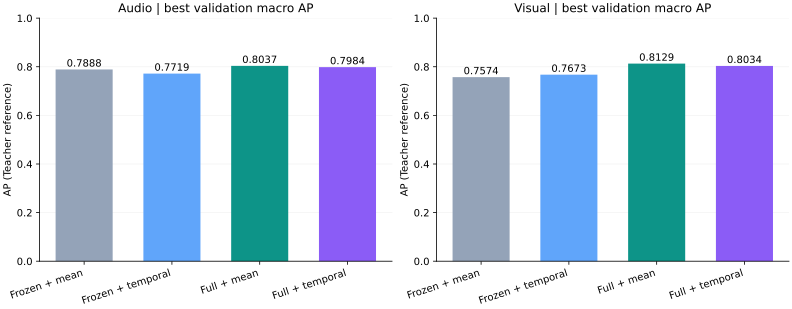
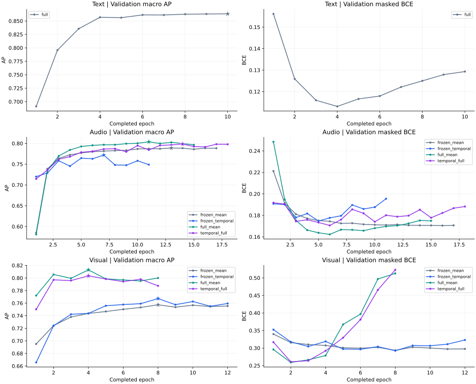

# Cue提取器九组训练完成报告

生成时间：2026-10-21 17:09:45（北京时间）  
项目：`/ai/sjq/AffectGPT-sjq`  
评估参考：Teacher伪标签；人工300条金标准尚未完成。

## 1. 主要结论

九组实验全部正常完成，进程退出码均为0；Text跑满10轮，其余八组因验证集连续4轮未改善而正常早停。首组于10-20 16:42:38启动，最后一组于10-21 09:03:36写入complete事件，整批跨度为16时20分58秒。每组best.pt与last.pt均存在。

按预先使用的验证macro AP标准，当前工程候选为Text全量微调、Audio全量微调＋mean、Visual全量微调＋mean，最佳macro AP分别为0.8632、0.8037、0.8129。它们用于后续人工评估候选，不代表已经完成部署验收。

全量微调在本次单种子对照中提高了音频、视频两种结构的最佳AP。额外时序模块在全量微调下均未超过mean的AP；但视频全量时序组的宏F1略高于全量mean组。因此不能将“mean的AP最高”概括成所有指标均优于时序，也不能由本轮单次运行断言时序建模普遍无效。

本报告直接读取best.pt内嵌的完整验证指标，避免把validation.last.json的末轮F1/逐Cue结果与best AP混用。所有F1/P/R均使用未校准0.5阈值，且取AP选出的checkpoint，并非各自单独最大化后的结果。未重新训练、重新推理或调用Teacher API。

## 2. 数据版本与样本隔离

| 项目 | 当前口径 |
|---|---|
| 原始样本 / 模态任务 | 31,327 / 93,981 |
| 成功 / 最终失败任务 | 93,903 / 78（Text4、Audio5、Visual69） |
| 失败对应不同样本 | 72；任何一个模态失败，整条从所有当前角色排除 |
| 三模态成功成员 | 31,255 |
| 训练 / 验证 / 人工保留 / 诊断保留 | 27,679 / 3,076 / 300 / 200 |
| 当前数据包 | `/ai/sjq/AffectGPT-sjq/cue_student/artifacts/release_strict_all_modalities_20261020_163131` |
| release_id | `2019ab786e4e065699a3f980291b1d300a17ee1ec9a18213672f620fd2823ac7` |
| holdout_id | `8d384d71d1aed030adb5f480f5b28a4379c48ffda9c6bc1be1648f8fc6ca8224` |
| 策略 | `all_modalities_succeeded_v1` |

九组绑定同一release和holdout。对release所有文件SHA256及成员白名单作复核，失败72条与全部角色交集为0；同一模态各配置的验证ID、targets、mask完全一致，全部验证样本为3,076条。三个模态的可评估Cue分别为15/17/10，均有正负支持。

| 模态 | 角色候选训练数 | 实际优化样本 | 无有效监督跳过 | 训练有效Cue位置 | 验证有效Cue位置 |
|---|---|---|---|---|---|
| Text | 27679 | 27673 | 6 | 397290 | 44117 |
| Audio | 27679 | 27679 | 0 | 331334 | 36878 |
| Visual | 27679 | 27677 | 2 | 253399 | 28164 |

无有效监督跳过指成功标注中所有Cue均被uncertain/unobservable屏蔽，不是允许失败模态样本留在其他模态训练。positive/negative共同监督；不把不确定或不可观察项补为negative。

人工300条保留原名单中299条合格成员，删除视觉失败的`samplenew3_00094241`，从旧独立诊断候选中按seed42补入`samplenew3_00039200`；不读取Cue/Emotion/description值。当前名单不是在全部31,255条上重新均匀随机抽300条。60条双标名单已固定，实际人工盲标/双标尚未完成。来源及内容近重复审计不完整，保留工程发布限制。

## 3. 九组设置与可比性

| 实验 | GPU | 编码器 | 附加聚合 | head_lr | encoder_lr |
|---|---|---|---|---|---|
| text | 0 | full | 双语融合 | 1e-04 | 2e-05 |
| audio | 0 | frozen | mean | 1e-03 | 冻结不更新 |
| audio_temporal | 0 | frozen | Transformer＋mean | 1e-03 | 冻结不更新 |
| audio_full | 0 | full | mean | 1e-03 | 1e-05 |
| audio_temporal_full | 0 | full | Transformer＋mean | 1e-03 | 1e-05 |
| visual | 1 | frozen | mean | 1e-03 | 冻结不更新 |
| visual_temporal | 1 | frozen | Transformer＋mean | 1e-04 | 冻结不更新 |
| visual_full | 0 | full | mean | 1e-03 | 1e-05 |
| visual_temporal_full | 1 | full | Transformer＋mean | 1e-04 | 1e-05 |

Text为共享XLM-R双语编码与融合，编码器全量训练；Audio为完整16kHz单声道HuBERT序列；Visual为完整时段2FPS采样、首末帧、实际PTS、letterbox和CLIP。HuBERT内部已有时间上下文；temporal组额外使用256维、2层、4头、FFN1024的带位置/秒数Transformer。

共同设置：seed42、BF16、普通masked BCE、AdamW、weight_decay=0.01、10% warmup后线性衰减、梯度裁剪1、dropout0.1。Text microbatch4×累积8；音视频上限2×累积16，另按每batch音频时长和20秒/视频15秒动态打包，实际每步样本数不固定为32。Text上限10轮、patience3；音视频上限20轮、patience4。

输入加载优化已用于九组：Text workers0、各Audio2、各Visual4，spawn、预取、锁页内存、异步拷贝及视频单解码线程。新增全量四组启用gradient checkpointing及每进程20% PyTorch allocator预算；冻结组每轮仍完整编码，未启用冻结特征缓存。GPU0六组/GPU1三组共享资源。

Visual mean的head_lr为1e-3，Visual temporal为1e-4，故其时序对照包含学习率差异。两卡并发任务数、退出时间、解码/保存开销不同，下面的墙钟耗时是实际运行记录，不能解释为相同资源下的算法速度或总GPU算时。九组均从对应预训练模型新建，不沿用旧含失败样本的Student。

## 4. 最佳checkpoint验证结果

| 实验 | 最佳epoch | 最佳step | macro AP | macro F1 | micro F1 | micro P | micro R | masked BCE |
|---|---|---|---|---|---|---|---|---|
| text | 10 | 8650 | 0.8632 | 0.8014 | 0.8522 | 0.8542 | 0.8502 | 0.1293 |
| audio | 13 | 11375 | 0.7888 | 0.7045 | 0.7942 | 0.8165 | 0.7730 | 0.1708 |
| audio_temporal | 7 | 6125 | 0.7719 | 0.6928 | 0.7953 | 0.8090 | 0.7820 | 0.1796 |
| audio_full | 11 | 9626 | 0.8037 | 0.7143 | 0.8033 | 0.8267 | 0.7813 | 0.1697 |
| audio_temporal_full | 14 | 12250 | 0.7984 | 0.7104 | 0.8003 | 0.8273 | 0.7749 | 0.1853 |
| visual | 8 | 7151 | 0.7574 | 0.6496 | 0.6982 | 0.7566 | 0.6481 | 0.2935 |
| visual_temporal | 8 | 7151 | 0.7673 | 0.6617 | 0.7062 | 0.7585 | 0.6607 | 0.2924 |
| visual_full | 4 | 3576 | 0.8129 | 0.7239 | 0.7627 | 0.7940 | 0.7338 | 0.2787 |
| visual_temporal_full | 4 | 3576 | 0.8034 | 0.7274 | 0.7595 | 0.7945 | 0.7274 | 0.2922 |

best按固定可评估Cue集合的macro AP选取，同分优先更低BCE；F1/P/R为这个checkpoint在0.5下的值。不同模态的Cue语义、覆盖和难度不同，不直接依据这些数值比较“文本比音频/视频准确多少”。

### 4.1 配对对照

| 变化（候选−参照） | Δmacro AP（绝对值） | Δmacro F1（绝对值） | Δmicro F1（绝对值） |
|---|---|---|---|
| 音频：冻结下加入时序 | -0.0169 | -0.0117 | +0.0011 |
| 音频：mean下全量微调 | +0.0149 | +0.0098 | +0.0092 |
| 音频：时序下全量微调 | +0.0265 | +0.0175 | +0.0050 |
| 音频：全量下加入时序 | -0.0053 | -0.0039 | -0.0031 |
| 视频：冻结下加入时序 | +0.0099 | +0.0120 | +0.0081 |
| 视频：mean下全量微调 | +0.0556 | +0.0743 | +0.0646 |
| 视频：时序下全量微调 | +0.0361 | +0.0657 | +0.0532 |
| 视频：全量下加入时序 | -0.0096 | +0.0034 | -0.0032 |

AP×100后表达的差异为：音频mean全量相对冻结约+1.49个AP点，视频mean约+5.56个AP点；全量下额外时序相对mean分别约−0.53和−0.96个AP点。以上仅为本次单种子、开发验证集上的观测差异，未计算配对置信区间或多种子方差，不作统计显著性声明。

音频冻结时序组虽macro AP下降，micro F1略高于冻结mean；视频全量时序的macro F1为0.7274，略高于全量mean的0.7239。选择依据应保持预先定义的主要指标，不能事后只挑有利指标宣称胜出。

## 5. 训练过程、结束方式与耗时

| 实验 | 开始（北京时间） | complete事件 | 实际轮数 / 上限 | 完成step / 计划上限 | 结束方式 | 实际墙钟 |
|---|---|---|---|---|---|---|
| text | 10-20 16:42:38 | 10-20 19:42:27 | 10 / 10 | 8650 / 8650 | 跑满轮数 | 2时59分49秒 |
| audio | 10-20 16:42:40 | 10-20 23:50:04 | 17 / 20 | 14875 / 17500 | 正常早停 | 7时07分24秒 |
| audio_temporal | 10-20 16:42:46 | 10-20 23:18:43 | 11 / 20 | 9626 / 17500 | 正常早停 | 6时35分57秒 |
| audio_full | 10-20 17:18:54 | 10-21 06:10:27 | 15 / 20 | 13125 / 17500 | 正常早停 | 12时51分32秒 |
| audio_temporal_full | 10-20 17:20:05 | 10-21 09:03:36 | 18 / 20 | 15750 / 17500 | 正常早停 | 15时43分31秒 |
| visual | 10-20 16:42:42 | 10-21 05:02:06 | 12 / 20 | 10727 / 17879 | 正常早停 | 12时19分24秒 |
| visual_temporal | 10-20 16:42:44 | 10-21 05:02:08 | 12 / 20 | 10727 / 17879 | 正常早停 | 12时19分24秒 |
| visual_full | 10-20 17:21:45 | 10-21 07:18:00 | 8 / 20 | 7151 / 17879 | 正常早停 | 13时56分14秒 |
| visual_temporal_full | 10-20 17:17:04 | 10-21 04:31:54 | 8 / 20 | 7151 / 17879 | 正常早停 | 11时14分50秒 |

耗时从supervisor记录的该组started_at至训练complete事件计算，包含初始化、加载、训练、验证及保存；进程实际退出稍晚，原始finished_at另存JSON。八组早停均在连续4个epoch未刷新best后结束，所有退出码0，未将早停误报为异常中断。未记录GPU活跃占空比全程积分，不将并发墙钟相加作为整批完成时间。

曲线星标对应AP选出的best。全量视频两组均在第4轮取得best，第8轮早停；继续训练期间验证BCE回升，说明应保留best而非直接使用last。下表只比较同一指标，不将在线训练batch loss误当最终模型训练集评估。

| 实验 | best AP | 末轮AP | best时BCE | 末轮BCE |
|---|---|---|---|---|
| text | 0.8632 | 0.8632 | 0.1293 | 0.1293 |
| audio | 0.7888 | 0.7883 | 0.1708 | 0.1707 |
| audio_temporal | 0.7719 | 0.7489 | 0.1796 | 0.1955 |
| audio_full | 0.8037 | 0.7965 | 0.1697 | 0.1749 |
| audio_temporal_full | 0.7984 | 0.7978 | 0.1853 | 0.1882 |
| visual | 0.7574 | 0.7555 | 0.2935 | 0.2976 |
| visual_temporal | 0.7673 | 0.7594 | 0.2924 | 0.3230 |
| visual_full | 0.8129 | 0.8000 | 0.2787 | 0.5129 |
| visual_temporal_full | 0.8034 | 0.7875 | 0.2922 | 0.5230 |

当前GPU只读快照（非训练峰值或整个训练期间的利用率）：

- 0, NVIDIA A800-SXM4-80GB, 0 %, 0 MiB, 81920 MiB
- 1, NVIDIA A800-SXM4-80GB, 0 %, 0 MiB, 81920 MiB

## 6. 三路工程候选的42个Cue明细

候选按验证macro AP选定。覆盖率为Teacher mask=1占3,076条验证样本的比例；其余为uncertain/unobservable，不代表样本缺失。P/R/F1均为Teacher参考、阈值0.5。完整九组逐Cue结果保存在同名JSON。

### 6.1 文本：text

| Cue | 正例 | 负例 | 屏蔽 | 覆盖率 | AP | P | R | F1 |
|---|---|---|---|---|---|---|---|---|
| `TXT_AFFECT_WORD_POSITIVE` | 87 | 2986 | 3 | 99.90% | 0.8215 | 0.7738 | 0.7471 | 0.7602 |
| `TXT_AFFECT_WORD_NEGATIVE` | 583 | 2418 | 75 | 97.56% | 0.9067 | 0.8362 | 0.8405 | 0.8383 |
| `TXT_EVALUATION_POSITIVE` | 552 | 2315 | 209 | 93.21% | 0.9569 | 0.9094 | 0.8913 | 0.9003 |
| `TXT_EVALUATION_NEGATIVE` | 824 | 1883 | 369 | 88.00% | 0.9364 | 0.8675 | 0.8422 | 0.8547 |
| `TXT_NEGATION_PRESENT` | 1084 | 1914 | 78 | 97.46% | 0.9832 | 0.9385 | 0.9299 | 0.9342 |
| `TXT_CONTRAST_PRESENT` | 226 | 2699 | 151 | 95.09% | 0.9314 | 0.8678 | 0.8717 | 0.8698 |
| `TXT_INTENSIFIER_PRESENT` | 1024 | 1875 | 177 | 94.25% | 0.9347 | 0.8351 | 0.8604 | 0.8475 |
| `TXT_UNCERTAINTY_HEDGE` | 153 | 2740 | 183 | 94.05% | 0.8385 | 0.8358 | 0.7320 | 0.7805 |
| `TXT_RHETORICAL_QUESTION` | 307 | 2365 | 404 | 86.87% | 0.9837 | 0.9571 | 0.9446 | 0.9508 |
| `TXT_EXCLAMATION_INTERJECTION` | 255 | 2762 | 59 | 98.08% | 0.8880 | 0.7948 | 0.8353 | 0.8145 |
| `TXT_DESIRE_NEED` | 600 | 2435 | 41 | 98.67% | 0.9006 | 0.8082 | 0.8217 | 0.8149 |
| `TXT_EXPLICIT_CAUSAL_ATTRIBUTION_SELF` | 47 | 2960 | 69 | 97.76% | 0.7357 | 0.7500 | 0.6383 | 0.6897 |
| `TXT_EXPLICIT_CAUSAL_ATTRIBUTION_OTHER` | 207 | 2777 | 92 | 97.01% | 0.7364 | 0.6449 | 0.6667 | 0.6556 |
| `TXT_EXPLICIT_SUCCESS_OUTCOME` | 51 | 2981 | 44 | 98.57% | 0.6541 | 0.7692 | 0.5882 | 0.6667 |
| `TXT_EXPLICIT_FAILURE_LOSS_OUTCOME` | 148 | 2859 | 69 | 97.76% | 0.7410 | 0.6528 | 0.6351 | 0.6438 |

### 6.2 音频：audio_full

| Cue | 正例 | 负例 | 屏蔽 | 覆盖率 | AP | P | R | F1 |
|---|---|---|---|---|---|---|---|---|
| `AUD_SPEECH_RATE_REL_FAST` | 132 | 2079 | 865 | 71.88% | 0.7814 | 0.8590 | 0.5076 | 0.6381 |
| `AUD_SPEECH_RATE_REL_SLOW` | 726 | 753 | 1597 | 48.08% | 0.9831 | 0.9195 | 0.9435 | 0.9313 |
| `AUD_PITCH_LEVEL_REL_HIGH` | 46 | 972 | 2058 | 33.09% | 0.7757 | 0.8000 | 0.6087 | 0.6914 |
| `AUD_PITCH_LEVEL_REL_LOW` | 127 | 1029 | 1920 | 37.58% | 0.6709 | 0.7263 | 0.5433 | 0.6216 |
| `AUD_VOCAL_INTENSITY_REL_HIGH` | 61 | 1164 | 1851 | 39.82% | 0.7781 | 0.7826 | 0.5902 | 0.6729 |
| `AUD_VOCAL_INTENSITY_REL_LOW` | 151 | 1033 | 1892 | 38.49% | 0.7691 | 0.7095 | 0.6954 | 0.7023 |
| `AUD_PITCH_VARIABILITY_HIGH` | 377 | 1490 | 1209 | 60.70% | 0.8987 | 0.8228 | 0.8249 | 0.8238 |
| `AUD_PITCH_VARIABILITY_LOW` | 1097 | 1076 | 903 | 70.64% | 0.8951 | 0.8431 | 0.7347 | 0.7852 |
| `AUD_PAUSE_LONG` | 326 | 2671 | 79 | 97.43% | 0.8059 | 0.7301 | 0.7301 | 0.7301 |
| `AUD_PAUSE_FREQUENT` | 20 | 1354 | 1702 | 44.67% | 0.5727 | 0.4400 | 0.5500 | 0.4889 |
| `AUD_INTONATION_RISING` | 1093 | 1758 | 225 | 92.69% | 0.8866 | 0.8020 | 0.8079 | 0.8049 |
| `AUD_INTONATION_FALLING` | 1986 | 1012 | 78 | 97.46% | 0.9322 | 0.8551 | 0.8439 | 0.8495 |
| `AUD_INTONATION_FLAT` | 242 | 2125 | 709 | 76.95% | 0.6204 | 0.6257 | 0.4628 | 0.5321 |
| `AUD_VOICE_TENSE` | 239 | 2598 | 239 | 92.23% | 0.8468 | 0.8681 | 0.6611 | 0.7506 |
| `AUD_VOICE_TREMBLING` | 65 | 2955 | 56 | 98.18% | 0.8066 | 0.8235 | 0.6462 | 0.7241 |
| `AUD_LAUGHTER_PRESENT` | 33 | 3042 | 1 | 99.97% | 0.8292 | 0.5833 | 0.8485 | 0.6914 |
| `AUD_CRYING_SOBBING_PRESENT` | 37 | 3009 | 30 | 99.02% | 0.8106 | 0.7353 | 0.6757 | 0.7042 |

### 6.3 视频：visual_full

| Cue | 正例 | 负例 | 屏蔽 | 覆盖率 | AP | P | R | F1 |
|---|---|---|---|---|---|---|---|---|
| `VIS_BROWS_FURROWED` | 1014 | 2056 | 6 | 99.80% | 0.8784 | 0.7960 | 0.7929 | 0.7945 |
| `VIS_BROWS_RAISED` | 1247 | 1815 | 14 | 99.54% | 0.8577 | 0.8072 | 0.7418 | 0.7731 |
| `VIS_EYES_WIDENED` | 789 | 1572 | 715 | 76.76% | 0.9022 | 0.7898 | 0.8428 | 0.8155 |
| `VIS_EYES_SQUINTED` | 632 | 1994 | 450 | 85.37% | 0.8028 | 0.7695 | 0.6867 | 0.7258 |
| `VIS_SMILE_PRESENT` | 419 | 2586 | 71 | 97.69% | 0.8778 | 0.8418 | 0.7494 | 0.7929 |
| `VIS_MOUTH_CORNERS_DOWN` | 1036 | 1704 | 336 | 89.08% | 0.8729 | 0.7920 | 0.7828 | 0.7874 |
| `VIS_LIPS_PRESSED` | 341 | 2609 | 126 | 95.90% | 0.4353 | 0.5132 | 0.2845 | 0.3660 |
| `VIS_GRIMACE_PRESENT` | 211 | 2482 | 383 | 87.55% | 0.8243 | 0.8187 | 0.6209 | 0.7062 |
| `VIS_TEARING_PRESENT` | 94 | 2501 | 481 | 84.36% | 0.7946 | 0.9804 | 0.5319 | 0.6897 |
| `VIS_HEAD_LOWERED` | 739 | 2323 | 14 | 99.54% | 0.8835 | 0.8296 | 0.7510 | 0.7884 |

### 6.4 优先复核线索

- Text：成功结果Cue的AP约0.6541，验证正例51；自身原因归因仅47个正例。不能只看文本平均值，稀有与边界语义需人工核验。
- Audio：频繁停顿AP约0.5727、F1约0.4889，正例仅20；相对高音高有效覆盖约33.09%，相对低音高约37.58%。需分别审查稀有支持和Teacher可观察性，不把屏蔽位置补负例。
- Visual：闭唇Cue（VIS_LIPS_PRESSED）AP约0.4353、F1约0.3660，是候选中的明显薄弱项；可见泪水Cue的Teacher参考precision约0.9804而recall约0.5319，不能仅依据高precision宣布识别充分。

这些是人工审计和误差分析线索，不据本报告自动删除Cue、修改标签、调阈值或重启训练。

## 7. 产物、候选权重与复核证据

| 模态 | AP标准下候选best.pt |
|---|---|
| text | `/ai/sjq/AffectGPT-sjq/cue_student/output/strict_all_modalities_20261020_163131/text/best.pt` |
| audio | `/ai/sjq/AffectGPT-sjq/cue_student/output/full_finetune_20261020_170308/audio_full/best.pt` |
| visual | `/ai/sjq/AffectGPT-sjq/cue_student/output/full_finetune_20261020_170308/visual_full/best.pt` |

该候选列表不是已部署模型；保留全部九组best/last及原配置。冻结编码器组checkpoint体积较小属于只保存可训练部分的预期设计，恢复/推理仍依赖training_manifest所绑定的原编码器资产；不可孤立复制一个小checkpoint后认为模型完整。

| 实验 | best大小GiB | last大小GiB | 运行产物目录 |
|---|---|---|---|
| text | 3.105 | 3.105 | `/ai/sjq/AffectGPT-sjq/cue_student/output/strict_all_modalities_20261020_163131/text` |
| audio | 0.003 | 0.003 | `/ai/sjq/AffectGPT-sjq/cue_student/output/strict_all_modalities_20261020_163131/audio` |
| audio_temporal | 0.021 | 0.021 | `/ai/sjq/AffectGPT-sjq/cue_student/output/strict_all_modalities_20261020_163131/audio_temporal` |
| audio_full | 3.529 | 3.529 | `/ai/sjq/AffectGPT-sjq/cue_student/output/full_finetune_20261020_170308/audio_full` |
| audio_temporal_full | 3.547 | 3.547 | `/ai/sjq/AffectGPT-sjq/cue_student/output/full_finetune_20261020_170308/audio_temporal_full` |
| visual | 0.002 | 0.002 | `/ai/sjq/AffectGPT-sjq/cue_student/output/strict_all_modalities_20261020_163131/visual` |
| visual_temporal | 0.021 | 0.021 | `/ai/sjq/AffectGPT-sjq/cue_student/output/strict_all_modalities_20261020_163131/visual_temporal` |
| visual_full | 3.400 | 3.400 | `/ai/sjq/AffectGPT-sjq/cue_student/output/full_finetune_20261020_170308/visual_full` |
| visual_temporal_full | 3.418 | 3.418 | `/ai/sjq/AffectGPT-sjq/cue_student/output/full_finetune_20261020_170308/visual_temporal_full` |

证据入口：两个job的status.json、configs和各组日志；各output的training_manifest.json、events.jsonl、best.pt、last.pt、validation.last.json/npz。JSON附完整配置、编码器资产哈希、checkpoint内置signature、文件大小/mtime及关键来源文件SHA256。未对大型checkpoint重新计算文件级SHA256，不把内置运行signature称作权重文件哈希。

校验完成：九组状态/退出码、best内嵌指标与最佳事件一致、末轮NPZ重算指标一致、同模态验证ID/目标/mask一致、72条失败样本与所有角色隔离、release全部成员文件哈希一致。此次只读取训练产物并新增报告，不改代码、标签、数据划分、方案或权重。

## 8. 当前结论边界与后续工作

目前可确认的是：九组工程训练完成，且在同一Teacher验证口径下获得了可复核的冻结/全量及时序对照。验证集同时参与checkpoint和开发选择，因此结果不是独立测试性能；尚无多种子、显著性检验或人工准确率结论。来源/近重复限制、299＋1抽样修订、可判定子集覆盖均需随结果披露。

后续先完成人工300条三模态盲审、60条双标与仲裁，并在开发选择冻结后开展逐Cue人工评估和阈值交叉拟合。对稀有支持、停顿、闭唇和泪水等单独分析，再确定active/deferred及部署阈值。OOF折模型、Memory、三路42维组合与AMG为独立后续工作，当前九组完成不等于它们已完成；目标域标签不参与选择。

## 附录：来源指纹与文件说明

当前九组共有代码指纹：`e4e521695acfeb64fd647f6da635fb49d27b203e34f203db1a64e69eb0787b76`。
本报告的指标提取不执行GPU推理。所有图、JSON和Markdown仅在服务器生成，不下载原始数据或训练权重。

| 报告文件 | 用途 |
|---|---|
| `/ai/sjq/AffectGPT-sjq/cue_student/reports/cue_training_report_20261021.md` | 主报告 |
| `/ai/sjq/AffectGPT-sjq/cue_student/reports/cue_training_report_20261021.json` | 完整九组指标、123个run-Cue结果、配置、曲线与来源 |
| `/ai/sjq/AffectGPT-sjq/cue_student/reports/cue_training_report_20261021_assets/best_macro_ap.svg` | 音视频四组AP比较 |
| `/ai/sjq/AffectGPT-sjq/cue_student/reports/cue_training_report_20261021_assets/validation_curves.svg` | 三模态验证AP/BCE曲线 |

